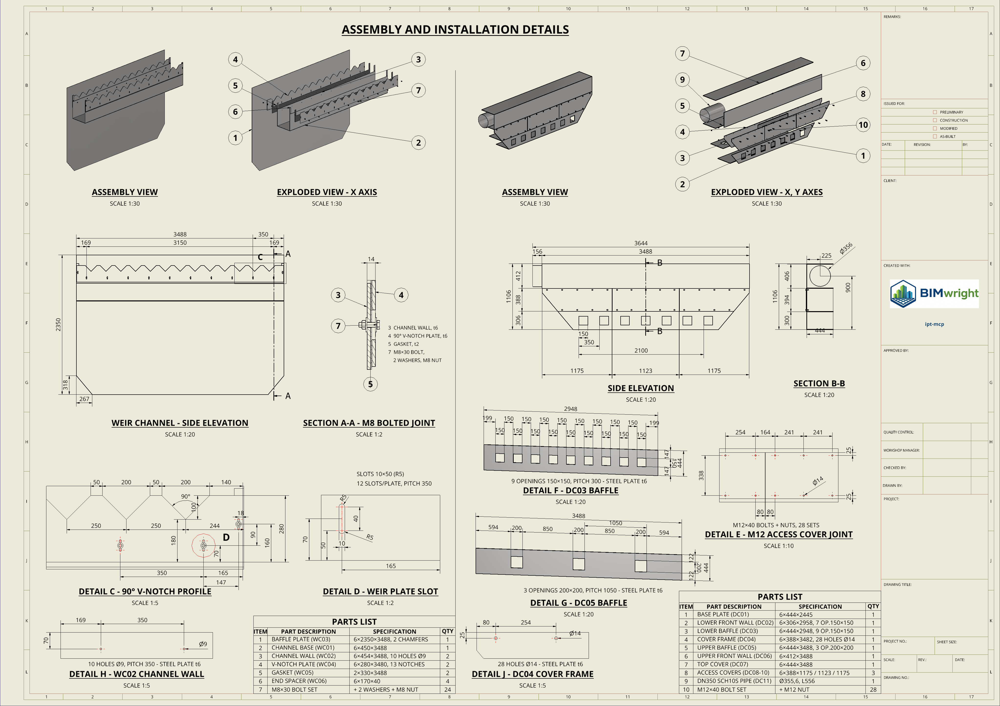

<!-- mcp-name: io.github.bimwright/ipt-mcp -->

<h1 align="center">ipt-mcp</h1>

<p align="center">
  <a href="https://github.com/bimwright/ipt-mcp/actions/workflows/build.yml"></a>
  <a href="LICENSE"></a>
  <a href="#サポート対象-inventor-バージョン"></a>
  <a href="#ツール一覧"></a>
</p>

<p align="center">
  <a href="README.md">English</a> · <a href="README.vi.md">Tiếng Việt</a> · <a href="README.zh-CN.md">简体中文</a> · 日本語
</p>

---

`ipt-mcp` は、Claude Code および MCP 対応クライアントが **Autodesk Inventor 2022-2027** をローカルで操作できるようにする、オープンソース（[Apache-2.0](LICENSE)）の [Model Context Protocol](https://modelcontextprotocol.io) ゲートウェイです。

エージェントは stdio 経由で MCP を通信します。サーバーはローカルの認証付きトランスポート（TCP または Named Pipe）を介して NDJSON を、バージョン別のインプロセス Inventor アドインに転送します。アドインはすべてのコマンドを Inventor の STA スレッドにマーシャリングし、Inventor API とやり取りします。

モデルはユーザーのマシン上に留まります。

---

## 実例：Inventor のネイティブ図面

この機械の組立・据付詳細図のシートは、**エージェントが ipt-mcp を介して Autodesk Inventor 2027 を操作するワークフローで作成・調整したもの**です。レンダリングしたモックアップではありません。ネイティブの図面ツールと `inventor_send_code` を使用し、人が指示・確認・編集を行いました。

[](.github/assets/showcase/inventor-assembly-drawing.png)

*画像をクリックすると、シートをフル解像度（4096 × 2893）で確認できます。*

- **15 のビュー：** 組立図、分解図、断面図、拡大詳細図。
- **111 のネイティブ寸法と 21 の部品タグ**、および 2 つの部品表。
- **英語の注記とカスタム表題欄：** BIMwright ロゴを埋め込み、プロジェクト情報の欄は空白。
- **MCP による仕上げ：** 寸法スタイルの統一、注記の位置合わせ、完成シートの PNG 出力。

これは人が確認したプレゼンテーション用の実例であり、**製作用の承認済み図面でも、単一プロンプトによる自動生成結果でもありません**。公開するのはプレゼンテーション画像のみで、プロジェクトのモデルは配布しません。

---

## ipt-mcp の概要

2 つのプロセス、1 つのローカルパイプ:

- **`Bimwright.Ipt.Server.exe`** — Claude Code、Cursor、Cline、Codex、または他の stdio MCP クライアントによって起動される .NET 10 MCP stdio サーバーです。**Inventor への参照は一切持たず**、Inventor がインストールされていない Windows 上でビルド・テストできます。ゲートウェイの実行には、ユーザー ID とセットアップのライフサイクルのために Windows が必要です。「サーバーのみ」は Inventor SDK に依存しないことを指し、クロスプラットフォームでの実行に対応するという意味ではありません。
- **`Bimwright.Ipt.Plugin.InvNN.dll`** — `Inventor.exe` 内部にロードされる `ApplicationAddInServer` アドインで、TCP または Named Pipe のリスナーを実行し、Inventor のメイン UI（STA）スレッド上でコマンドを実行します。Inventor のバージョンごとに 1 つの薄いシェルを持ち、すべて同じ `src/shared/**` のソースグロブからコンパイルされます。

Revit とは異なり、Inventor には **`ExternalEvent` に相当する機能がありません**。アドインは隠しメッセージオンリーの WinForms コントロール（`InventorStaDispatcher`）を介して STA スレッドに処理をマーシャリングします。詳細な設計は [ARCHITECTURE.md](ARCHITECTURE.md) を参照してください。

---

## サポート対象 Inventor バージョン

| Inventor | ターゲットフレームワーク | トランスポート | 備考 |
|----------|------------------|-----------|-------|
| 2022 | `net48` (.NET Framework 4.8) | TCP | `System.Windows.Forms` を直接参照 |
| 2023 | `net48` (.NET Framework 4.8) | TCP | |
| 2024 | `net48` (.NET Framework 4.8) | TCP | |
| 2025 | `net8.0-windows7.0` | Named Pipe | `UseWindowsForms`、`EnableDynamicLoading` |
| 2026 | `net8.0-windows7.0` | Named Pipe | |
| 2027 | `net10.0-windows7.0` | Named Pipe | .NET 10 SDK が必要。`UseInventorAssemblyContext` を適用 |

- MCP サーバーは 1 つのプロセスであり、**Inventor のバージョンの影響を受けません** — JSON エンベロープを転送するだけです。
- 2022-2024（net48 アドイン）は TCP、2025-2027 は Named Pipe を使用します。Named Pipe により、モダン Windows でのループバックファイアウォールプロンプトを回避します。
- Inventor は 2025 年以降、デスクトップアドイン開発を .NET Framework から移行しました: **2025/2026 は .NET 8、2027 は .NET 10**。（.NET 8 アドインは 2027 でもバイナリ互換ですが、net10 がネイティブターゲットです。）
- すべての場所で **4 桁の西暦**（2022..2027）を使用してください — レガシーバージョンコードは使用しないでください。

> **ステータス: Phase 1 と Phase 2 のサポート範囲は受け入れ済みです。** Phase 3 では 4 つのツールを追加し、ビルド、自動テスト、Inventor 2027 の使い捨てネイティブ fixture で検証しました。インストール済みクライアントでの受け入れと release の受け入れは別に行います。[Phase 3 の動作](docs/testing/drawing-phase3.md)を参照してください。

最終 MCP 結果の出力ガードは 64/256 KiB で警告し、UTF-8 で 1 MiB を上限とします。大きな読み取りは絞り込みを要求し、完了した書き込みは要約した効果を保持します。再実行してはいけません。`--disable-output-guard` でも転送上限は有効です。CLI/JSON/環境変数のしきい値と、設定可能な 36 時間の spill ポリシーは[図面テスト文書](docs/testing/drawing-phase1.md)を参照してください。

---

## インストール / MCP クライアントの設定

[GitHub Releases](https://github.com/bimwright/ipt-mcp/releases/latest) からクライアント用セットアップ ZIP をダウンロードします。自己完結型の MCP サーバーと、**実際の** interop に対してコンパイルされた Inventor アドインの年版が含まれます（`manifest.json` を参照）。v0.1.0 の ZIP には **2025** と **2027** が含まれます。その他の年版はローカルでビルドしてください。`SkipInventorReferenceCheck` による形だけの DLL は配布しないでください。

```powershell
$tag = (Invoke-RestMethod https://api.github.com/repos/bimwright/ipt-mcp/releases/latest).tag_name
$zip = "$env:TEMP\IptMcp.Setup-$tag-win-x64.zip"
$dir = "$env:TEMP\IptMcp.Setup-$tag-win-x64"
Invoke-WebRequest "https://github.com/bimwright/ipt-mcp/releases/download/$tag/IptMcp.Setup-$tag-win-x64.zip" -OutFile $zip
Expand-Archive $zip -DestinationPath $dir -Force

powershell -ExecutionPolicy Bypass -File "$dir\install.ps1" -WhatIf
powershell -ExecutionPolicy Bypass -File "$dir\install.ps1"
```

`%APPDATA%\Autodesk\ApplicationPlugins\Bimwright.Ipt.bundle\` と、固定パス `%LOCALAPPDATA%\Bimwright\ipt-mcp\server\current\ipt-mcp.exe` に `ipt-mcp.exe` をデプロイします。インストーラーは失敗時にロールバックし、インストールした bundle をパッケージと照合し、`--help` でサーバーのスモークチェックを行います。MCP クライアントの設定は変更しません。クライアントにはこの固定の `ipt-mcp.exe` パスを自分で指定してください（エージェントによる設定は ZIP 内の `AGENTS.md` を参照）。更新してもパスは変わらないため、クライアントは再起動するだけで済みます。`-PruneOldServers` は、クライアントの指定先を変更した後に旧来の `server\<version>\` コピーを削除します。`uninstall.ps1` はすべてを削除します（`-Purge` を指定しない限り個人データは残ります。`install.ps1 -Uninstall` は bundle のみを削除します）。年版を固定するには `--target 2025` または `BIMWRIGHT_INVENTOR_TARGET=2025` を使います。

`dotnet tool install -g Bimwright.Ipt.Server` は**使わないでください**。サポートされたクライアントのインストール方法ではありません。

**開発者向け:** Inventor の interop があるマシンで `pwsh scripts/package-bundle.ps1` を実行します（SDK のない年版はスキップ）。再ビルドの前に Inventor を閉じてください。

アドインの検出は自動です。稼働中の各アドインが `%LOCALAPPDATA%\Bimwright\ipt-mcp\inventor-<year>-<pid>.json` を書き込みます。ゲートウェイが自動で接続するのは、稼働中の Inventor がちょうど 1 つの場合だけです。複数開いている場合は、1 つを選ぶまで呼び出しは `AMBIGUOUS_TARGET` を返します。`inventor_list_available_targets` を呼び出し、次に `pid:<n>` または `id:<target_id>` を指定して `inventor_switch_target` を呼び出してください。選択したセッションが別のセッションに置き換えられることはありません。そのセッションが終了した場合、`pid:<n>` または `id:<target_id>` で明示的に切り替えるまで、呼び出しは `TARGET_LOST` を返します。このゲートウェイが選択した稼働中のセッションから離れるには `rebind=true` が必要です（ない場合は `TARGET_REBIND_REQUIRED`）。`auto` や年版の指定で選択が移ることはありません。不正なセレクタは `INVALID_TARGET_SELECTOR` を返します。`inventor_get_current_target` と `inventor_list_available_targets` はセッションを選択しません。`--read-only` では `inventor_switch_target` を利用できません。起動時に `--target pid:<n>` を渡すか、Inventor を 1 つだけ開いて実行してください。各 toast カードのタイトルにはゲートウェイ名、Inventor の年版、呼び出し元の agent（`ipt-mcp 2027 · Claude`）が表示され、ホバーすると `PID <n>` がフェード表示されるため、エージェントが選択したセッションと照合できます。

書き込みは確認済みのドキュメントに対してのみ実行されます。アクティブドキュメントをユーザーと確認し、セッションごとに一度、`pid:<n>` と `verify=true` を指定して `inventor_switch_target` を呼び出してください。それまでの書き込みは `TARGET_UNCONFIRMED` を返し、送信されません。別のドキュメントがアクティブになった場合、書き込みはアドインから `DOCUMENT_CHANGED`（または `DOCUMENT_UNCONFIRMED`）を返し、開始されません。もう一度確認するか、`document`（完全パスまたは名前）で対象ドキュメントを指定してください。指定したドキュメントはアクティブドキュメントに縛られません。確認済みのドキュメントを閉じた後は、別のドキュメントを開くか作成すると、確認がそのドキュメントに移ります。`inventor_open_document(s)`、`inventor_new_part`、`inventor_new_assembly`、`inventor_new_drawing`、`inventor_new_sheet_fabrication_part`、`inventor_create_part` でドキュメントを開くか作成すると、確認はアクティブになったドキュメントに移ります。サーバーとアドインの両方が `document_target_v1` に対応している必要があります。古いアドインまたはサーバーでは書き込みが `PAIRING_REQUIRED` を返し、読み取りは引き続き動作します。両方を同じ release から更新してください。

`inventor_send_code` はデフォルトで有効です。`--disable-send-code` は code ツールを非表示にし、`BIMWRIGHT_INVENTOR_PLUGIN_DISABLE_SEND_CODE=1` はホストで実行を停止します。read-only モードでは実行できません。実際のプロジェクト作業では `usage_context="project"`、ipt-mcp 自体のテストでは `"test"` を渡します（既定は `"unknown"`）。この値は call journal に記録されるだけで、スクリプトの実行方法は変わりません。

---

## ビルドと開発

Autodesk Inventor のバイナリおよび Inventor SDK は、このリポジトリには**再配布されていません**（[再配布しないもの](#再配布しないもの) を参照）。**サーバーとテスト**のビルドと実行には Windows と .NET 10 SDK が必要で、Inventor のインストールは不要です。**バージョン別アドイン**のビルドには、対応する SDK に加えて Inventor の相互運用参照アセンブリが必要です。

```powershell
# Server + tests on Windows (server-only; .NET 10 SDK, no Inventor installation required):
dotnet build src/server -c Debug
dotnet test  tests/Bimwright.Ipt.Tests -c Debug

# Legacy TFM compatibility check using the installed 2027 interop reference:
dotnet build src/plugin-inv24 -c Debug /p:InventorInteropDir="C:\Program Files\Common Files\Autodesk Shared\Extensions 2027\Framework\Interop"
dotnet build src/plugin-inv27 -c Debug   # real 2027 interop compile; needs the .NET 10 SDK

# A per-version add-in always needs an Inventor interop reference. For a legacy TFM compatibility
# check, point InventorInteropDir at an installed compatible interop; real release builds use the
# matching year's default path.
```

- **サーバー** は明示的に `shared/Contracts/*` + `shared/Security/*`（+ ToolBaker）のみをインクルードするため、Inventor SDK がなくてもコンパイルできます。
- 各 **アドイン** は `<Compile Include="..\shared\**\*.cs" />` を使用して、API に触れる `Infrastructure`/`Plugin`/`Handlers` を含むすべてをインクルードします。
- デフォルトの相互運用ヒントパスは `C:\Program Files\Common Files\Autodesk Shared\Extensions <year>\Framework\Interop\Autodesk.Inventor.Interop.dll` です。
- 2027 アドインのビルドには **.NET 10 SDK** のインストールが必要です。
- **アドイン DLL をデプロイする前に Inventor を閉じてください** — 閉じていないとファイルがロックされます。

---

## ツール一覧

2.5.1 はデフォルトで **150 ツール**（`--toolsets all`）を公開します。`--disable-send-code` では **144 ツール**、`--read-only` では **39 ツール**です。MCP 名はすべて `inventor_` で始まります。toolset フィルターでこの範囲を絞り込めます。以下の公開済み v0.2.1 ベンチマーク記録は、当時の 111 ツールの範囲のままです。

`code` を含む全 19 toolset がデフォルトで有効です。`--toolsets <csv>` で絞り込めます。

すべての長さ入力は **mm**、角度は **度** 単位です。アドインが Inventor 内部のセンチメートル/ラジアンに変換します。

**ドキュメントの指定。** ドキュメント単位のツール（`get_document_info`、`list_bodies`、`list_features`、iProperty・パラメータ・マテリアル・質量の各ツール、`save_document`、`close_document`、アセンブリツール）は、省略可能な `document` を受け付けます。これは Inventor がすでにメモリに読み込んでいるドキュメントの完全パスまたは名前で、開いているウィンドウ*または*アセンブリの参照として読み込まれたパートを指定できます。パス、表示名、ファイル名、一意な部分文字列の順に照合します。自動で開いたりアクティブにしたりすることはなく、曖昧な名前や不明な名前の場合は候補を返します。省略するとアクティブドキュメントが対象になります。

**オカレンスセレクタ。** 一括処理のアセンブリツールは、共通のセレクタでオカレンスを選びます: `{names?: [glob], regex?, file?: glob, path_contains?, leaf?: false, max_depth?, include_suppressed?: false, limit?}`（または名前 1 つ / 名前の配列）。glob は `*`/`?` を使います。`/` を含む名前の glob はオカレンスのパス（`SUB:1/PART:2`）に一致します。一致が 0 件、または `limit` を超える場合はエラーとなり、最も近い名前を一覧表示します。結果が黙って切り詰められることはありません。

**ダイアログ。** 保存、開く、閉じる、エクスポート、ドキュメントの一括ツール、および表題欄を配置する図面ツール（`new_drawing`、`add_sheet`、`set_title_block`）は、既定で `Application.SilentOperation`（`silent=true`）のもとで実行されます。そのため Inventor は、呼び出しをブロックする非表示のモーダルダイアログを開かず、自身のプロンプトに既定値で応答します。プロンプト入力付きの表題欄を持つテンプレートでも、`new_drawing` が「Prompted Texts」ダイアログで止まることはなくなりました。入力欄は `inventor_set_title_block` で埋めてください。Inventor には特定のダイアログに選んだボタンで応答するイベント（Revit の `DialogBoxShowing`）がないため、ダイアログごとの応答ルールはありません。

**ホストのビジー状態。** Inventor でモーダルダイアログが開いている間、health 以外のすべてのコマンドは、ダイアログの後ろで待機せずに直ちに `HOST_BUSY` を返します。`HOST_BUSY` は、コマンドキューが満杯の場合や、それ以前の処理が期限まで Inventor を占有していた場合にも返されます。いずれの場合もコマンドは開始されておらず、後から実行されることもないため、Inventor が空いた後に再送しても安全です。`TIMEOUT` は、コマンドが開始されたものの時間内に完了しなかったことを意味するようになりました。結果は不明なので、書き込みを再試行する前にドキュメントを確認してください。`inventor_health` は `host_busy`、`busy_reason`（`modal_dialog` または `sta_busy`）、`modal_dialog {open, title}` を報告します。これらは Inventor のメインスレッドに触れずに調べます。アドインは同時に最大 4 つの接続を処理するため、長い呼び出しの実行中でも health や次の呼び出しは接続できます。アドインが時間内に接続を受け付けない場合（たとえば一度に 1 つの呼び出ししか処理しない古いアドイン）、呼び出しは `TARGET_BUSY` を返します。パイプが存在しない場合は `TARGET_UNAVAILABLE` を返します。どちらも何も送信されていないことを示すため、コマンドは実行されていません。


### drawing_query (2) / drawing (20) — Inventor 2027

以前の Inventor 2027 fixture の結果: [Phase 3 ツールの動作](docs/testing/drawing-phase3.md)。これらの記録は v0.2.1 の実行時の変更より前のものです。ライブでの受け入れ検証をやり直す必要があります。

`inventor_get_drawing_info` と `inventor_find_view_geometry` は読み取り専用です。図面の書き込みツール:
`inventor_new_drawing`, `inventor_add_sheet`, `inventor_set_title_block`,
`inventor_add_drawing_view`, `inventor_add_section_view`, `inventor_edit_drawing_view`,
`inventor_add_drawing_dimension`, `inventor_add_balloon`, `inventor_export_drawing`,
`inventor_capture_sheet`, `inventor_add_drawing_note`, `inventor_add_drawing_table`,
`inventor_add_drawing_symbol`, `inventor_edit_drawing_annotation`, `inventor_delete_drawing_items`,
`inventor_edit_drawing_table`, `inventor_set_drawing_styles`, `inventor_edit_sheet`, `inventor_sketch_on_view`, `inventor_hide_view_edges`。キャプチャは PNG ファイルを書き込むため、read-only からは除外されます。

[図面のチェックと現在の制限](docs/testing/drawing-phase1.md) ·
[図面の注記、表、シート](docs/testing/drawing-phase2.md) ·
[汎用ライブスモーク記録](docs/benchmarks/drawing-phase1-smoke.json) ·
[宣言済み read-only 一覧](docs/testing/readonly-tools.json)。

### 開発チェックアウトの Sheet Fabrication

作成には `sheet_fabrication`、読み取り専用の確認には `sheet_fabrication_query` を選択します:

```bash
bimwright-ipt --toolsets sheet_fabrication,sheet_fabrication_query
```

| ツール | 用途 |
|---|---|
| `inventor_new_sheet_fabrication_part` | Inventor の sheet テンプレートからパートを作成。 |
| `inventor_sheet_fabrication_info` | 板厚、スタイル、展開パターンの状態を確認。 |
| `inventor_set_sheet_fabrication_thickness` | パートの板厚を値またはパラメータ式で上書き。 |
| `inventor_sheet_fabrication_face` | 閉じたスケッチプロファイルからベースプレートを作成。 |
| `inventor_sheet_fabrication_flange` | 選択した境界エッジにフランジを追加。 |
| `inventor_sheet_fabrication_cut` | スケッチプロファイルでシートを切り抜く。 |
| `inventor_flat_pattern` | 展開パターンを作成または確認。 |
| `inventor_unwrap_try` | 選択した面の展開を試行。通常のパートにも適用可能。 |

`--read-only` では確認用ツールが残り、作成ツールは除外されます。応答フィールドは `is_sheet_fabrication` と `use_sheet_fabrication_style_thickness` です。以前の開発時の名前を使っているワークフローは、ツールと toolset の参照を更新する必要があります。同じリビジョンからビルドしたサーバーとアドインを使ってください。Autodesk の `SheetMetal*` API 識別子とテンプレートのファイル名は変わりません。

### iLogic ルールとソースの実行

`ilogic` toolset は、既存の内部/外部ルールの実行、ルールの一覧表示と読み取り、診断情報の読み取りを行い、コマンド/元に戻すツールを提供します。4 つの query ツールは `--read-only` でも利用できます。

`inventor_ilogic_upsert_rule` による VB ソースの作成・変更と、`inventor_ilogic_run_snippet` の実行には、`code` toolset と send-code の許可が必要です。`--disable-send-code` は両方を非表示にし、アドインの kill switch はこれらを別途拒否します。ルールの実行、ソースの作成、UI コマンド、元に戻す操作は、その効果が document トランザクションの外に及ぶ可能性があるため、`batch_execute` 内ではブロックされます。

`upsert_rule` は、新しく作成したルールを Autodesk の AddRule で一度実行します。既存のルールでは、`run=true` を指定するとテキストを置き換えた後に一度実行します。ネイティブの失敗ステータス、ルールの例外、不完全なクリーンアップは、`data` に診断情報を含む `ok:false` を返します。ルールによる任意の副作用はロールバックされません。

スニペットは `iProperties.Value("Custom", "MCP_RESULT")` を通じて文字列を返します。既存の文字列プロパティは復元され、呼び出しで作成されたチャネルは削除されます。文字列以外のプロパティとの衝突は実行前に拒否されます。一時ルールの接頭辞を共有する既存のルールは保持されます。65,536 文字を超える結果は、切り詰めた JSON を返さずに失敗します。過去の `MCP_RESULT_BEGIN/END` ログマーカーは、スニペットの結果として扱われなくなりました。

`ilogic_read_log` は、正の `max_chars`（既定 65,536、最大 1,048,576）で読み取り量を制限します。`max_chars=0` はファイル全体を明示的に要求します。応答は `bytes_read` と `truncated` を報告します。ルールの引数は、文字列、数値、真偽値、null を含むフラットな JSON オブジェクトです。

Sheet Fabrication の作成には sheet fabrication テンプレートが必要で、batch 内では実行できません。板厚の編集に失敗した場合は、以前の板厚/スタイルの状態に戻ります。across-bends カットの深さは、シートの変更に合わせてネイティブの Thickness パラメータに従います。フランジ半径の上書き値は有限で、0 より大きい必要があります。

### meta (3) — サーバーサイドターゲットツール。アドインへのラウンドトリップなし。`--read-only` でも公開

| ツール | 説明 |
|---|---|
| `inventor_list_available_targets` | 検出された稼働中の Inventor アドインターゲットを一覧表示（年、pid、トランスポート、アクティブドキュメント）。`selected` はゲートウェイのターゲットを示す。 |
| `inventor_get_current_target` | 選択中のターゲットを報告。選択は行わない（まだ何も選択されていない場合は `bound=false` と稼働中の候補を返す）。 |
| `inventor_switch_target` | `pid:<n>`、`id:<target_id>`、`auto`、または Inventor の年版でターゲットを選択。複数のセッションに一致するセレクタは拒否される。このゲートウェイが選択した稼働中のセッションから離れるには `rebind=true` が必要。`verify=true` で書き込み用にアクティブドキュメントを確認。`--read-only` では登録されない。 |

### query (12) — 読み取り専用のドキュメント/ヘルス/モデルプローブとエージェントの結果報告

Inventor の各セッションの開始時に、必要なら目的のターゲットを選択した後、`inventor_health(check_updates=true)` を一度呼び出し、エージェントが新しい安定版 release を把握できるようにします。ネットワークが利用できない、または禁止されている場合は既定のオフライン呼び出しを使い、更新チェックは未確認/不明のままにします。以降の通常のプローブはオフラインのままです。既存のホストフィールドと `setup_gateway`/`setup_plugin` の識別情報は維持され、コンパクトな `mcp` ブロックに `server_version`、`server_informational_version`、`plugin_version`、`server_build_id`、`plugin_build_id`、`version_alignment`、`revision_alignment` が追加されます。alignment は `match`、`mismatch`、`unknown` のいずれかです。version や revision が一致しても、バイナリ互換性や発行元の信頼性は証明されません。build ID はロード済みアセンブリの informational-version メタデータを使い、ない場合はコンポーネントの module ID を使います。実行時の識別情報は、サーバーの起動時またはアドインのアクティブ化時に取得されます。`artifact_sha256` はその取得時点のディスク上の観測値（`artifact_hash_basis=on_disk_at_identity_capture`）であり、ロード済みメモリのダイジェストでも、その後のファイル置き換えが反映されたことの証明でもありません。

既定の呼び出しはローカルで、オフラインでも動作します。ホストが存在しないか到達できない場合でも、サーバーの識別情報が `ok:false`、`host_connected:false`、元のエラーとともに返されます。これはホストのプローブ成功ではありません。`check_updates=true` は[公式の安定版 release](https://docs.github.com/en/rest/releases/releases#get-the-latest-release) を 1 つ取得し、そのタグをソースのコミットに解決します。すべてのリクエストは合計 5 秒の予算を共有し、各メタデータ応答は 256 KiB に制限されます。`update.components.server` と `.plugin` はそれぞれ `current_version`、`current_build_id`、`version_status`、`build_status`、`status` を報告します。コンポーネントの status は `update_available`、`release_match`、`release_mismatch`、`ahead_of_release`、`unknown`、`not_checked` のいずれかです。revision の比較には、ロード済みアセンブリのメタデータにある完全な Git ハッシュを使い、それ以外の build ID は unknown のままです。サーバーが release と一致していても、ロード済みの古いプラグインは表示されたままです。タグの解決に失敗した場合、version の比較は維持されますが、build status は unknown のままです。

`update.status=checked` は release の lookup が成功したことを意味し、両方のコンポーネントが最新であることを意味しません。コンポーネントごとの `update_available` は semantic version だけを比較します。コンポーネントの version が release と一致する場合、`release_mismatch` になるのは両側に完全な Git SHA があり、その SHA が異なる場合だけです。`+development`、`+build`、revision なしなどの revision メタデータの場合、そのコンポーネントの status は `unknown` になります。release version の組み合わせで、確定した revision 不一致がない場合、revision 証拠の不足は `RELEASE_IDENTITY_UNVERIFIED` として報告されます。どちらの結果も自動ダウングレードを推奨しません。全体のフラグは、いずれかのコンポーネントに新しい安定版がある場合は true、両方の version/revision が release と一致する場合だけ false、それ以外は null です。ソース revision の一致は release アーティファクトのバイトを検証しません（`artifact_verification=not_performed`）。応答がパッケージをダウンロードしたりインストールしたりすることはありません。プレビュー、許可、ロールバック、再起動後の確認については[インストールガイド](AGENTS.md)に従ってください。

`update.components` と `update.notification` の両方を確認し、その `agent_action` に従ってください。コードは `NEW_RELEASE_AVAILABLE`、`RELEASE_REVIEW_REQUIRED`、`RELEASE_IDENTITY_UNVERIFIED`、`UPDATE_CHECK_UNAVAILABLE`、および情報通知の `LOCAL_VERSION_AHEAD` を区別します。lookup の失敗は `lookup_reason`（`http_403`、`timeout`、`network_unavailable` など）を報告し、報告済みの実行時識別情報は変更せず、ローカルの故障を主張したりインストール許可を求めたりしません。release より新しいローカル version は、古い相手がなくても報告されます。コンポーネントごとの `update_available=false` は、より高い semantic version が確認されなかったことだけを意味し、release の識別情報が一致したことを意味しません。null の通知だけでは最新であることの証明になりません。

通知は `protected_components` と `protected_component_reasons` を示します。既知の ahead のビルドや未解決の観測済みビルドは保持されます。識別情報が観測されていないプラグインは、`identity_observed=false` とともに `unobserved_components` に別途記載されます。目的の Inventor 接続を確認してメタデータを取得してください。ホストが閉じている、またはインストール済みプラグインが破損していると推測してはいけません。`comparison_reason` は、実行時証拠の不足と、release の lookup/revision 証拠が得られないことを区別します。アーティファクトのハッシュがないこと自体では保護の有無は決まりません。release アーティファクトのバイト検証は別に扱います。

要約する前に、両方のコンポーネントの比較、保護/未観測のフィールド、通知メッセージの全文を読んでください。通知の `components` は主に影響を受ける集合を示すだけで、実行時のすべての事実ではありません。サーバーが ahead でプラグインが未観測の場合、プラグインについては `RELEASE_IDENTITY_UNVERIFIED` を返し、サーバーは別途保護します。両方のコンポーネントの version が release と一致していてタグの解決に失敗した場合、同じコードが `comparison_reason=release_revision_unavailable` と外部の `lookup_reason` とともに返されます。これだけではコンポーネントが保護対象や故障とは見なされず、false の提案フラグが引き続きインストールをブロックします。update の手順を停止し、不足している release 証拠を取得してください。それ以外の正常な Inventor 作業は続行できます。

`update_guidance.mode` は `check_only`、`retry_check`、`review`、`none`、`prepare_update` のいずれかです。インストール手順と `requires_user_authorization=true` を返すのは、`bundle_update_proposal_allowed=true` を伴う `prepare_update` だけです。該当する場合は既存の許可を再利用します。その他のモードは確認/報告/レビューの手順だけを含み、install.ps1 やインストーラーのコマンドも、インストール許可の要求も含みません。新しいローカルサーバーと古いプラグインの組み合わせでは ZIP 全体の提案がブロックされます。タグの解決失敗や未観測の相手も、既知の新バージョンの事実を保持したまま提案をブロックします。health が何かをインストールすることはありません。4 つの annotation は引き続き read-only true、destructive false、idempotent true、open-world true です。

許可された update では、health の提案にある正確な release タグを維持します。展開前に公式 ZIP を付属の `.zip.sha256` asset と照合し、`manifest.json` を必須とし、置き換えの前にインストーラーをプレビューして展開済みファイルのチェックサムを検証します。health は期待される ZIP ダイジェストを返さず、パッケージの検証も行いません。manifest は個々のペイロードファイルを検証するもので、ZIP 全体のチェックサムに代わるものでも、独立した発行元認証を確立するものでもありません。

再接続/再起動の後、**クライアント**は新しい `initialize` と新しい `tools/list` を記録し、同じ接続で health を呼び出す必要があります。`serverInfo.version` には完全な informational version が含まれます。`serverInfo.name/version` を `client_verification.expected_server_info` と、health ツールの `_meta["bimwright/ipt-mcp/runtime"]` を `client_verification.expected_runtime`（version、module ID、PID、プロセス開始時刻）と比較してください。現在のスキーマと annotation（省略可能な真偽値 `check_updates`、read-only/open-world のヒントを含む）も確認してください。ツール数だけでは不十分です。`client_verification.status=not_observable_by_server` はこの境界を明示します。クライアントがハンドシェイクやカタログの証拠を隠す場合、その更新は未検証のままです。サーバーへの直接のスモークテストは候補のプロトコルを検証できますが、他のクライアントのキャッシュは証明できません。

| ツール | 説明 |
|---|---|
| `inventor_health` | セッション開始時に `check_updates=true` で一度呼び出して release を確認し、`update.notification` がある場合はユーザーに通知する。通常のプローブは既定でオフライン。ホスト状態とロード済みのサーバー/プラグインの識別情報を報告。 |
| `inventor_report_task_result` | エージェントが明示的に報告するタスク結果: `task_id`、`outcome`（`completed`/`failed`/`cancelled`）、1 行の `summary`、省略可能な Markdown の `body`（最大 32 KiB）。サマリーカードを表示し、前回の報告以降に実行した書き込みツールとともに報告を `%LOCALAPPDATA%\Bimwright\ipt-mcp\reports\` に保存する。Inventor に到達できない場合も保存する。モデル変更なし。 |
| `inventor_get_report_history` | 保存済みのエージェント報告を新しい順に返す: サマリーのページ（`offset`、`limit` 1–50）、または `report_id` で指定した 1 件の全文。ローカルデータで、Inventor なしで動作。 |
| `inventor_list_open_documents` | メモリ内のドキュメントを一覧: タイトル、パス、種類、is_active、dirty、visible。オプションで `filter` / `dirty_only`。 |
| `inventor_get_document_state` | 保存や作業終了の前に確認: `mode`（`local_file`、`unsaved`、`template`、`read_only`）、`is_modified`、`dirty_references`、`modifiable`、`is_read_only`、`exists_on_disk`、`saved_in_version`、`needs_migrating`、`file_save_counter`、`document_id`、および保存の `policy {mode, rules, allowed}` とプロジェクトの `old_versions_to_keep`。アクティブドキュメント、`document`、または `scope=all`。ドキュメントが開いていなくても動作。 |
| `inventor_get_document_info` | アクティブまたは指定したドキュメントのタイトル、完全パス、種類、dirty フラグ。`references=true` でファイル参照（欠落フラグ付き）を追加。 |
| `inventor_list_bodies` | パートのソリッドボディを一覧: id（`body:N`）、名前、volume_mm3、bbox_mm、face_count、生成フィーチャ（created_by）、visible。 |
| `inventor_list_features` | パートのフィーチャをツリー順に一覧: 名前、種類、health、suppressed、body_names。 |
| `inventor_probe_brep` | パートの B-rep をポート口で調査: 内側ループ円エッジを持つ平面 — normal（IsParamReversed 補正済み）、center_mm、port_diameter_mm、面上の全円。 |
| `inventor_list_sketch_points` | 名前付きスケッチを調べる: 点の参照、mm 単位の位置、円/円弧の中心と線の端点、および `origin_ref`。省略可能な `document` で開いているパートを選択。`max_items` の既定は 200（1–1000）。形状の投影やドキュメントの変更は行わない。 |

### document (12) — ドキュメントライフサイクル（書き込み）

| ツール | 説明 |
|---|---|
| `inventor_new_part` | 新しいパーツドキュメント（.ipt）を作成。テンプレートパスはオプション。 |
| `inventor_new_assembly` | 新しいアセンブリドキュメント（.iam）を作成。テンプレートパスはオプション。 |
| `inventor_open_document` | 完全パスから既存のドキュメントを開き、アクティブにする。 |
| `inventor_save_document` | `inventor_get_document_state` のポリシーに従ってアクティブドキュメント（または `document`）を保存し、そのポリシーを強制する。上書き保存: 一度も保存されていないドキュメント、テンプレート、読み取り専用ファイル、ディスク上に存在しないファイルは拒否（`data.reason`）。何も変更がなければ `saved=false`、`reason=no_changes`。古い形式のファイルは、ユーザーの承認後に `allow_format_upgrade=true` が必要。`path` 指定時: 既存のフォルダー内に、ドキュメントの種類の新しいローカルファイルとして名前を付けて保存。既存のファイルを上書きすることはない。 |
| `inventor_close_document` | アクティブドキュメント（または `document`）を閉じる。`save=true` で `inventor_save_document` のポリシーに従って先に保存し、保存が拒否された場合はドキュメントを開いたままにする（`data.reason`）。 |
| `inventor_set_units` | アクティブドキュメントの長さ単位を設定（mm、cm、m、in、ft）。 |
| `inventor_set_material` | アクティブパーツに名前でマテリアルを割り当て。 |
| `inventor_save_all` | ルートドキュメントを更新し、変更のある参照ドキュメントと一緒にサイレント保存。ファイルごとに saved / read_only / error を報告。`dry_run` 対応。`inventor_save_document` のポリシーに従う（`dry_run` でも同様）: ルートが一度も保存されていない、テンプレート、読み取り専用、または存在しない場合、あるいは保存対象のドキュメントがテンプレートか、`allow_format_upgrade=true` のない古い形式のファイルの場合は、`data.reason` とともに拒否。 |
| `inventor_open_documents` | 複数のドキュメントを一度に開く（既定はウィンドウなしで、`document` を指定した編集用）。 |
| `inventor_close_documents` | パス/名前指定、または表示中の全ドキュメントを閉じる（`keep_active`）。`save=true` はファイルごとに `inventor_save_document` のポリシーに従う: 拒否されたファイルは変更を保持したまま開いたままになる（`status=refused`、`reason`）。 |
| `inventor_save_checkpoint` | ユーザーの承認のもとで、確認済みのアクティブなローカルファイルを、その隣の `<name>.checkpoints\` にコピーする（未保存の変更がある場合は先に保存）。サイズと SHA-256 で検証し、インデックスに登録する。アセンブリと図面のチェックポイントにはそのファイルだけが含まれる（`REFERENCES_NOT_CAPTURED`）。`allow_format_upgrade=true` は、古い形式のファイルの変換をユーザーが承認した後にのみ指定。 |
| `inventor_manage_checkpoints` | `action=list`。`prune`（`dry_run=true` でプレビューし、承認後にプレビューした `plan_hash` で適用。マイルストーンは保持）。`restore` はチェックポイントを `<name>-restored-<id>.<ext>` にコピーし、作業ファイルを上書きしない。 |

### ipart (8) — Standard iPart ファミリーと Excel カタログ

| ツール | 用途 |
|---|---|
| `inventor_get_ipart_info` | 開いている通常のパート、factory、member、表の行、Excel のバインド、生成状態を確認。読み取り専用。 |
| `inventor_create_ipart_factory` | クリーンな保存済みの通常パートを新しい factory パスにコピーし、パラメータ、マテリアル、説明、フィーチャ抑制の列を設定。 |
| `inventor_update_ipart_table` | Excel カタログが表を所有する前に、行全体の upsert をプレビュー/適用。 |
| `inventor_set_ipart_row` | アセンブリのオカレンスを変更せずに、factory の 1 行を選択して検証。 |
| `inventor_generate_ipart_members` | 選択した行をプレビュー/生成し、ボディとプロパティを検証。検証済みで変更のない member は再利用。 |
| `inventor_sync_ipart_excel` | 保存済みの `.xlsx` カタログを一方向で factory にプレビュー/適用。 |
| `inventor_place_ipart_member` | 生成済みの member を開いているアセンブリに配置。 |
| `inventor_change_ipart_member` | 特定のトップレベルオカレンス 1 つを、同じ factory の別の検証済みの行に切り替え。 |

パラメトリックにモデリングしたパートから始めます。`{name:"Length",kind:"parameter",target:"Length"}` や `{name:"Hole",kind:"suppression",target:"MountHole"}` のように列を設定します。factory には Member と Part Number が自動で含まれます。行の入力は `{member:"BUSH-020",part_number:"BUSH-020",values:{Length:40,Hole:false}}` で、設定したすべての列が必要です。数値パラメータは元のパラメータの単位を使い、文字列は Inventor の式を受け付けます。真偽値の抑制は `true = suppress`、`false = compute` を意味します。マテリアルは factory ドキュメントですでに利用可能である必要があります。

Excel では、`member`、`part_number`、設定した列名を含む 1 行のヘッダー行と、それに続く連続した完全な行を使います。設定したセルは空にできません。省略可能な Description 列を設定した場合はそれも同様です。ネイティブのプロパティセルを空にすることはサポートされていません。最初の同期では `path`、`sheet`、`header_cell` を指定します。省略可能な `mapping` で、これらの名前を別の Excel ヘッダーに対応付けられます。以降の呼び出しではバインドを再利用できます。表の更新、Excel の同期、生成は既定で `dry_run=true` で、適用するには `dry_run=false` が必要です。同期の前にブックを保存/再計算してください。これらのツールはキャッシュされた数式の結果を含む保存済みの値を読み取り、Excel に書き戻すことはありません。バインド後は、JSON で表を書き込む代わりに Excel で行を編集して同期してください。Excel の行を並べ替えても member の識別は維持されます。省略された既存の member は削除されずに拒否されます。

ワークフローは **Excel を編集 → 表を同期 → 選択した member を生成 → オカレンスを配置または切り替え** です。同期は変更された factory の行を再構築して検証しますが、ファイルの生成やアセンブリの更新は自動では行いません。アセンブリの参照にはネイティブの member `.ipt` ファイルが引き続き必要です。factory、隣接する `.ipart-mcp.json` チェックポイントファイル、ブック、生成された member フォルダーはまとめて管理してください。

書き込みツールは現在、`inventor_create_ipart_factory` で作成した管理対象の Standard iPart factory に対応しています。ソースは、独立したパラメータを持つ、クリーンな保存済みの通常のソリッドパートである必要があります。カスタム iPart、板金、ネイティブの Excel パラメータリンク、既存 factory の取り込み、iAssembly は対象外です。出力パスはローカルドライブ上の新しい `.ipt` パスである必要があり、共有/プロキシのキャッシュは拒否されます。カタログの上限は 16 MiB、1,000 行、設定列 48 個で、生成は 1 回の呼び出しで名前付き member を 1–50 個受け付けます。マクロや外部ブックへのリンクは受け付けません。

factory の操作は、管理対象のコピーとチェックポイントを明示的に保存します。アセンブリの操作では、保存はユーザーに任されます。すべての書き込みは `batch_execute`、入れ子のトランザクション、変更のある factory、競合する操作を拒否します。複数ファイルの操作が失敗すると、ディスクにファイルが残ることがあります。`file_effects` と保留中の操作を確認し、必要ならクリーンな factory を復元してから、同じ操作を再開してください。トランザクションの中止はファイルのロールバックを意味しません。member の生成では、ファイルを最新とする前にネイティブのボディを比較し、プロパティを読み戻します。

### parameters (7) — モデル、ユーザー、Excel パラメータ

| ツール | 説明 |
|---|---|
| `inventor_list_parameters` | パラメータ（モデル + ユーザー）を一覧: 名前、式、値、単位、種類。 |
| `inventor_get_parameter` | 名前で 1 つのパラメータを取得: 式、値、単位。 |
| `inventor_set_parameter` | 既存のパラメータの式/値を設定し、ドキュメントを更新。 |
| `inventor_create_parameter` | 新しいユーザーパラメータを作成（名前、式、単位）。 |
| `inventor_list_excel_tables` | ネイティブのスプレッドシート表、安定したリンク表 ID、パラメータ値、health を一覧。 |
| `inventor_link_excel_table` | ローカルの `.xlsx` パラメータブロックをリンクし、再計算後にネイティブの読み戻しを検証。 |
| `inventor_reload_excel_table` | ID で指定したリンク表を再読み込みし、保存済みの値と形状の health を検証して、前回検証したリンク/再読み込み以降の変更を報告。 |

Excel ブロックは**最初のワークシート**を使い、縦方向の列 `name`、`value`、`units`、省略可能な `comment` で構成します。`start_cell` はヘッダーではなく最初のパラメータ行を指します。名前は一意な ASCII 識別子である必要があり、値は有限の保存済み数値または数式の結果である必要があります。`mm`、`deg`、`ul`（単位なし）、またはその他の Inventor の単位を指定します。リンク/再読み込みの前にブックを再計算して保存してください。これらのツールは Excel の数式を計算せず、ブックを編集せず、パートを保存しません。制限: ローカルドライブの `.xlsx`、16 MiB、連続した 1,000 行。マクロ、外部ブックへのリンク、UNC パス、再読み込み中のパラメータ構成の変更は不可です。

たとえば `inventor_link_excel_table(path="C:/parts/flange.xlsx", start_cell="A6", document="flange.ipt")` でリンクし、その `table_id` を `inventor_reload_excel_table` で再利用します。形状を変えるには、スケッチ寸法、板厚、パターン数がリンクしたパラメータ名を参照している必要があります。パートにすでにあるネイティブのリンクは、最初に成功した再読み込みで変更の基準を確立します。その呼び出しは、以前の値を作り出さずに `changed_parameters=null` を報告します。

Excel の書き込みは `batch_execute` の外で実行され、独自の document トランザクションを持ちます。失敗した形状更新を中止した後も、Inventor が更新済みのスプレッドシートパラメータを保持することがあります。そのため再読み込みは、失敗後の状態を永続化された検証済みチェックポイントと比較し、復元を検証できない場合は `rollback_failed` / `recovery_required` を報告します。その場合は最後に検証した Excel の値を復元し、再読み込みを成功させ、保存する前にパートを確認してください。`transaction_aborted` だけでは、リンクした値が復元されたことの証明になりません。

### properties (4) — iProperties とマスプロパティ（書き込み）

| ツール | 説明 |
|---|---|
| `inventor_get_iproperty` | プロパティセット名とプロパティ名で iProperty 値を取得。 |
| `inventor_set_iproperty` | iProperty 値を設定。 |
| `inventor_get_mass_properties` | 質量（g）、体積（mm³）、表面積（mm²）、重心、境界ボックス。 |
| `inventor_list_iproperty_sets` | iProperty セットを列挙（name、internal_name、プロパティ名。オプションで値）— get/set_iproperty 用の discovery。 |

### sketch (11) — 2D スケッチ形状と拘束（書き込み）

| ツール | 説明 |
|---|---|
| `inventor_create_sketch` | 平面上に 2D スケッチを作成（XY/XZ/YZ、または面/作業平面参照）。 |
| `inventor_project_geometry` | モデルエッジ/頂点（エッジ ID 指定）をアクティブスケッチに投影。 |
| `inventor_draw_line` | (x1,y1) から (x2,y2) へのスケッチ線を描画。 |
| `inventor_draw_circle` | 中心点 + 半径からスケッチ円を描画。 |
| `inventor_draw_rectangle` | 2 点指定のスケッチ矩形を描画。 |
| `inventor_draw_arc` | スケッチ円弧を描画（中心、半径、開始/終了角度）。 |
| `inventor_add_sketch_dimension` | スケッチエンティティに駆動寸法拘束を追加。 |
| `inventor_add_sketch_point_dimension` | 2 つの点参照間の水平、垂直、または平行の距離を、mm 単位の正の数値またはパラメータ式で駆動。省略可能な `document` で開いているパートを指定。 |
| `inventor_add_sketch_constraint` | 幾何拘束を追加（一致、平行、接線、…）。 |
| `inventor_draw_text` | フィットテキストボックスを追加（position mm、任意の font_size_mm。rotation_deg は 90 の倍数のみ）。 |
| `inventor_close_sketch` | スケッチの編集を終了（スケッチ編集モードを終了）。 |

穴の位置を決めるには、スケッチ名を指定して `inventor_list_sketch_points` を呼び出し、role が `circle_center` の点を選び、`origin_ref` からその `point_ref` へ 2 つの点寸法を追加します:
`orientation="horizontal", value="HoleX"` と `orientation="vertical", value="HoleY"`。
これらの既存パラメータを変更すると穴の中心が移動します。式では、リンク済みの既存 Excel パラメータを参照できます。
省略可能な `text_position=[x,y]` で、注記の位置をスケッチの mm 単位で指定できます。
両方の点は同じスケッチに属している必要があります。参照はネイティブのオブジェクトキーを使い、削除されたオブジェクトや別のファイルのものは拒否されます。名前を付けて保存した後は再度問い合わせてください。距離は正である必要があり、オフセットが 0 の場合は幾何拘束を使います。寸法の作成では再計算と実際の点間距離を検証し、失敗時はロールバックし、保存は呼び出し側に任せます。
必要に応じて、原点寸法はスケッチの原点を投影するか、固定のローカル原点を作成します。この補助点も、操作がロールバックされた場合は削除されます。batch 内や別の開いているトランザクション内では、寸法はそのトランザクションのドキュメントを対象にする必要があります。

### feature (17) — ソリッドフィーチャと作業フィーチャ（書き込み）

| ツール | 説明 |
|---|---|
| `inventor_create_part` | JSON レシピからパート全体を 1 回の呼び出しで作成: スケッチ（矩形 / 円 / バルジ付きポリライン、内側の穴、原点平面または固定平面上）→ 押し出し / 穴 / フィレット / 面取り → マテリアル + iProperty → サイレント Save-As。エラーはレシピのパス（`features[2].extrude.distance`）を示し、構築に失敗したパートは保存せずに閉じる。`dry_run` は検証のみ。 |
| `inventor_build_solids` | 既存のパートにデータから多数のソリッドを 1 回の呼び出しで作成: item `{name, op: new/join/cut, target?}` と 1 つの形状（join/cut は `name` 省略可、`defaults` で繰り返す形状の値を補完）— `box`（min/max）、`tube`（a, b, od, wall?）、`prism`（axis, from, to, profile）、`extrude`（平面ポーズ, depth, profile）。全 item を先に検証し、問題をまとめて返す。各 item は作成後に検査（正常なフィーチャ、新規ボディ 1 つ、カットは体積を減らし結合は増やす）。失敗した item は削除され、作成済みは残り、`next_index` で再開位置を示す。`dry_run` はパートに対して検証する。元に戻す操作は 1 回分。 |
| `inventor_extrude` | 名前付きスケッチを押し出し（距離、結合/切断/交差、方向）。 |
| `inventor_revolve` | 名前付きスケッチを軸周りに回転（角度、操作）。 |
| `inventor_combine` | ソリッドボディをブール演算（ベース + ツールボディ、結合/切断/交差、keep_tool_bodies）。 |
| `inventor_batch_execute` | 最大 20 個のワイヤコマンドを 1 トランザクションで実行（1 つの undo、エラー時はロールバック）。 |
| `inventor_fillet` | 一定半径のエッジフィレット — `edgeIds` または `edges` セレクタ `{kind:circular, radius_mm?, center_mm?, on_body?, adjacent_surface_types?}`。`matched_edges` を返す。 |
| `inventor_chamfer` | モデルエッジに等距離の面取りを追加。 |
| `inventor_create_work_plane` | 作業平面を作成（オフセット、3 点、接線、または固定原点+軸）。 |
| `inventor_create_work_axis` | 作業軸を作成（2 点、エッジ、平面交差、点を通る面の法線）。 |
| `inventor_create_work_point` | {x,y,z}/[x,y,z] mm に固定作業点を作成。コンストラクション点は命名不可（name_applied が報告）。 |
| `inventor_hole` | 決定論的に選択された平面に対して穴あけ/ざぐり穴/皿穴を作成。タップねじメタデータはオプション。 |
| `inventor_circular_pattern` | 指定軸周りにパーツフィーチャを円形パターン（角度内の個数）。 |
| `inventor_rectangular_pattern` | 1 つまたは 2 つの指定軸に沿ってパーツフィーチャを矩形パターン。 |
| `inventor_loft` | 順序付きスケッチプロファイル群（'SketchName' または 'SketchName:N'）をロフト。オプションでセンターラインスケッチ、closed/merge-tangent-faces。 |
| `inventor_sweep` | スケッチプロファイルをスケッチパスに沿ってスイープ（接続セグメントはチェーン）。orientation normal_to_path\|parallel。 |
| `inventor_create_bim_connector` | 円形ポートエッジ上に BIM パイプコネクタを作成（ref は inventor_probe_brep の `circles[].edge`）。kind=pipe、任意で system/flow/connection メタデータ。 |

### export (11) — ビューキャプチャと形状エクスポート（書き込み）

> `output_path` は許可されたルート配下に置く必要があります：ユーザープロファイル、`%TEMP%`、または追加したルート — 例: Inventor マシンで `BIMWRIGHT_INVENTOR_EXPORT_ROOT=D:\Inventor-Exports` を設定（設定後に Inventor と MCP クライアント/サーバーセッションを再起動）。

| ツール | 説明 |
|---|---|
| `inventor_capture_view` | アクティブビューを PNG ファイルとしてキャプチャ（`<export-root>\captures\` または `output_path`）。`inline=true` でサイズ制限付き base64 PNG を返す。同じ呼び出しでビューを設定でき（デザインビュー、オブジェクト/オカレンスの表示、方向またはカメラ、フィット）、複数の `shots` を一度に撮影できる。自動命名のキャプチャは 30 日保持し、200 MB を超えると古いものから削除する。名前を指定したファイルは削除しない。 |
| `inventor_set_view_state` | デザインビューの有効化または作成、オブジェクトの表示切替（作業フィーチャ、スケッチ、…）、セレクタによるオカレンスの表示/非表示。 |
| `inventor_export_step` | アクティブパーツ/アセンブリを STEP（.stp/.step）にエクスポート。 |
| `inventor_export_stl` | アクティブパーツ/アセンブリを STL（.stl）にエクスポート。 |
| `inventor_export_sat` | アクティブパーツ/アセンブリを ACIS SAT（.sat）にエクスポート — Revit との interop フォーマット。acis_version は 7 がデフォルト（唯一のサポート値）。 |
| `inventor_export_bodies_sat` | 開いている複数パーツのソリッドボディを 1 ボディ 1 SAT ファイルで一括エクスポート（`items=[{document, bodies?, key?}]`、`out_dir`）。パスと既存ファイルを事前チェックし、`verify=true` で各ファイルを読み戻して体積/bbox/面数を照合、ボディ単位でエラーを報告。 |
| `inventor_export_dxf` | 2D DXF をエクスポート。ソース（`sketch` または `flat_pattern`）を指定する必要あり。 |
| `inventor_derive_envelope` | ソースのパーツ/アセンブリから derived part を作成 — envelope/interop パス：`derive_style`、`include_bodies` によるソリッド選択、軽量 `bounding_box` モード。許可ルート下に .ipt を保存。 |
| `inventor_view_fit` | アクティブビューをモデル範囲にズームフィット（キャプチャ前に実行）。 |
| `inventor_set_view_orientation` | 標準カメラ方向（iso/front/top/…）を設定し、マルチアングルキャプチャに対応。 |
| `inventor_set_camera` | カメラを明示的に配置（eye/target mm、up、perspective、extents_mm、fit）— 標準方向が合わない場合に capture_view の前に使用。 |

> エクスポートパスは絶対パスで、許可された出力ルート（ユーザープロファイルまたは temp）の下にある必要があります。

### assembly (9、書き込み) — アセンブリの構成と編集

| ツール | 説明 |
|---|---|
| `inventor_create_design_view` | アセンブリのデザインビューをコピー。オカレンスの表示/外観の設定を正確に指定し、オプションでアクティブ化。Inventor 2027 の使い捨て fixture で検証済み。 |
| `inventor_place_occurrence` | コンポーネント（.ipt/.iam）をアクティブアセンブリに配置。初期姿勢と接地はオプション。 |
| `inventor_add_constraint` | 2 つの名前付き参照を拘束（mate/flush/insert/angle）。応答には `health` が含まれるため、常に確認してください。 |
| `inventor_create_imate` | 決定論的面セレクターを使用して、アクティブパーツに名前付き iMate を作成。 |
| `inventor_place_occurrences` | 複数コンポーネントを 1 つの元に戻す単位で配置。姿勢は原点+回転、軸、または 4×4 行列。`lock` = none / grounded / workplanes（パートの原点平面に同一面拘束された、非表示の固定作業平面 3 つ）。 |
| `inventor_delete_occurrences` | セレクタに一致するトップレベルのオカレンスを（ロック平面とともに）削除。`dry_run`。 |
| `inventor_set_occurrence_state` | セレクタに一致するすべてのオカレンスに、表示 / 抑制 / 接地 / 姿勢 / ロックを 1 つの元に戻す単位で設定。`dry_run`。 |
| `inventor_set_appearance` | オカレンス（セレクタ）またはパートのボディに RGB で色を付ける、または名前でライブラリの外観を適用。 |
| `inventor_reset_appearance` | オカレンスまたはパートのボディから外観の上書きを削除。 |

### assembly_query (6、読み取り専用) — 数値セルフチェックバッテリー。`--read-only` でも存続

| ツール | 説明 |
|---|---|
| `inventor_list_interfaces` | ドキュメントまたは 1 つのオカレンスの名前付きインターフェース（iMate、作業フィーチャ、原点形状）を一覧。 |
| `inventor_list_occurrences` | セレクタで絞り込んだオカレンスのレポートを、選択したフィールド（path、file、bbox_mm、transform、visibility、grounded、material、appearance、mass、volume）で出力。インラインまたはファイルへ。 |
| `inventor_check_interference` | 干渉解析を実行 — 従来のオカレンス名、または境界ボックスによる事前フィルタ付きの `set_a` × `set_b` セレクタ。ペアは体積順に並べ、`max_pairs` で上限。 |
| `inventor_measure_min_distance` | 2 つのオカレンスまたは名前付き参照間の最小 3D 距離（mm）— または一括: `pairs[]`、または `threshold_mm` 付きの `set_a` × `set_b`（クリアランスチェック）。 |
| `inventor_get_assembly_bom` | BOM + オカレンスツリー（接地フラグと並進/回転の自由度を含む）。 |
| `inventor_list_constraints` | すべての拘束をタイプ、`health`、抑制フラグ、2 つのオカレンス名とともに読み取り。 |

### code (4) — C# スクリプトとコードモジュール

| ツール | 説明 |
|---|---|
| `inventor_send_code` | `inventor_send_code` はデフォルトで有効です。`--disable-send-code` は code ツールを非表示にし、`BIMWRIGHT_INVENTOR_PLUGIN_DISABLE_SEND_CODE=1` はホストで実行を停止します。read-only モードでは実行できません。 |
| `inventor_save_code_module` | 再利用可能な C# ヘルパーモジュールを保存（宣言のみ、保存前にアドインでポリシー検査とドライコンパイル）。`requires` で他のモジュールを指定。 |
| `inventor_list_code_modules` | 保存済みモジュールをハッシュ、説明、宣言されたシグネチャとともに一覧。 |
| `inventor_delete_code_module` | 保存済みモジュールを削除（他のモジュールが requires している間は拒否）。 |

### toolbaker (3、読み取り専用) — サーバーサイドのベイクデータベースのみを操作

| ツール | 説明 |
|---|---|
| `inventor_list_baked_tools` | 検証済みでコンパイル・登録されたすべてのベイク済みツールを一覧。 |
| `inventor_list_bake_suggestions` | 繰り返しワークフローから生成されたアクティブな ToolBaker 提案を一覧。 |
| `inventor_create_bake_issue_draft` | 提案の GitHub Issue ドラフトを作成（送信はしない）。 |

### toolbaker_write (3、書き込み) — ベイク済みツールの実行と提案ライフサイクルの管理

| ツール | 説明 |
|---|---|
| `inventor_run_baked_tool` | 名前と JSON パラメータで登録済みのベイク済みツールを実行。 |
| `inventor_accept_bake_suggestion` | 提案を受け入れ: 検証 + コンパイル + 適用 + 永続化してベイク済みツールとして登録。 |
| `inventor_dismiss_bake_suggestion` | アクティブな提案を却下またはスヌーズ。 |

---

## Toast 通知

Inventor の表示中、コマンド結果は **1 枚のコンパクトな活動カード**に集約され、最新ツールと、数字がロールする **Success / Failed / Capture** カウンターを表示します。Capture は Success の内数で、`inventor_capture_view` の `inline=true` も含みます。操作総数に別途加算する値ではありません。Failed はソフト失敗や batch rollback も含みます。読み取り・書き込みとも強調色は青で、失敗を記録したカードは赤を維持します。このカードは rvt-mcp・dwg-mcp と同じもので、数値が変わってもレイアウトは安定し、優先順位付きスタックやツールごとの toast キューはありません。画像を保存できた capture が成功すると、その**サムネイル**が固定サイズの枠の中央に表示され、サムネイルをクリックするとファイルを開きます。件数はこの Inventor target 上でカードが保持される期間のもので、推定したジョブや特定 MCP client の件数ではありません。`inventor_health` は toast を生成しません。**Agent connected** は状態通知で、カウンターを増やさず、保持中の活動カードやタスク報告を置き換えません。

活動カードは既定で **最後の結果から 20 秒**で消えます。**Status → Toast duration → Apply** で 10、20、30、60 秒を選択でき、`toastIdleSeconds` に保存されます。保存に失敗するとエラーを表示し、以前の時間を維持します。ポインターの移動を伴う実際のホバーで期限を一時停止し、離れると選択した時間を最初から数え直します。新しい時間は次の結果またはポインターが離れた時点から適用されます。静止したカーソルの下にカードが出現しただけではホバーと見なしません。カードをクリックすると **History** を開いてカードを閉じ、**×** はカードを閉じるだけです。カードのタイトルには、branding の設定に関係なくゲートウェイ名、**Inventor の年版**、最新の呼び出し元 agent（`ipt-mcp 2027 · Claude`）が常に表示され、カードにホバーするとタイトルの横に `PID <n>` がフェードインします。

ジョブ全体の結果は、agent が `inventor_report_task_result` で明示的に報告します。agent/job ごとに一意な `task_id`（1–80 文字）、`outcome`（`completed`、`failed`、`cancelled`）、正確な 1 行の `summary`（1–120 文字）が必要です。報告は **同じ共有スロットを置き換え**、**Agent reported** と表示し、有効期間は **8 秒**です。実際のホバーで一時停止し、離れると数え直します。活動カウンターには加算せず、次のツール結果で新しい活動カードが始まります。無通信時間やツール呼び出しの成功から、タスクの完了を推測することはありません。報告は Inventor API に触れないため Inventor のコマンドキューを迂回し、長い `send_code` がメインスレッドを占有していても届きます。応答の `toast_shown` は、表示用にカードが保持されたかを示します。Inventor の最小化中やダイアログの背後で保持されたカードも含まれ、フレームが使用可能になると表示されます。報告は Toasts 設定と **Pause for today** に従い（一時停止中は `toast_shown` が `false` になります）、server **と** add-in の両方の更新が必要です。

**保存される報告。** サーバーはすべての報告を `%LOCALAPPDATA%\Bimwright\ipt-mcp\reports\` に 1 件 1 つの JSON ファイルとして保存します（最新の 500 件を保持）。省略可能な Markdown の `body` と、前回の報告以降にセッションで実行した書き込みツールも含まれます。同じセッションから同じ `task_id` を再送すると、その報告が置き換えられます。報告はエージェントによる申告であり、検証されたものではありません。`inventor_get_report_history` で読み戻せます。エージェントが報告するまで、モデルを変更するツールの結果には `_report` リマインダーが付きます（最初は完全な形、以降は短い形。`send_code` では、スクリプトがモデルを変更したかをサーバーが判断できないため、条件付きのリマインダーが 1 回）。読み取り、開く/閉じる/保存、チェックポイント、エクスポートには付きません。

Toast は **専用 STA UI スレッド上のコードのみで構築した WPF** を使用し、**所有者なし・非アクティブ化（unowned / no-activate）ウィンドウ**として動作します。Inventor のメイン STA から独立し、toast スレッドから Inventor COM を呼びません。コマンド結果の通知はレスポンス返却後に投稿します。フォーカスを奪わず、Inventor の最小化中やモーダルダイアログ表示中は隠れ、**他のアプリが前面でも最前面を維持**します。カードは rvt-mcp・dwg-mcp と同じ固定のライトスタイルで、テーマ設定はなく、カードの背後の画面を読み取ることもありません。

リボンから toast を切り替え：**Bimwright ▸ MCP → Toasts**（Status で診断ダイアログを開きます；一時停止中に **Toasts** をクリックすると、toast を有効にしたまま本日の再開が行われます）。展開カード上の **Pause for today**（その場で **Resume** に切り替わります）または **Status** の **Pause for today** で、当日の通常 toast と接続通知を一時停止できます。選択は `%LOCALAPPDATA%\Bimwright\ipt-mcp\iptmcp.config.json` の `enableToast` と `toastSnoozedDate` に永続化されます。環境変数 `BIMWRIGHT_INVENTOR_ENABLE_TOAST` は JSON 値を上書きします。廃止された `toastTheme` キーと `BIMWRIGHT_INVENTOR_TOAST_THEME` は無視されます。不正な形式の設定ファイルはそのまま残されます — トグルは上書きを拒否します。

同じリボンの **Toast Brand** は **デフォルト OFF** です。選択は同じファイルの `showBranding` に保存され、次回の Inventor 起動時に復元されます。有効にするとカード下部にワードマーク用の行を確保し、実際のホバーでそこに BIMwright ワードマークをワイプ表示し、離れるとフェードアウトします。**カード出現時の自動ワードマークワイプはありません**。動きは Windows のアニメーション設定に従います。Toast UI のラベルは英語のままで、README の翻訳は UI のローカライズを意味しません。

## MCP コマンド履歴

呼び出しログファイルは既定で無効です。`--enable-call-log` で有効にすると、プラグインは秘匿化した呼び出しを `%LOCALAPPDATA%\Bimwright\ipt-mcp\mcp-calls.jsonl` に記録します。ファイルへのログ記録がオフでも、メモリ内の History は利用できます。

新しいプラグイン、ゲートウェイ、send-code の journal セグメントは、次の UTF-8 レコードで 5 MiB を超える前にローテーションします。生成される各グループは最大 100 MiB を 30 日間保持し、アクティブなファイルの隣に一意なアーカイブを置きます。最近の大きすぎる旧形式のセグメントは、グループの予算内で保持されます。起動時のメンテナンスは、呼び出しログがオフのときも、それを有効にすることなく実行されます。追記、ローテーション、保持はプロセス間ロックを共有します。ログ記録が失敗してもロックを迂回せず、CAD の結果も変わりません。メンテナンスは一致する生成ログのグループだけを扱い、設定、復旧状態、モデルファイル、ユーザーのエクスポートは保持します。

トランスポートの起動時には、準備完了を通知する前にエンドポイントを確保します。停止時には実際の接続を閉じ、まだ始まっていない処理をキャンセルします。受付制御は、キャンセルされた STA への投稿をそのコールバックが処理し終わるまで保持し、投稿済みまたは実行中の項目は最大 64 個です。Inventor の STA スレッドですでに実行中の処理は、完了まで実行されます。タイムアウトや接続の切断で結果が不明になることがあります。再試行する前に health を使い、ドキュメントの状態を確認してください。同じスクリプトを自動で再送しないでください。

`send_code`、`ilogic_run_snippet`、`ilogic_upsert_rule` のソース本体は、既定で `{code_hash, code_length}` に秘匿化されます。`BIMWRIGHT_CACHE_SEND_CODE_BODIES=1` は表示と再実行のために本体をメモリに保持します。`BIMWRIGHT_PERSIST_SEND_CODE_BODIES=1`（+ 省略可能な `BIMWRIGHT_PERSIST_SEND_CODE_BODIES_TTL`、例 `4h`/`2d`、既定 4 時間）は、bake 用に秘匿化した `send_code` 本体を `send-code-journal.jsonl` に書き込み、再実行時に復元できるようにします。ウィンドウは、復元した本体が秘匿化されており、元の本体と動作が異なる可能性があることを警告します。iLogic のソースには復元用の journal がなく、秘匿化された History の項目は再実行できません。

---

## 安全性

簡潔に言えば、モデルはユーザーのマシン上に留まり、書き込み/危険なツールは制限されます。

- **読み取り専用モード。** `--read-only` は `ReadOnly = true` のツールだけを登録し、ドキュメントやファイルへの書き込みを除外します。parameter/property の参照、view fit、code module 一覧は利用可能です。add-in 側も `BIMWRIGHT_INVENTOR_PLUGIN_READ_ONLY=1` / `BIMWRIGHT_INVENTOR_READ_ONLY=1` を適用します。
- **send_code.** `inventor_send_code` はデフォルトで有効です。`--disable-send-code` は code ツールを非表示にし、`BIMWRIGHT_INVENTOR_PLUGIN_DISABLE_SEND_CODE=1` はホストで実行を停止します。read-only モードでは実行できません。
- **ローカルで認証付きのトランスポート。** TCP はループバックにバインドされ、Named Pipe はローカルマシンスコープです。各セッションごとのディスクリプタにはランダムな認証トークンが含まれますが、MCP メタツールがそれを返すことはありません。
- **サニタイズされたエラー。** モデルに返されるエラーメッセージは、絶対パスやシークレットの漏洩を防ぐためにサニタイズされています。
- **ToolBaker の制御。** デフォルトで ToolBaker は有効化されています。--disable-toolbaker コマンドラインフラグを渡すか、BIMWRIGHT_INVENTOR_ENABLE_TOOLBAKER=0 を設定することで、完全に無効化できます。
- **許可されたエクスポートパス。** ファイルエクスポートツールは、output_path が安全なフォルダー（User Profile または Temp ディレクトリ内）を指していることを検証します。環境変数 BIMWRIGHT_INVENTOR_EXPORT_ROOT を設定することで、許可されたルートフォルダーを追加定義できます。
- **エラーとジャーナルの秘密情報マスク。** 引用符付きのキー/値形式の認証情報と `Bearer` トークンは常にマスクされます。さらに 24 文字以上の英数字の連続を秘密情報とみなしてマスクするヒューリスティックがあり、**既定で有効**です。長い識別子（COM 型名、パーツ名）を読める状態にしたい信頼済みマシンでは、ユーザー環境変数 `BIMWRIGHT_INVENTOR_MASK_LONG_TOKENS=0` を設定してください（サーバーとアドインの両方が読み取ります。Inventor と MCP クライアントを再起動）。

**ToolBaker** は、繰り返しのローカルワークフローを個人用の検証済みツールに変換します。提案は `inventor_list_bake_suggestions` で表示され、`inventor_accept_bake_suggestion`（検証 → コンパイル → 適用 → 永続化）で明示的に受け入れると、`inventor_list_baked_tools` / `inventor_run_baked_tool` で呼び出し可能になります。adaptive bake を有効にすると（`--enable-adaptive-bake`、既定はオフ）、3 種類の異なる `data` 入力で成功した `send_code` スクリプトがスクリプトツールとして提案されます。同じコードで受け入れるまではハッシュだけが記録され、受け入れ後のツールはデータだけで実行され、`send_code` と同じ制限が適用されます。ベイクデータベースと監査ログは `%LOCALAPPDATA%\Bimwright\ipt-mcp\baked\` にローカルに保存されます。詳細は [docs/toolbaker.md](docs/toolbaker.md) および [SECURITY.md](SECURITY.md) を参照してください。

---

## 再配布しないもの

このプロジェクトは、Autodesk Inventor のバイナリや Inventor SDK / 相互運用 DLL を**再配布しません**。出荷されるサーバーと単体テストは、Inventor がインストールされていなくてもビルドおよび実行できます。バージョン別アドインのビルドには、**ローカルの Inventor インストール**、または対応する**相互運用参照アセンブリ**（`Autodesk.Inventor.Interop.dll`）が必要です。これらはデフォルトの Autodesk 共有拡張パス、または明示的な `/p:InventorInteropDir=...` MSBuild プロパティで指定します。Inventor に対するゲートウェイの実行には、ライセンスされた Inventor のインストールが必要です。

---

## bimwright ファミリー

AI アシスタントと BIM・CAD アプリケーションをつなぐオープンソースのツール。

**bimwright** は **BIM** と **wright** を組み合わせた名前です。wright は、ものを作る人や建てる人を表す古い英語で、*shipwright*（船大工）などに使われます。

[ゲートウェイ名の付け方](https://github.com/bimwright/.github/blob/master/profile/README.md#naming)を参照してください。

- [**rvt-mcp**](https://github.com/bimwright/rvt-mcp) — Autodesk® Revit®
- [**dwg-mcp**](https://github.com/bimwright/dwg-mcp) — Autodesk® AutoCAD®
- [**nwd-mcp**](https://github.com/bimwright/nwd-mcp) — Autodesk® Navisworks®
- [**ipt-mcp**](https://github.com/bimwright/ipt-mcp) — Autodesk® Inventor®
- [**bim-wiki**](https://github.com/bimwright/bim-wiki) — ベトナム語優先の BIM 知識ベース

---

## ライセンス

[Apache-2.0](LICENSE)。[LICENSE](LICENSE) を参照してください。

Inventor および Autodesk は Autodesk, Inc. の登録商標です。bimwright は独立したオープンソースプロジェクトであり、Autodesk, Inc. とは提携、スポンサー、または推奨関係にありません。

## 権限と auto mode (Permissions & auto mode)

次の allow list は 39 個の read-only annotation から生成され、実行中のサーバーと照合されます。`ipt-mcp` はクライアントの正確な server ID に置き換えてください。`mcp__ipt-mcp__*` などサーバー全体のワイルドカードは使わないでください。`inventor_send_code` には annotation も、操作を強制する metadata もありません。その個別の allow ルールはユーザーが別途選択します。実際のクライアントでの許可の保存は、そのクライアントでテストする必要があります。

<!-- BEGIN GENERATED READONLY -->
```json
{
  "permissions": {
    "allow": [
      "mcp__ipt-mcp__inventor_check_interference",
      "mcp__ipt-mcp__inventor_create_bake_issue_draft",
      "mcp__ipt-mcp__inventor_find_view_geometry",
      "mcp__ipt-mcp__inventor_get_assembly_bom",
      "mcp__ipt-mcp__inventor_get_current_target",
      "mcp__ipt-mcp__inventor_get_document_info",
      "mcp__ipt-mcp__inventor_get_document_state",
      "mcp__ipt-mcp__inventor_get_drawing_info",
      "mcp__ipt-mcp__inventor_get_ipart_info",
      "mcp__ipt-mcp__inventor_get_iproperty",
      "mcp__ipt-mcp__inventor_get_mass_properties",
      "mcp__ipt-mcp__inventor_get_parameter",
      "mcp__ipt-mcp__inventor_get_report_history",
      "mcp__ipt-mcp__inventor_health",
      "mcp__ipt-mcp__inventor_ilogic_get_rule",
      "mcp__ipt-mcp__inventor_ilogic_list_rules",
      "mcp__ipt-mcp__inventor_ilogic_read_log",
      "mcp__ipt-mcp__inventor_list_available_targets",
      "mcp__ipt-mcp__inventor_list_bake_suggestions",
      "mcp__ipt-mcp__inventor_list_baked_tools",
      "mcp__ipt-mcp__inventor_list_bodies",
      "mcp__ipt-mcp__inventor_list_code_modules",
      "mcp__ipt-mcp__inventor_list_commands",
      "mcp__ipt-mcp__inventor_list_constraints",
      "mcp__ipt-mcp__inventor_list_edges",
      "mcp__ipt-mcp__inventor_list_excel_tables",
      "mcp__ipt-mcp__inventor_list_faces",
      "mcp__ipt-mcp__inventor_list_features",
      "mcp__ipt-mcp__inventor_list_interfaces",
      "mcp__ipt-mcp__inventor_list_iproperty_sets",
      "mcp__ipt-mcp__inventor_list_occurrences",
      "mcp__ipt-mcp__inventor_list_open_documents",
      "mcp__ipt-mcp__inventor_list_parameters",
      "mcp__ipt-mcp__inventor_list_sketch_points",
      "mcp__ipt-mcp__inventor_measure_min_distance",
      "mcp__ipt-mcp__inventor_probe_brep",
      "mcp__ipt-mcp__inventor_report_task_result",
      "mcp__ipt-mcp__inventor_sheet_fabrication_info",
      "mcp__ipt-mcp__inventor_view_fit"
    ]
  }
}
```
<!-- END GENERATED READONLY -->

### 実行時の設定 (v2.5.1)

| 設定 | 既定値 | CLI / JSON |
|---|---|---|
| send_code | オン | `--enable-send-code` / `--disable-send-code`; `enableSendCode` |
| 呼び出しログファイル | オフ | `--enable-call-log` / `--disable-call-log`; `enableCallLog` |
| toolset | all | `--toolsets all`; `toolsets` |
| 読み取り専用 | オフ | `--read-only`; `readOnly` |
| 応答ガード | オン | `--enable-output-guard` / `--disable-output-guard`; `enableOutputGuard` |
| 警告 / 強い警告 / 上限 | 65536 / 262144 / 1048576 バイト | `--output-warning-bytes`, `--output-strong-warning-bytes`, `--output-budget-bytes`; `outputWarningBytes`, `outputStrongWarningBytes`, `outputBudgetBytes` |
| 転送上限 | 5000000 バイト | `--max-response-bytes`; `maxResponseBytes` |
| spill の保持期間 | 36 時間 | `--spill-retention-hours`; `spillRetentionHours`（無効な値の場合: 36） |

CLI は環境変数より、環境変数は `--config` JSON より優先されます。サーバーのログ設定はプラグインにも伝わり、`BIMWRIGHT_INVENTOR_PLUGIN_DISABLE_CALL_LOG=1` で拒否できます。History からの再実行は呼び出しログを永続化しません。メモリ内の History は独立しています。本体のキャッシュ（`BIMWRIGHT_CACHE_SEND_CODE_BODIES=1`）と本体の journal 記録（`BIMWRIGHT_PERSIST_SEND_CODE_BODIES=1`、TTL 既定 4 時間）は個別のオプトインで、journal 記録には呼び出しログも必要です。有効化した呼び出しログはソースの長さ/ハッシュを保持し、ソース本体は保持しません。保存済みのコードモジュールはユーザーが明示的に要求した保存です。認証情報に似たソースの値は、コードを書き換えずに、コンパイル/保存の前に拒否されます。

`BIMWRIGHT_KEEP_ALL_LOGS=1`（`true`、`yes`、`on` も可。サーバーと Inventor の両方が読めるようにユーザー環境変数に設定し、両方を再起動します）は、すべてのログ、journal、報告を保持します。ゲートウェイの呼び出しログ、プラグインの呼び出しログ、send-code journal の 30 日 / 100 MiB の削除を行わず、最新 500 件の報告上限でも何も削除せず、呼び出しログのバージョン移行でも旧ログ（ソース本体を含む可能性があります）を削除しません。`captures\` 内の自動命名キャプチャも保持します。ファイルは引き続きタイムスタンプ付きのアーカイブにローテーションされるため、上書きされることはありません。このスイッチは削除を止めるだけです。オフの記録を有効にせず、記録内容も send-code 本体の TTL も変えません。本体の保存をオフにした後も、send-code journal を 7 日後に削除せず保持します。これは保存された本体の期限に対する意図的な例外なので、すべての記録を残したい所有者のマシンでのみ使用してください。その場合、ディスク使用量は上限なく増えます。spill ファイル、チェックポイント、コードモジュール、ToolBaker データ、検出ファイルは通常どおり整理されます。既定はオフです。

`send_code` は `app` と null 許容の `doc` を提供し、`return` を含むスクリプト本体と省略可能な補助宣言を受け付け、`System`、`System.Collections.Generic`、`System.Linq`、`Inventor` をインポートします。アクティブドキュメントへの書き込みは 1 つの元に戻すトランザクションを共有し、エラー時は中止され、警告は返されます。新規/閉じたドキュメント、他のドキュメント、外部ファイルはそのロールバックの範囲外です。大きすぎるスクリプト出力にはファイル、プレビュー、スキーマ、`mutation_applied: null` が含まれます。ファイルを読み、スクリプトを再実行しないでください。spill ファイルは `%LOCALAPPDATA%\Bimwright\ipt-mcp\spill` に置かれ、新しいファイルが件数の上限で削除されることはありません。

[ベンチマーク記録と検証範囲](docs/benchmarks/README.md)。

[v0.2.1 ライブベンチマーク: Inventor 2027、111 ツール](docs/benchmarks/v0.2.1-inventor-2027.md)。
