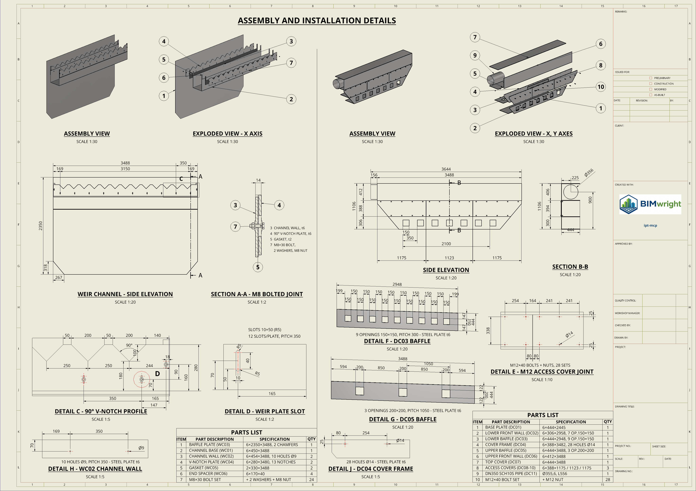

<!-- mcp-name: io.github.bimwright/ipt-mcp -->

<h1 align="center">ipt-mcp</h1>

<p align="center">
  <a href="https://github.com/bimwright/ipt-mcp/actions/workflows/build.yml"></a>
  <a href="LICENSE"></a>
  <a href="#supported-inventor-versions"></a>
  <a href="#tool-surface"></a>
</p>

<p align="center">
  English · <a href="README.vi.md">Tiếng Việt</a> · <a href="README.zh-CN.md">简体中文</a> · <a href="README.ja.md">日本語</a>
</p>

---

`ipt-mcp` is an open-source ([Apache-2.0](LICENSE)) [Model Context Protocol](https://modelcontextprotocol.io) gateway that lets Claude Code — and any MCP-capable client — drive **Autodesk Inventor 2022-2027** locally.

The agent speaks MCP over stdio. The server speaks NDJSON over a local authenticated transport (TCP or Named Pipe) to a per-version in-process Inventor add-in. The add-in marshals every command onto Inventor's STA thread and talks to the Inventor API.

Your model stays on your machine.

---

## Real-world example: a native Inventor drawing

This mechanical assembly and installation sheet was created and refined in **Autodesk Inventor 2027 through an agent-driven ipt-mcp workflow**—not a rendered mockup. The workflow used native drawing tools and `inventor_send_code`, with human direction, review and edits.

[](.github/assets/showcase/inventor-assembly-drawing.png)

*Click the image to inspect the full-resolution sheet (4096 × 2893).*

- **15 views:** assemblies, exploded arrangements, sections and enlarged details.
- **111 native dimensions and 21 item tags**, plus two parts lists.
- **English annotations and a custom title block**, with an embedded BIMwright logo and blank project fields.
- **MCP-assisted refinement:** matching dimension styles, aligning annotations and exporting the finished sheet as a PNG.

This is a human-reviewed presentation example, **not a fabrication release or a one-prompt automatic result**. Only the presentation image is included; project models are not distributed.

---

## What ipt-mcp Is

Two processes, one local pipe:

- **`Bimwright.Ipt.Server.exe`** — a .NET 10 MCP stdio server launched by Claude Code, Cursor, Cline, Codex, or another stdio MCP client. It has **no Inventor reference** and can be built/tested on Windows without Inventor installed. The gateway runtime requires Windows for its user identity and setup lifecycle; server-only describes independence from the Inventor SDK, not cross-platform runtime support.
- **`Bimwright.Ipt.Plugin.InvNN.dll`** — an `ApplicationAddInServer` add-in that loads inside `Inventor.exe`, runs a TCP or Named-Pipe listener, and executes commands on Inventor's main UI (STA) thread. One thin shell per Inventor year, all compiled from the same `src/shared/**` source glob.

Unlike Revit, Inventor has **no `ExternalEvent`** equivalent. The add-in marshals work onto the STA thread through a hidden message-only WinForms control (`InventorStaDispatcher`). See [ARCHITECTURE.md](ARCHITECTURE.md) for the full design.

---

## Supported Inventor Versions

| Inventor | Target framework | Transport | Notes |
|----------|------------------|-----------|-------|
| 2022 | `net48` (.NET Framework 4.8) | TCP | references `System.Windows.Forms` directly |
| 2023 | `net48` (.NET Framework 4.8) | TCP | |
| 2024 | `net48` (.NET Framework 4.8) | TCP | |
| 2025 | `net8.0-windows7.0` | Named Pipe | `UseWindowsForms`, `EnableDynamicLoading` |
| 2026 | `net8.0-windows7.0` | Named Pipe | |
| 2027 | `net10.0-windows7.0` | Named Pipe | needs the .NET 10 SDK; honors `UseInventorAssemblyContext` |

- The MCP server is one process, **unaffected by the Inventor version** — it just forwards JSON envelopes.
- TCP for 2022-2024 (net48 add-ins); Named Pipe for 2025-2027 — Named Pipe avoids the loopback-firewall prompt on modern Windows.
- Inventor moved desktop add-in development off .NET Framework starting in 2025: **.NET 8 for 2025/2026, .NET 10 for 2027**. (.NET 8 add-ins remain binary-compatible on 2027, but net10 is the native target.)
- Use **4-digit calendar years** (2022..2027) everywhere — never legacy version codes.

> **Status: Phase 1 and Phase 2 supported scope accepted.** Phase 3 adds four tools validated by build, automated tests and native Inventor 2027 disposable fixtures; installed-client and release acceptance remain separate. See [Phase 3 behavior](docs/testing/drawing-phase3.md).

The final MCP output guard warns at 64/256 KiB and uses a 1 MiB UTF-8 budget. Oversized reads request narrowing; completed writes retain compact effects and must not be replayed. `--disable-output-guard` keeps the transport fence active. CLI/JSON/environment thresholds and the configurable 36-hour spill policy are documented in [drawing testing](docs/testing/drawing-phase1.md).

---

## Install / Wire an MCP Client

Download the client setup ZIP from [GitHub Releases](https://github.com/bimwright/ipt-mcp/releases/latest). It includes a self-contained MCP server and Inventor add-in years compiled against **real** interop (see `manifest.json`). The v0.1.0 ZIP ships **2025** and **2027**. Other years: build locally — do not ship `SkipInventorReferenceCheck` shape-only DLLs.

```powershell
$tag = (Invoke-RestMethod https://api.github.com/repos/bimwright/ipt-mcp/releases/latest).tag_name
$zip = "$env:TEMP\IptMcp.Setup-$tag-win-x64.zip"
$dir = "$env:TEMP\IptMcp.Setup-$tag-win-x64"
Invoke-WebRequest "https://github.com/bimwright/ipt-mcp/releases/download/$tag/IptMcp.Setup-$tag-win-x64.zip" -OutFile $zip
Expand-Archive $zip -DestinationPath $dir -Force

powershell -ExecutionPolicy Bypass -File "$dir\install.ps1" -WhatIf
powershell -ExecutionPolicy Bypass -File "$dir\install.ps1"
```

Deploys `%APPDATA%\Autodesk\ApplicationPlugins\Bimwright.Ipt.bundle\` and `ipt-mcp.exe` to the fixed path `%LOCALAPPDATA%\Bimwright\ipt-mcp\server\current\ipt-mcp.exe`. The installer rolls back on failure, verifies the installed bundle against the package, smoke-checks the server with `--help`, and never edits MCP client configs — point your client at that fixed `ipt-mcp.exe` path yourself (see `AGENTS.md` in the ZIP for agent-driven wiring). Updates keep the path, so clients only need a restart; `-PruneOldServers` retires legacy `server\<version>\` copies once clients are repointed. `uninstall.ps1` runs the full sweep (personal data kept unless `-Purge`; `install.ps1 -Uninstall` removes the bundle only). Pin a year with `--target 2025` or `BIMWRIGHT_INVENTOR_TARGET=2025`.

Do **not** `dotnet tool install -g Bimwright.Ipt.Server` — that is not the supported client install.

**Developer:** `pwsh scripts/package-bundle.ps1` on a box with Inventor interop (skip years without SDK). Close Inventor before rebuilds.

Add-in discovery is automatic: each running add-in writes `%LOCALAPPDATA%\Bimwright\ipt-mcp\inventor-<year>-<pid>.json`. The gateway binds automatically only when exactly one Inventor is live. With several open, calls return `AMBIGUOUS_TARGET` until you pick one: call `inventor_list_available_targets`, then `inventor_switch_target` with `pid:<n>` or `id:<target_id>`. A selected session is never swapped for another: if it exits, calls return `TARGET_LOST` until you switch explicitly with `pid:<n>` or `id:<target_id>`. Leaving a running session that this gateway selected needs `rebind=true` (otherwise `TARGET_REBIND_REQUIRED`), and `auto` or a year never moves a selection. A malformed selector returns `INVALID_TARGET_SELECTOR`. `inventor_get_current_target` and `inventor_list_available_targets` never select a session. Under `--read-only`, `inventor_switch_target` is not available: pass `--target pid:<n>` at startup, or run with a single Inventor open. Each toast card title ends with `PID: <n>` of its Inventor, so you can match it to the session the agent selected.

Writes run only on a confirmed document. Check the active document with the user, then call `inventor_switch_target` with `pid:<n>` and `verify=true` once per session; until then writes return `TARGET_UNCONFIRMED` and are not sent. If another document becomes active, a write returns `DOCUMENT_CHANGED` (or `DOCUMENT_UNCONFIRMED`) from the add-in and is not started; confirm again, or pass `document` (full path or name) to name the target document, which is not tied to the active one. Once the confirmed document is closed, opening or creating another one moves the confirmation to it. Opening or creating a document with `inventor_open_document(s)`, `inventor_new_part`, `inventor_new_assembly`, `inventor_new_drawing`, `inventor_new_sheet_fabrication_part` or `inventor_create_part` moves the confirmation to the document it activates. The server and add-in must both support `document_target_v1`: with an older add-in or server, writes return `PAIRING_REQUIRED` and reads still work, so update both from the same release.

`inventor_send_code` is enabled by default. `--disable-send-code` hides code tools; `BIMWRIGHT_INVENTOR_PLUGIN_DISABLE_SEND_CODE=1` disables execution in the host. Read-only mode excludes it. Pass `usage_context="project"` for real project work or `"test"` when testing ipt-mcp itself (default `"unknown"`); it is recorded in the call journal and does not change how the script runs.

---

## Build & Develop

Autodesk Inventor binaries and the Inventor SDK are **not redistributed** in this repo (see [Not Redistributed](#not-redistributed)). Building and running the **server and tests** requires Windows and the .NET 10 SDK, with no Inventor installation required; building a **per-version add-in** needs the matching SDK plus the Inventor interop reference assembly.

```powershell
# Server + tests on Windows (server-only; .NET 10 SDK, no Inventor installation required):
dotnet build src/server -c Debug
dotnet test  tests/Bimwright.Ipt.Tests -c Debug

# Legacy TFM compatibility check using the installed 2027 interop reference:
dotnet build src/plugin-inv24 -c Debug /p:InventorInteropDir="C:\Program Files\Common Files\Autodesk Shared\Extensions 2027\Framework\Interop"
dotnet build src/plugin-inv27 -c Debug   # real 2027 interop compile; needs the .NET 10 SDK

# A per-version add-in always needs an Inventor interop reference. For a legacy TFM compatibility
# check, point InventorInteropDir at an installed compatible interop; real release builds use the
# matching year's default path.
```

- The **server** explicit-includes only `shared/Contracts/*` + `shared/Security/*` (+ ToolBaker), so it compiles with no Inventor SDK present.
- Each **add-in** uses `<Compile Include="..\shared\**\*.cs" />` to pull in everything, including the API-touching `Infrastructure`/`Plugin`/`Handlers`.
- The default interop hint path is `C:\Program Files\Common Files\Autodesk Shared\Extensions <year>\Framework\Interop\Autodesk.Inventor.Interop.dll`.
- Building add-in 2027 needs the **.NET 10 SDK** installed.
- **Close Inventor before deploying add-in DLLs** it would otherwise lock.

---

## Tool Surface

The development checkout exposes **150 tools** by default (`--toolsets all`); `--disable-send-code` exposes **144 tools**, and `--read-only` exposes **39 tools**. All MCP names start with `inventor_`. Toolset filters narrow this surface. Published v0.2.1 benchmark records below retain their original 111-tool scope.

All 19 toolsets are enabled by default, including `code`. Use `--toolsets <csv>` to narrow the surface.

All length inputs are in **mm**, angles in **degrees**; the add-in converts to Inventor's internal centimetres/radians.

**Targeting a document.** Document-level tools (`get_document_info`, `list_bodies`, `list_features`, the iProperty, parameter, material and mass tools, `save_document`, `close_document`, and the assembly tools) take an optional `document`: a full path or a name of a document Inventor already has in memory — an open window *or* a part loaded as an assembly reference. It is matched by path, display name, file name, then a unique substring; it is never opened or activated automatically, and an ambiguous or unknown name returns the candidates. Omit it to act on the active document.

**Occurrence selectors.** The bulk assembly tools pick occurrences with one shared selector: `{names?: [glob], regex?, file?: glob, path_contains?, leaf?: false, max_depth?, include_suppressed?: false, limit?}` (or just a name / array of names). Globs use `*`/`?`; a name glob containing `/` matches the occurrence path (`SUB:1/PART:2`). Zero matches or more than `limit` is an error that lists the closest names — results are never silently truncated.

**Dialogs.** Save, open, close, export, the batch document tools and the drawing tools that place a title block (`new_drawing`, `add_sheet`, `set_title_block`) run under `Application.SilentOperation` by default (`silent=true`), so Inventor answers its own prompts with their defaults instead of opening a hidden modal dialog that blocks the call. A template whose title block has prompted entries no longer stops `new_drawing` on the "Prompted Texts" dialog; fill the entries with `inventor_set_title_block`. Inventor has no event for answering one specific dialog with a chosen button (Revit's `DialogBoxShowing`), so there is no per-dialog answer rule.

**Host busy.** While a modal dialog is open in Inventor, every command except health returns `HOST_BUSY` at once instead of queueing behind the dialog. `HOST_BUSY` is also returned when the command queue is full or when earlier work kept Inventor busy until the deadline. In each case the command was not started and will not run later, so it is safe to send again once Inventor is free. `TIMEOUT` now means the command started and did not finish in time: its outcome is unknown, so inspect the document before retrying a write. `inventor_health` reports `host_busy`, `busy_reason` (`modal_dialog` or `sta_busy`) and `modal_dialog {open, title}`, probed without touching Inventor's main thread. The add-in serves up to four connections at once, so health and the next call still connect while a long call runs. When an add-in does not accept the connection in time (for example an older add-in that serves one call at a time), the call returns `TARGET_BUSY`; when its pipe does not exist it returns `TARGET_UNAVAILABLE`. Both say nothing was sent, so the command did not run.


### drawing_query (2) / drawing (20) — Inventor 2027

Earlier Inventor 2027 fixture results: [Phase 3 tool behavior](docs/testing/drawing-phase3.md). These records predate v0.2.1 runtime changes; live acceptance must be renewed.

`inventor_get_drawing_info` and `inventor_find_view_geometry` are read-only. Drawing writes:
`inventor_new_drawing`, `inventor_add_sheet`, `inventor_set_title_block`,
`inventor_add_drawing_view`, `inventor_add_section_view`, `inventor_edit_drawing_view`,
`inventor_add_drawing_dimension`, `inventor_add_balloon`, `inventor_export_drawing`,
`inventor_capture_sheet`, `inventor_add_drawing_note`, `inventor_add_drawing_table`,
`inventor_add_drawing_symbol`, `inventor_edit_drawing_annotation`, `inventor_delete_drawing_items`,
`inventor_edit_drawing_table`, `inventor_set_drawing_styles`, `inventor_edit_sheet`, `inventor_sketch_on_view`, `inventor_hide_view_edges`. Captures write PNG files and are excluded from read-only.

[Drawing checks and current limitations](docs/testing/drawing-phase1.md) ·
[Drawing annotations, tables and sheets](docs/testing/drawing-phase2.md) ·
[Generic live smoke record](docs/benchmarks/drawing-phase1-smoke.json) ·
[Declared read-only inventory](docs/testing/readonly-tools.json).

### Sheet Fabrication in the development checkout

Select `sheet_fabrication` for authoring and `sheet_fabrication_query` for read-only inspection:

```bash
bimwright-ipt --toolsets sheet_fabrication,sheet_fabrication_query
```

| Tool | Purpose |
|---|---|
| `inventor_new_sheet_fabrication_part` | Create a part from an Inventor sheet template. |
| `inventor_sheet_fabrication_info` | Inspect thickness, style and flat-pattern state. |
| `inventor_set_sheet_fabrication_thickness` | Override the part thickness with a value or parameter expression. |
| `inventor_sheet_fabrication_face` | Create a base plate from a closed sketch profile. |
| `inventor_sheet_fabrication_flange` | Add a flange to selected boundary edges. |
| `inventor_sheet_fabrication_cut` | Cut a sketch profile through the sheet. |
| `inventor_flat_pattern` | Create or inspect the flat pattern. |
| `inventor_unwrap_try` | Try unwrapping selected faces; also applies to ordinary parts. |

`--read-only` retains the inspection tool and removes the authoring tools. The response fields are `is_sheet_fabrication` and `use_sheet_fabrication_style_thickness`. Workflows using the earlier development names must update their tool and toolset references. Use a server and add-in built from the same revision. Autodesk's `SheetMetal*` API identifiers and template filenames remain unchanged.

### iLogic rules and source execution

The `ilogic` toolset runs existing internal/external rules, lists or reads rules, reads diagnostics, and provides command/undo tools. Its four query tools remain available under `--read-only`.

Creating or changing VB source through `inventor_ilogic_upsert_rule`, and executing `inventor_ilogic_run_snippet`, requires the `code` toolset and send-code permission. `--disable-send-code` hides both; the add-in kill switch rejects them independently. Rule execution, source authoring, UI commands and undo are blocked inside `batch_execute`, because their effects can escape its document transaction.

`upsert_rule` runs a newly created rule once through Autodesk's AddRule. For an existing rule, `run=true` executes it once after replacing the text. Native failure status, rule exceptions, and incomplete cleanup return `ok:false` with diagnostics in `data`; arbitrary rule side effects are not rolled back.

Snippets return a string through `iProperties.Value("Custom", "MCP_RESULT")`. An existing string property is restored, and a channel created by the invocation is deleted. A non-string collision is rejected before execution. Existing rules sharing the temporary-rule prefix are preserved. Results above 65,536 characters fail rather than returning truncated JSON. Historical `MCP_RESULT_BEGIN/END` log markers are no longer treated as snippet results.

`ilogic_read_log` bounds reads for positive `max_chars` (default 65,536, maximum 1,048,576). `max_chars=0` explicitly requests the whole file. The response reports `bytes_read` and `truncated`. Rule arguments are flat JSON objects containing strings, numbers, booleans or null.

Sheet Fabrication creation requires a sheet fabrication template and cannot run inside a batch. Failed thickness edits restore the previous thickness/style state; across-bends cut depth follows the native Thickness parameter as the sheet changes. A flange radius override must be finite and greater than zero.

### meta (3) — server-side target tools, never round-trip to the add-in; stay exposed under `--read-only`

| Tool | Description |
|---|---|
| `inventor_list_available_targets` | List detected live Inventor add-in targets (year, pid, transport, active document); `selected` marks the gateway's target. |
| `inventor_get_current_target` | Report the selected target; never selects one (`bound=false` with the live candidates when nothing is selected yet). |
| `inventor_switch_target` | Select the target by `pid:<n>`, `id:<target_id>`, `auto` or Inventor year; a selector matching several sessions is refused. `rebind=true` is needed to leave a running session this gateway selected. `verify=true` confirms the active document for writes. Not registered under `--read-only`. |

### query (12) — read-only document/health/model probes and agent outcome reports

Start each Inventor session with one `inventor_health(check_updates=true)` call after selecting the intended target if needed, so the agent discovers newer stable releases. If network access is unavailable or disallowed, use the offline default and leave the update check not checked/unknown. Later routine probes stay offline. Its existing host fields and `setup_gateway`/`setup_plugin` identities are preserved; the compact `mcp` block adds `server_version`, `server_informational_version`, `plugin_version`, `server_build_id`, `plugin_build_id`, `version_alignment` and `revision_alignment`. Alignment is `match`, `mismatch` or `unknown`; a matching version or revision does not prove binary compatibility or publisher trust. Build ids use loaded assembly informational-version metadata, falling back to the component's module id. Runtime identity is captured at server startup or add-in activation. `artifact_sha256` is a disk observation at that capture time (`artifact_hash_basis=on_disk_at_identity_capture`), not a digest of loaded memory or proof that a later file replacement has taken effect.

The default call is local and works offline. If the host is absent or unreachable, server identity is still returned alongside `ok:false`, `host_connected:false` and the original error; this is not a successful host probe. `check_updates=true` fetches one [official stable release](https://docs.github.com/en/rest/releases/releases#get-the-latest-release) and resolves its tag to a source commit. All requests share a five-second budget; each metadata response is limited to 256 KiB. `update.components.server` and `.plugin` each report `current_version`, `current_build_id`, `version_status`, `build_status` and `status`. Component status is `update_available`, `release_match`, `release_mismatch`, `ahead_of_release`, `unknown` or `not_checked`. Revision comparison uses a full Git hash in loaded assembly metadata; other build ids stay unknown. An older loaded plugin remains visible even when the server matches the release. Tag-resolution failure preserves the version comparison but leaves build status unknown.

`update.status=checked` means the release lookup succeeded, not that both components are current. Per-component `update_available` compares semantic versions only. When a component version matches the release, `release_mismatch` requires a full Git SHA on both sides and different SHAs. Revision metadata such as `+development`, `+build` or no revision instead gives that component status `unknown`. For a pair at the release version with no confirmed revision mismatch, missing revision evidence is reported as `RELEASE_IDENTITY_UNVERIFIED`. Neither result recommends an automatic downgrade. The overall flag is true if either component has a newer stable version available, false only if both versions/revisions match the release, and null otherwise. Source revision equality does not verify release artifact bytes (`artifact_verification=not_performed`). The response never downloads packages or installs them. Follow [the install guide](AGENTS.md) for preview, authorization, rollback and restart verification.

Inspect both `update.components` and `update.notification`, then follow its `agent_action`. Codes distinguish `NEW_RELEASE_AVAILABLE`, `RELEASE_REVIEW_REQUIRED`, `RELEASE_IDENTITY_UNVERIFIED`, `UPDATE_CHECK_UNAVAILABLE` and informational `LOCAL_VERSION_AHEAD`. Lookup failure reports `lookup_reason` (such as `http_403`, `timeout` or `network_unavailable`), leaves reported runtime identities unchanged, and does not claim a local fault or request installation authorization. A local version ahead of the release is reported even without an older peer. Per-component `update_available=false` only means no higher semantic version was established; it does not mean release identity matched. Null notification alone never proves up to date.

The notification names `protected_components` with `protected_component_reasons`; known ahead or unresolved observed builds are preserved. A plugin whose identity has not been observed is listed separately in `unobserved_components`, with `identity_observed=false`: check the intended Inventor connection and obtain metadata, without assuming the host is closed or the installed plugin is corrupt. `comparison_reason` distinguishes missing runtime evidence from unavailable release lookup/revision evidence. Missing artifact hashes do not by themselves determine protection; release artifact-byte verification remains separate.

Read both component comparisons, protection/unobserved fields and the full notification message before summarizing; notification `components` names the primary affected set, not all runtime facts. An ahead server with an unobserved plugin returns `RELEASE_IDENTITY_UNVERIFIED` for the plugin while separately protecting the server. When both component versions match the release but tag resolution fails, the same code accompanies `comparison_reason=release_revision_unavailable` and an external `lookup_reason`. This alone does not mark the component protected or faulty; the false proposal flag still blocks installation. Stop the update workflow and obtain the missing release evidence; otherwise healthy Inventor work can continue.

`update_guidance.mode` is `check_only`, `retry_check`, `review`, `none` or `prepare_update`. Only `prepare_update`, with `bundle_update_proposal_allowed=true`, returns the installation workflow and `requires_user_authorization=true`; reuse existing authorization when applicable. Other modes contain only check/report/review steps, no install.ps1 or installer commands, and no request for installation authorization. A newer local server plus an old plugin blocks the full ZIP proposal; failed tag resolution or an unobserved peer also blocks it while preserving any known newer-version fact. Health never installs anything. The four annotations remain read-only true, destructive false, idempotent true and open-world true.

For a permitted update, keep the exact release tag from the health proposal. Verify the official ZIP against its companion `.zip.sha256` asset before extraction, require `manifest.json`, and preview the installer to validate extracted file checksums before replacement. Health returns no expected ZIP digest and performs no package verification. The manifest checks individual payload files; it does not replace the whole-ZIP checksum or establish independent publisher authentication.

After reconnect/restart, the **client** must record a new `initialize` and a fresh `tools/list`, then call health on that same connection. `serverInfo.version` includes the full informational version. Compare `serverInfo.name/version` with `client_verification.expected_server_info` and the health tool's `_meta["bimwright/ipt-mcp/runtime"]` with `client_verification.expected_runtime` (version, module id, PID and process start time). Also verify its current schema and annotations, including optional boolean `check_updates` and read-only/open-world hints. Tool count alone is insufficient. `client_verification.status=not_observable_by_server` makes the boundary explicit; when a client hides handshake/catalog evidence, its refresh remains unverified. A direct-server smoke test validates the candidate protocol but cannot certify another client's cache.

| Tool | Description |
|---|---|
| `inventor_health` | Call with `check_updates=true` once at session start to discover releases and notify the user when `update.notification` is present. Routine probes stay offline by default. Reports host state and loaded server/plugin identities. |
| `inventor_report_task_result` | Explicit agent-reported task outcome: `task_id`, `outcome` (`completed`/`failed`/`cancelled`), single-line `summary`, optional Markdown `body` (max 32 KiB). Shows the summary card and saves the report under `%LOCALAPPDATA%\Bimwright\ipt-mcp\reports\` with the write tools run since the last report, also when Inventor is not reachable. No model changes. |
| `inventor_get_report_history` | Saved agent reports, newest first: a page of summaries (`offset`, `limit` 1–50), or one report in full by `report_id`. Local data; works without Inventor. |
| `inventor_list_open_documents` | List documents in memory: title, path, type, is_active, dirty, visible; optional `filter` / `dirty_only`. |
| `inventor_get_document_state` | Check before saving or ending work: `mode` (`local_file`, `unsaved`, `template`, `read_only`), `is_modified`, `dirty_references`, `modifiable`, `is_read_only`, `exists_on_disk`, `saved_in_version`, `needs_migrating`, `file_save_counter`, `document_id`, plus the save `policy {mode, rules, allowed}` and the project's `old_versions_to_keep`. Active document, `document`, or `scope=all`; works with no document open. |
| `inventor_get_document_info` | Title, full path, type and dirty flag of the active or a targeted document; `references=true` adds its file references (with missing flags). |
| `inventor_list_bodies` | List the part's solid bodies: id (`body:N`), name, volume_mm3, bbox_mm, face_count, created_by feature, visible. |
| `inventor_list_features` | List the part's features in tree order: name, type, health, suppressed, body_names. |
| `inventor_probe_brep` | Survey the part's B-rep for port mouths: planar faces with inner-loop circular edges — normal (IsParamReversed-corrected), center_mm, port_diameter_mm, all circles on the face. |
| `inventor_list_sketch_points` | Inspect a named sketch: point references, positions in mm, circle/arc centres and line endpoints, plus `origin_ref`. Optional `document` selects an open part; `max_items` defaults to 200 (1–1000). Does not project geometry or change the document. |

### document (12) — document lifecycle (write)

| Tool | Description |
|---|---|
| `inventor_new_part` | Create a new part document (.ipt); optional template path. |
| `inventor_new_assembly` | Create a new assembly document (.iam); optional template path. |
| `inventor_open_document` | Open an existing document from a full path and make it active. |
| `inventor_save_document` | Save the active document (or `document`) following the `inventor_get_document_state` policy, which it enforces. In place: refused for a never-saved document, a template, a read-only file or a file missing on disk (`data.reason`); `saved=false`, `reason=no_changes` when nothing changed; an older-format file needs `allow_format_upgrade=true` after the user approved. With `path`: Save-As to a new local file of the document's type in an existing folder; an existing file is never overwritten. |
| `inventor_close_document` | Close the active document (or `document`); `save=true` saves first under the `inventor_save_document` policy, and a refused save keeps the document open (`data.reason`). |
| `inventor_set_units` | Set the active document's length unit (mm, cm, m, in, ft). |
| `inventor_set_material` | Assign a material to the active part by name. |
| `inventor_save_all` | Update a root document and save it with every dirty referenced document, silently; per-file saved / read_only / error; `dry_run`. Follows the `inventor_save_document` policy (also on `dry_run`): refused with `data.reason` when the root is never-saved, a template, read-only or missing, or a document it would save is a template or an older-format file without `allow_format_upgrade=true`. |
| `inventor_open_documents` | Open several documents in one call (default without windows, for `document`-targeted edits). |
| `inventor_close_documents` | Close documents by path/name, or all visible ones (`keep_active`). `save=true` follows the `inventor_save_document` policy per file: a refused file stays open with its changes (`status=refused`, `reason`). |
| `inventor_save_checkpoint` | With user approval, copy the confirmed active local file into `<name>.checkpoints\` next to it (saving first if it has unsaved changes), verified by size and SHA-256 and indexed. Assembly and drawing checkpoints hold only that file (`REFERENCES_NOT_CAPTURED`). `allow_format_upgrade=true` only after the user approved converting an older-format file. |
| `inventor_manage_checkpoints` | `action=list`; `prune` (preview with `dry_run=true`, apply with the previewed `plan_hash` after approval; milestones are kept); `restore` copies a checkpoint to `<name>-restored-<id>.<ext>` and never overwrites the working file. |

### ipart (8) — Standard iPart families and Excel catalogs

| Tool | Purpose |
|---|---|
| `inventor_get_ipart_info` | Inspect an open ordinary part, factory or member, table rows, Excel binding and generation state. Read-only. |
| `inventor_create_ipart_factory` | Copy a clean saved ordinary part to a new factory path and configure parameter, material, description and feature-suppression columns. |
| `inventor_update_ipart_table` | Preview/apply complete row upserts before an Excel catalog owns the table. |
| `inventor_set_ipart_row` | Select and verify one factory row without changing assembly occurrences. |
| `inventor_generate_ipart_members` | Preview/generate selected rows, verify their bodies and properties, and reuse verified unchanged members. |
| `inventor_sync_ipart_excel` | Preview/apply a saved `.xlsx` catalog to the factory in one direction. |
| `inventor_place_ipart_member` | Place a previously generated member in an open assembly. |
| `inventor_change_ipart_member` | Switch one exact top-level occurrence to another verified row of the same factory. |

Start with a parametrically modeled part. Configure columns such as `{name:"Length",kind:"parameter",target:"Length"}` and `{name:"Hole",kind:"suppression",target:"MountHole"}`. The factory includes Member and Part Number automatically. Row input is `{member:"BUSH-020",part_number:"BUSH-020",values:{Length:40,Hole:false}}`, with every configured column present. Numeric parameters use the original parameter's units; strings accept Inventor expressions. Boolean suppression means `true = suppress`, `false = compute`. Materials must already be available in the factory document.

For Excel, use one header row with `member`, `part_number` and the configured column names, followed by complete contiguous rows. Configured cells must be nonempty, including Description if that optional column is configured; clearing native property cells is not supported. Supply `path`, `sheet` and `header_cell` on the first sync; optional `mapping` maps these names to other Excel headers. Later calls can reuse the binding. Table update, Excel sync and generation default to `dry_run=true`; applying requires `dry_run=false`. Save/recalculate the workbook before syncing: these tools read saved values, including cached formula results, and never write back to Excel. After binding, edit rows in Excel and sync instead of writing the table through JSON. Reordering Excel rows preserves member identity; omitted existing members are rejected instead of deleted.

The workflow is **edit Excel → sync table → generate selected members → place or switch occurrences**. Sync rebuilds and verifies changed factory rows; it does not generate files or refresh assemblies automatically. Native member `.ipt` files remain necessary for assembly references. Manage the factory, its adjacent `.ipart-mcp.json` checkpoint file, the workbook and the generated member folder together.

Write tools currently support managed Standard iPart factories created by `inventor_create_ipart_factory`. Sources must be clean, saved ordinary solid parts with independent parameters; custom iParts, sheet metal, native Excel parameter links, existing-factory adoption and iAssemblies are outside this scope. Output paths must be new local-drive `.ipt` paths; shared/proxy caches are refused. Catalog limits are 16 MiB, 1,000 rows and 48 configured columns; generation accepts 1–50 named members per call. No macros or external workbook links are accepted.

Factory operations explicitly save their managed copy and checkpoint. Assembly operations leave saving to the user. All writes reject `batch_execute`, nested transactions, dirty factories and conflicting operations. A failed multi-file operation may leave files on disk: inspect `file_effects` and the pending operation, restore a clean factory if necessary, then resume that same operation. Transaction abort does not imply file rollback. Member generation compares native bodies and reads back properties before marking a file current.

### parameters (7) — model, user & Excel parameters

| Tool | Description |
|---|---|
| `inventor_list_parameters` | List parameters (model + user): name, expression, value, unit, kind. |
| `inventor_get_parameter` | Get one parameter by name: expression, value, unit. |
| `inventor_set_parameter` | Set an existing parameter's expression/value, then update the document. |
| `inventor_create_parameter` | Create a new user parameter (name, expression, unit). |
| `inventor_list_excel_tables` | List native spreadsheet tables, stable linked-table IDs, parameter values and health. |
| `inventor_link_excel_table` | Link a local `.xlsx` parameter block and verify native readback after recompute. |
| `inventor_reload_excel_table` | Reload a linked table by ID, verify saved values and geometry health, and report changes since its last verified link/reload. |

Excel blocks use the **first worksheet**, with vertical columns `name`, `value`, `units`, and optional `comment`. `start_cell` points to the first parameter row, not its header. Names must be unique ASCII identifiers; values must be finite saved numbers or formula results; specify `mm`, `deg`, `ul` (unitless), or another Inventor unit. Recalculate and save the workbook before linking/reloading. The tools do not calculate Excel formulas, edit the workbook, or save the part. Limits: local-drive `.xlsx`, 16 MiB, 1,000 contiguous rows; no macros, external workbook links, UNC paths, or changed parameter membership during reload.

For example, link with `inventor_link_excel_table(path="C:/parts/flange.xlsx", start_cell="A6", document="flange.ipt")`, then reuse its `table_id` with `inventor_reload_excel_table`. Sketch dimensions, thickness and pattern counts must reference the linked parameter names for the geometry to change. Native links already present in a part establish their change baseline on the first successful reload; that call reports `changed_parameters=null` rather than inventing a previous value.

Excel writes run outside `batch_execute` and own their document transaction. Inventor may retain refreshed spreadsheet parameters after aborting a failed geometry update. Reload therefore compares the post-failure state with its persisted verified checkpoint and reports `rollback_failed` / `recovery_required` when restoration cannot be verified. In that case restore the last verified Excel values, reload successfully, and inspect the part before saving. `transaction_aborted` alone is not proof that linked values were restored.

### properties (4) — iProperties & mass properties (write)

| Tool | Description |
|---|---|
| `inventor_get_iproperty` | Get an iProperty value by property-set and property name. |
| `inventor_set_iproperty` | Set an iProperty value. |
| `inventor_get_mass_properties` | Mass (g), volume (mm³), surface area (mm²), centre of mass, bounding box. |
| `inventor_list_iproperty_sets` | List iProperty sets (name, internal_name, property names; optional values) — discovery for get/set_iproperty. |

### sketch (11) — 2D sketch geometry & constraints (write)

| Tool | Description |
|---|---|
| `inventor_create_sketch` | Create a 2D sketch on a plane (XY/XZ/YZ or a face/work-plane reference). |
| `inventor_project_geometry` | Project model edges/vertices (by edge ids) into the active sketch. |
| `inventor_draw_line` | Draw a sketch line from (x1,y1) to (x2,y2). |
| `inventor_draw_circle` | Draw a sketch circle from centre + radius. |
| `inventor_draw_rectangle` | Draw a two-point sketch rectangle. |
| `inventor_draw_arc` | Draw a sketch arc (centre, radius, start/end angle). |
| `inventor_add_sketch_dimension` | Add a driving dimension constraint to a sketch entity. |
| `inventor_add_sketch_point_dimension` | Drive the horizontal, vertical or aligned distance between two point references, using a positive number in mm or a parameter expression. Optional `document` targets an open part. |
| `inventor_add_sketch_constraint` | Add a geometric constraint (coincident, parallel, tangent, …). |
| `inventor_draw_text` | Add a fitted text box (position mm, optional font_size_mm; rotation_deg in multiples of 90). |
| `inventor_close_sketch` | Finish editing a sketch (exit sketch edit mode). |

To locate a hole, call `inventor_list_sketch_points` with its sketch name, select the point whose
role is `circle_center`, then add two point dimensions from `origin_ref` to that `point_ref`:
`orientation="horizontal", value="HoleX"` and `orientation="vertical", value="HoleY"`.
Changing those existing parameters moves the hole centre. Expressions can reference existing
linked Excel parameters. Optional `text_position=[x,y]` controls the annotation position in sketch mm.
Both points must belong to the same sketch. References use native object keys and reject deleted
objects or another file; query again after Save As. Distances must be positive; zero offsets require
geometric constraints. Dimension creation verifies recompute and actual point distance, rolls back
on failure, and leaves saving to the caller.
When needed, an origin dimension projects the sketch origin or creates a fixed local origin point;
this helper is also removed if the operation rolls back. Inside a batch or another open transaction,
the dimension must target that transaction's document.

### feature (17) — solid & work features (write)

| Tool | Description |
|---|---|
| `inventor_create_part` | Build a whole part from a JSON recipe in one call: sketches (rect / circle / polyline with arc bulges, inner voids, on origin or fixed planes) → extrude / hole / fillet / chamfer → material + iProperties → silent Save-As. Errors name the recipe path (`features[2].extrude.distance`); a failing build closes the part unsaved; `dry_run` validates only. |
| `inventor_build_solids` | Build many solids in an existing part from data in one call: items `{name, op: new/join/cut, target?}` with one shape (`name` optional for join/cut; `defaults` fills repeated shape values) — `box` (min/max), `tube` (a, b, od, wall?), `prism` (axis, from, to, profile) or `extrude` (plane pose, depth, profile). All items are validated first and every problem is returned at once; each item is checked after building (healthy feature, one new body, a cut must remove and a join must add volume). A failing item is removed, built items stay and `next_index` says where to resume. `dry_run` validates against the part. One undo step. |
| `inventor_extrude` | Extrude a named sketch (distance, join/cut/intersect, direction). |
| `inventor_revolve` | Revolve a named sketch about an axis (angle, operation). |
| `inventor_combine` | Boolean solid bodies (base + tool bodies, join/cut/intersect, keep_tool_bodies). |
| `inventor_batch_execute` | Run up to 20 wire commands in one transaction (single undo, rollback on error). |
| `inventor_fillet` | Add a constant-radius edge fillet — `edgeIds` or an `edges` selector `{kind:circular, radius_mm?, center_mm?, on_body?, adjacent_surface_types?}`; returns `matched_edges`. |
| `inventor_chamfer` | Add an equal-distance edge chamfer over model edges. |
| `inventor_create_work_plane` | Create a work plane (offset, three_points, tangent, or fixed origin+axes). |
| `inventor_create_work_axis` | Create a work axis (two_points, edge, plane_intersection, normal_to_face_through_point). |
| `inventor_create_work_point` | Create a fixed work point at {x,y,z}/[x,y,z] mm; construction points can't be named (name_applied reports it). |
| `inventor_hole` | Drilled/counterbore/countersink holes on a deterministically-selected planar face; optional tapped-thread metadata. |
| `inventor_circular_pattern` | Circular-pattern part features around a named axis (count over an angle). |
| `inventor_rectangular_pattern` | Rectangular-pattern part features along one or two named axes. |
| `inventor_loft` | Loft an ordered list of sketch profiles ('SketchName' or 'SketchName:N'), optional centerline sketch, closed/merge-tangent-faces. |
| `inventor_sweep` | Sweep a sketch profile along a sketch path (connected segments chain); orientation normal_to_path\|parallel. |
| `inventor_create_bim_connector` | Author a BIM pipe connector on a circular port edge (ref from inventor_probe_brep `circles[].edge`); kind=pipe, optional system/flow/connection metadata. |

### export (11) — view capture & geometry export (write)

> `output_path` must sit under an allowed root: the user profile, `%TEMP%`, or a root you add — e.g. set `BIMWRIGHT_INVENTOR_EXPORT_ROOT=D:\Inventor-Exports` on the Inventor machine (restart Inventor and your MCP client/server session afterwards).

| Tool | Description |
|---|---|
| `inventor_capture_view` | Capture the active view to a PNG file (under `<export-root>\captures\` or `output_path`); `inline=true` returns a bounded base64 PNG instead. Can set up the view in the same call (design view, object/occurrence visibility, orientation or camera, fit) and take several `shots` at once. |
| `inventor_set_view_state` | Activate or create a design view, toggle object visibility (work features, sketches, …) and show/hide occurrences by selector. |
| `inventor_export_step` | Export the active part/assembly to STEP (.stp/.step). |
| `inventor_export_stl` | Export the active part/assembly to STL (.stl). |
| `inventor_export_sat` | Export the active part/assembly to ACIS SAT (.sat) — the Revit interop format; acis_version defaults to 7 (the only supported value). |
| `inventor_export_bodies_sat` | Export solid bodies one SAT file per body across many open parts in one call (`items=[{document, bodies?, key?}]`, `out_dir`); preflights paths and existing files, `verify=true` reads each file back (volume/bbox/face count) and reports per-body errors. |
| `inventor_export_dxf` | Export a 2D DXF; must declare source (`sketch` or `flat_pattern`). |
| `inventor_derive_envelope` | Create a derived part from a source part/assembly — the envelope/interop path: `derive_style`, `include_bodies` per-solid selection, `bounding_box` lightweight mode; saves an .ipt under an allowed root. |
| `inventor_view_fit` | Zoom-fit the active view to the model extents (run before capture). |
| `inventor_set_view_orientation` | Set a standard camera orientation (iso/front/top/…) for multi-angle captures. |
| `inventor_set_camera` | Position the camera explicitly (eye/target in mm, up, perspective, extents_mm, fit) — use before capture_view when standard orientations don't fit. |

> Export paths must be absolute and under an allowed output root (user profile or temp).

### assembly (9, write) — compose and edit assemblies

| Tool | Description |
|---|---|
| `inventor_create_design_view` | Copy an assembly design view; exact occurrence visibility/appearance settings, optional activation. Validated on an Inventor 2027 disposable fixture. |
| `inventor_place_occurrence` | Place a component (.ipt/.iam) into the active assembly; optional initial pose + grounded. |
| `inventor_add_constraint` | Constrain two named refs (mate/flush/insert/angle); response carries `health` — always check it. |
| `inventor_create_imate` | Author a named iMate on the active part using a deterministic face selector. |
| `inventor_place_occurrences` | Place many components in one undo step; pose as origin+rotation, axes or a 4×4 matrix; `lock` = none / grounded / workplanes (three hidden fixed work planes flush-constrained to the part's origin planes). |
| `inventor_delete_occurrences` | Delete the top-level occurrences a selector matches (with their lock planes); `dry_run`. |
| `inventor_set_occurrence_state` | Set visible / suppressed / grounded / pose / lock on every selector match in one undo step; `dry_run`. |
| `inventor_set_appearance` | Colour occurrences (selector) or part bodies by RGB, or apply a library appearance by name. |
| `inventor_reset_appearance` | Remove appearance overrides from occurrences or part bodies. |

### assembly_query (6, read-only) — numeric self-check battery; survives `--read-only`

| Tool | Description |
|---|---|
| `inventor_list_interfaces` | List named interfaces (iMates, work features, origin geometry) of the doc or one occurrence. |
| `inventor_list_occurrences` | Selector-filtered occurrence report with chosen fields (path, file, bbox_mm, transform, visibility, grounded, material, appearance, mass, volume); inline or to a file. |
| `inventor_check_interference` | Run interference analysis — legacy occurrence names, or `set_a` × `set_b` selectors with a bounding-box prefilter; pairs sorted by volume, capped by `max_pairs`. |
| `inventor_measure_min_distance` | Minimum 3D distance (mm) between two occurrences or named refs — or a batch: `pairs[]` or `set_a` × `set_b` with `threshold_mm` (clearance checks). |
| `inventor_get_assembly_bom` | BOM + occurrence tree with grounded flag and translation/rotation degrees of freedom. |
| `inventor_list_constraints` | Read back every constraint with type, `health`, suppressed flag and the two occurrence names. |

### code (4) — C# scripts and code modules

| Tool | Description |
|---|---|
| `inventor_send_code` | `inventor_send_code` is enabled by default. `--disable-send-code` hides code tools; `BIMWRIGHT_INVENTOR_PLUGIN_DISABLE_SEND_CODE=1` disables execution in the host. Read-only mode excludes it. |
| `inventor_save_code_module` | Save a reusable C# helper module (declarations only); policy-checked and dry-compiled in the add-in before it is stored; `requires` other modules. |
| `inventor_list_code_modules` | List saved modules with hash, description and declared signatures. |
| `inventor_delete_code_module` | Delete a saved module (refused while another module requires it). |

### toolbaker (3, read-only) — operate purely on the server-side bake database

| Tool | Description |
|---|---|
| `inventor_list_baked_tools` | List all verified, compiled, registered baked tools. |
| `inventor_list_bake_suggestions` | List active ToolBaker suggestions from recurrent workflows. |
| `inventor_create_bake_issue_draft` | Create a GitHub issue draft for a suggestion (without submitting). |

### toolbaker_write (3, write) — run baked tools and manage the suggestion lifecycle

| Tool | Description |
|---|---|
| `inventor_run_baked_tool` | Execute a registered baked tool by name with JSON parameters. |
| `inventor_accept_bake_suggestion` | Accept a suggestion: validate + compile + apply + persist as a baked tool. |
| `inventor_dismiss_bake_suggestion` | Dismiss or snooze an active suggestion. |

---

## Toast Notifications

When Inventor is visible, command results update **one compact activity card** with the latest tool and rolling **Success / Failed / Capture** counters. Captures are a subset of successes, including `inventor_capture_view` with `inline=true`, not extra operations to add to the total. Failures include soft script failures and rolled-back batches. Read and write activity use blue accents; a recorded failure keeps the card's accent red. The card is the same one rvt-mcp and dwg-mcp show, so the layout stays stable as numbers change: no priority stack or per-tool toast queue. A successful capture that saved an image also shows a **thumbnail** of it, centred in one fixed frame; clicking the thumbnail opens the file. Counts cover this card's lifetime on the Inventor target, not an inferred job or a particular MCP client. `inventor_health` never toasts. **Agent connected** is a status notification: it neither increments counters nor replaces an active activity card or task report.

The activity card expires **20 seconds after the last result by default**. Choose 10, 20, 30 or 60 seconds in **Status → Toast duration → Apply**; the choice is saved as `toastIdleSeconds`. A failed save displays an error and keeps the previous duration active. A real hover, detected by pointer movement, pauses expiry; leaving rearms the full selected interval. The new duration takes effect on the next result or pointer leave. A card appearing under a stationary cursor does not count as a hover. Click the card to open **History** and dismiss it; **×** only dismisses it. The card title always names the gateway and the **Inventor year** (`ipt-mcp 2027`), regardless of branding.

To report a whole job's outcome, the agent explicitly calls `inventor_report_task_result` with a unique agent/job `task_id` (1–80 chars), `outcome` (`completed`, `failed`, `cancelled`), and a truthful single-line `summary` (1–120 chars). The report **replaces the same shared slot**, says **Agent reported**, and has an **8-second** lifetime, paused by real hover and rearmed on leave. It does not increment activity counters; the next tool result starts a new activity card. Idle time and successful tool calls never imply task completion. The report bypasses the Inventor command queue (it touches no Inventor API), so it still lands while a long `send_code` holds the main thread. Its response carries `toast_shown`, indicating whether a card was retained for display; a card held while Inventor is minimized or behind a dialog counts and appears once the frame is usable. Reports respect the Toasts toggle and require the updated server **and** add-in.

**Saved reports.** The server also saves every report as one JSON file in `%LOCALAPPDATA%\Bimwright\ipt-mcp\reports\` (the newest 500 are kept), with the optional Markdown `body` and the write tools the session ran since the previous report; resending a `task_id` from the same session replaces that report. Reports are agent-reported, not verified. `inventor_get_report_history` reads them back. Until the agent reports, results of model-changing tools carry a `_report` reminder (once in full, then short; for `send_code`, one conditional reminder because the server cannot tell whether a script changed the model). Reads, open/close/save, checkpoints and exports carry none.

Toasts use **code-only WPF on a dedicated STA UI thread**, with an **unowned, no-activate window** independent of Inventor's main STA and without Inventor COM calls on the toast thread. Command-result notifications are posted after the response is handed back. Toasts do not steal focus, hide while Inventor is minimized or a modal dialog is open, and **stay topmost even when another application is in the foreground**. The card uses one fixed light style, like rvt-mcp and dwg-mcp; there is no theme setting and nothing reads the screen behind it.

Toggle toasts from the ribbon: **Bimwright ▸ MCP → Toasts** (Status opens a diagnostic dialog). The choice persists in `%LOCALAPPDATA%\Bimwright\ipt-mcp\iptmcp.config.json` under `enableToast`. The environment variable `BIMWRIGHT_INVENTOR_ENABLE_TOAST` overrides the JSON value. The retired `toastTheme` key and `BIMWRIGHT_INVENTOR_TOAST_THEME` are ignored. A malformed config file is left untouched — the toggle refuses to overwrite it.

**Toast Brand** on the same ribbon is **off by default**; the choice persists in the same file under `showBranding` and is restored at the next Inventor start. Enabling it reserves a wordmark row at the bottom of the card and reveals the BIMwright wordmark there with a wipe on real hover, fading it out on leave. There is **no automatic entrance wordmark wipe**. Motion follows the Windows animation preference. Toast UI labels remain English; translated READMEs do not imply UI localization.

## MCP Command History

Call-log files are disabled by default. Enable them with `--enable-call-log`; the plug-in records redacted calls in `%LOCALAPPDATA%\Bimwright\ipt-mcp\mcp-calls.jsonl`. In-memory History stays available when file logging is off.

New plugin, gateway and send-code journal segments rotate before the next UTF-8 record would exceed 5 MiB. Each generated group retains at most 100 MiB for 30 days, with unique archives beside the active file; recent oversized legacy segments are preserved within the group budget. Startup maintenance also runs when call logging is off, without enabling it. Append, rotation and retention share a cross-process lock; logging failure does not bypass the lock or change the CAD result. Maintenance only handles the matching generated log groups and keeps configuration, recovery state, model files and user exports.

Transport startup reserves the endpoint before advertising readiness. Stop closes actual connections and cancels work that has not begun; admission retains canceled STA posts until their callbacks drain, with at most 64 posted or executing items. Work already running on Inventor's STA thread is allowed to finish. A timeout or lost connection can leave its result unknown: use health and inspect document state before retrying, and do not resend the same script automatically.

`send_code`, `ilogic_run_snippet` and `ilogic_upsert_rule` source bodies are redacted to `{code_hash, code_length}` by default. `BIMWRIGHT_CACHE_SEND_CODE_BODIES=1` keeps bodies in memory for display and re-run. `BIMWRIGHT_PERSIST_SEND_CODE_BODIES=1` (+ optional `BIMWRIGHT_PERSIST_SEND_CODE_BODIES_TTL`, e.g. `4h`/`2d`, default 4 h) writes bake-redacted `send_code` bodies to `send-code-journal.jsonl` so re-run can recover them — the window warns that a recovered body is redacted and may behave differently than the original. iLogic source has no recovery journal; its redacted History entries cannot be re-run.

---

## Safety

Short version: your model stays on your machine, and write/dangerous tools are gated.

- **Read-only mode.** `--read-only` keeps only tools annotated `ReadOnly = true`: no document or file writes. Parameter/property reads, view fit and code-module listing remain available. The add-in also enforces `BIMWRIGHT_INVENTOR_PLUGIN_READ_ONLY=1` / `BIMWRIGHT_INVENTOR_READ_ONLY=1`.
- **send_code.** `inventor_send_code` is enabled by default. `--disable-send-code` hides code tools; `BIMWRIGHT_INVENTOR_PLUGIN_DISABLE_SEND_CODE=1` disables execution in the host. Read-only mode excludes it.
- **Local, authenticated transport.** TCP binds loopback; Named Pipe is local-machine scoped. Each per-session descriptor carries a random auth token, but MCP meta tools never return it.
- **Sanitized errors.** Error messages returned to the model are sanitized to avoid leaking absolute paths/secrets.
- **ToolBaker controls.** ToolBaker is enabled by default. It can be completely disabled by passing the --disable-toolbaker CLI flag or setting BIMWRIGHT_INVENTOR_ENABLE_TOOLBAKER=0.
- **Allowed export paths.** File export tools validate that output_path points to a safe folder (within User Profile or Temp directory). You can define an additional allowed root folder by setting the BIMWRIGHT_INVENTOR_EXPORT_ROOT environment variable.
- **Secret masking in errors and journals.** Quoted key-value credentials and `Bearer` tokens are always masked. A heuristic also masks any 24+ character alphanumeric run as a possible secret; it is **on by default**. On a trusted machine where long identifiers (COM type names, part names) must stay readable, set `BIMWRIGHT_INVENTOR_MASK_LONG_TOKENS=0` in the user environment (read by both the server and the add-in; restart Inventor and the MCP client).

**ToolBaker** turns repeated local workflows into personal, verified tools: suggestions surface through `inventor_list_bake_suggestions`, you explicitly accept one with `inventor_accept_bake_suggestion` (validate → compile → apply → persist), and accepted tools become callable through `inventor_list_baked_tools` / `inventor_run_baked_tool`. With adaptive bake on (`--enable-adaptive-bake`, off by default), a `send_code` script that succeeds with 3 different `data` inputs is suggested as a script tool; only hashes are recorded until you accept it with the same code, and the tool then runs with just the data, under the same gates as `send_code`. The bake database and audit log live locally under `%LOCALAPPDATA%\Bimwright\ipt-mcp\baked\`. See [docs/toolbaker.md](docs/toolbaker.md) and [SECURITY.md](SECURITY.md).

---

## Not Redistributed

This project does **not** redistribute Autodesk Inventor binaries or the Inventor SDK / interop DLLs. The shipped server and unit tests build and run with no Inventor present. Building the per-version add-ins requires a **local Inventor installation** or the matching **interop reference assemblies** (`Autodesk.Inventor.Interop.dll`), supplied via the default Autodesk shared-extensions path or an explicit `/p:InventorInteropDir=...` MSBuild property. Running the gateway against Inventor requires a licensed Inventor install.

---

## The bimwright family

Open-source tools connecting AI assistants to BIM and CAD applications.

The name **bimwright** combines **BIM** with **wright**, an old word for a maker or builder—as in *shipwright*.

See [how the gateway names are chosen](https://github.com/bimwright/.github/blob/master/profile/README.md#naming).

- [**rvt-mcp**](https://github.com/bimwright/rvt-mcp) — Autodesk® Revit®
- [**dwg-mcp**](https://github.com/bimwright/dwg-mcp) — Autodesk® AutoCAD®
- [**nwd-mcp**](https://github.com/bimwright/nwd-mcp) — Autodesk® Navisworks®
- [**ipt-mcp**](https://github.com/bimwright/ipt-mcp) — Autodesk® Inventor®
- [**bim-wiki**](https://github.com/bimwright/bim-wiki) — Vietnamese-first BIM knowledge base

---

## License

[Apache-2.0](LICENSE). See [LICENSE](LICENSE).

Inventor and Autodesk are registered trademarks of Autodesk, Inc. bimwright is an independent open-source project and is not affiliated with, sponsored by, or endorsed by Autodesk, Inc.

## Permissions & auto mode

The allow list below is generated from the 39 read-only annotations and checked against the running server. Replace `ipt-mcp` with your exact client server ID. Do not use `mcp__ipt-mcp__*` or other server-wide wildcards. `inventor_send_code` has no annotations and no forced-interaction metadata; its exact allow rule is a separate user choice. Actual client permission persistence must be tested in that client.

<!-- BEGIN GENERATED READONLY -->
```json
{
  "permissions": {
    "allow": [
      "mcp__ipt-mcp__inventor_check_interference",
      "mcp__ipt-mcp__inventor_create_bake_issue_draft",
      "mcp__ipt-mcp__inventor_find_view_geometry",
      "mcp__ipt-mcp__inventor_get_assembly_bom",
      "mcp__ipt-mcp__inventor_get_current_target",
      "mcp__ipt-mcp__inventor_get_document_info",
      "mcp__ipt-mcp__inventor_get_document_state",
      "mcp__ipt-mcp__inventor_get_drawing_info",
      "mcp__ipt-mcp__inventor_get_ipart_info",
      "mcp__ipt-mcp__inventor_get_iproperty",
      "mcp__ipt-mcp__inventor_get_mass_properties",
      "mcp__ipt-mcp__inventor_get_parameter",
      "mcp__ipt-mcp__inventor_get_report_history",
      "mcp__ipt-mcp__inventor_health",
      "mcp__ipt-mcp__inventor_ilogic_get_rule",
      "mcp__ipt-mcp__inventor_ilogic_list_rules",
      "mcp__ipt-mcp__inventor_ilogic_read_log",
      "mcp__ipt-mcp__inventor_list_available_targets",
      "mcp__ipt-mcp__inventor_list_bake_suggestions",
      "mcp__ipt-mcp__inventor_list_baked_tools",
      "mcp__ipt-mcp__inventor_list_bodies",
      "mcp__ipt-mcp__inventor_list_code_modules",
      "mcp__ipt-mcp__inventor_list_commands",
      "mcp__ipt-mcp__inventor_list_constraints",
      "mcp__ipt-mcp__inventor_list_edges",
      "mcp__ipt-mcp__inventor_list_excel_tables",
      "mcp__ipt-mcp__inventor_list_faces",
      "mcp__ipt-mcp__inventor_list_features",
      "mcp__ipt-mcp__inventor_list_interfaces",
      "mcp__ipt-mcp__inventor_list_iproperty_sets",
      "mcp__ipt-mcp__inventor_list_occurrences",
      "mcp__ipt-mcp__inventor_list_open_documents",
      "mcp__ipt-mcp__inventor_list_parameters",
      "mcp__ipt-mcp__inventor_list_sketch_points",
      "mcp__ipt-mcp__inventor_measure_min_distance",
      "mcp__ipt-mcp__inventor_probe_brep",
      "mcp__ipt-mcp__inventor_report_task_result",
      "mcp__ipt-mcp__inventor_sheet_fabrication_info",
      "mcp__ipt-mcp__inventor_view_fit"
    ]
  }
}
```
<!-- END GENERATED READONLY -->

### Runtime settings (v0.2.1)

| Setting | Default | CLI / JSON |
|---|---|---|
| send_code | on | `--enable-send-code` / `--disable-send-code`; `enableSendCode` |
| Call-log files | off | `--enable-call-log` / `--disable-call-log`; `enableCallLog` |
| Toolsets | all | `--toolsets all`; `toolsets` |
| Read-only | off | `--read-only`; `readOnly` |
| Response guard | on | `--enable-output-guard` / `--disable-output-guard`; `enableOutputGuard` |
| Warning / strong warning / budget | 65536 / 262144 / 1048576 bytes | `--output-warning-bytes`, `--output-strong-warning-bytes`, `--output-budget-bytes`; `outputWarningBytes`, `outputStrongWarningBytes`, `outputBudgetBytes` |
| Transport cap | 5000000 bytes | `--max-response-bytes`; `maxResponseBytes` |
| Spill retention | 36 hours | `--spill-retention-hours`; `spillRetentionHours` (invalid values: 36) |

CLI overrides environment, which overrides `--config` JSON. The server's logging switch reaches the plug-in; `BIMWRIGHT_INVENTOR_PLUGIN_DISABLE_CALL_LOG=1` can veto it. History re-runs do not persist call logs. In-memory History is independent. Body caching (`BIMWRIGHT_CACHE_SEND_CODE_BODIES=1`) and body journaling (`BIMWRIGHT_PERSIST_SEND_CODE_BODIES=1`, TTL default 4 hours) are separate opt-ins; journaling also requires call logging. Enabled call logs keep source length/hash, never source bodies. Saved code modules are explicit user-requested storage; credential-like source values are rejected before compilation/storage, without rewriting the code.

`send_code` provides `app` and nullable `doc`, accepts a script body with `return` and optional helper declarations, and imports `System`, `System.Collections.Generic`, `System.Linq`, `Inventor`. Writes to the active document share one undo transaction; errors abort it and warnings are returned. New/closed documents, other documents and external files are outside that rollback scope. Oversized script output includes a file, preview, schema and `mutation_applied: null`; read the file and do not re-run the script. Spill files live under `%LOCALAPPDATA%\Bimwright\ipt-mcp\spill` and fresh files are never evicted by a count cap.

[Benchmark records and verification scope](docs/benchmarks/README.md).

[v0.2.1 live benchmark: Inventor 2027, 111 tools](docs/benchmarks/v0.2.1-inventor-2027.md).
