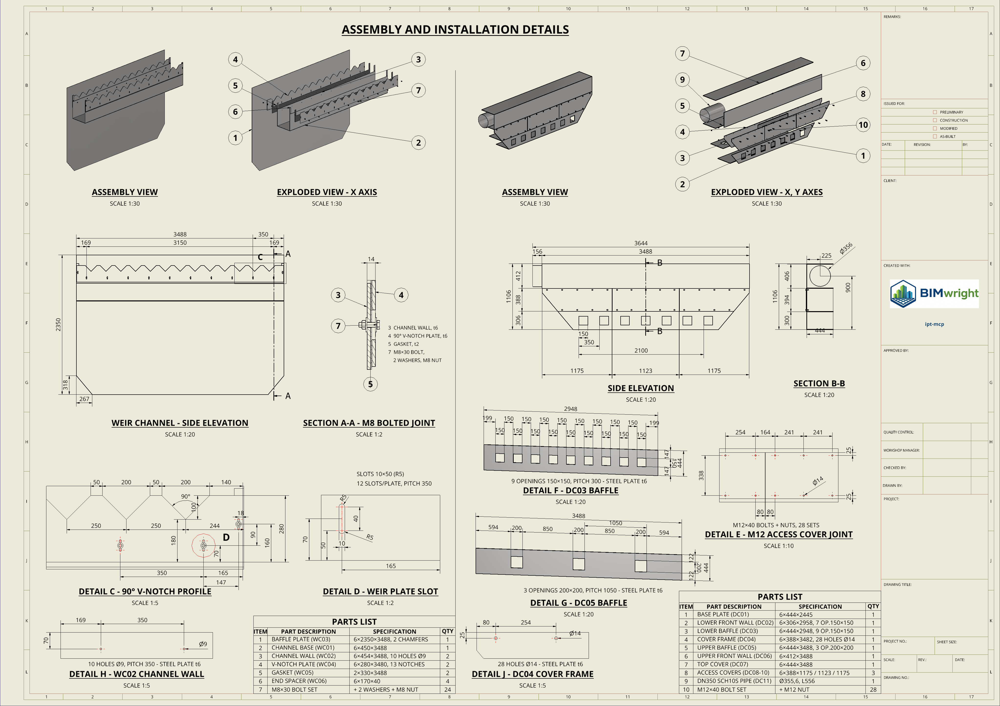

<!-- mcp-name: io.github.bimwright/ipt-mcp -->

<h1 align="center">ipt-mcp</h1>

<p align="center">
  <a href="https://github.com/bimwright/ipt-mcp/actions/workflows/build.yml"></a>
  <a href="LICENSE"></a>
  <a href="#phiên-bản-inventor-được-hỗ-trợ"></a>
  <a href="#bề-mặt-công-cụ"></a>
</p>

<p align="center">
  <a href="README.md">English</a> · Tiếng Việt · <a href="README.zh-CN.md">简体中文</a> · <a href="README.ja.md">日本語</a>
</p>

---

`ipt-mcp` là một cổng [Model Context Protocol](https://modelcontextprotocol.io) mã nguồn mở ([Apache-2.0](LICENSE)) cho phép Claude Code — và mọi client hỗ trợ MCP — điều khiển **Autodesk Inventor 2022-2027** ngay tại máy local.

Agent nói chuyện bằng MCP qua stdio. Server nói chuyện bằng NDJSON qua một kênh truyền local có xác thực (TCP hoặc Named Pipe) tới add-in Inventor chạy trong tiến trình theo từng phiên bản. Add-in đẩy mọi lệnh lên luồng STA của Inventor và làm việc với Inventor API.

Model của bạn vẫn nằm trên máy bạn.

---

## Ví dụ thực tế: bản vẽ native Inventor

Sheet chi tiết lắp ráp và lắp đặt cơ khí này được dựng và hoàn thiện trong **Autodesk Inventor 2027 bằng workflow agent điều khiển qua ipt-mcp**—không phải ảnh dựng minh họa. Workflow dùng các tool drawing native và `inventor_send_code`, có người hướng dẫn, kiểm tra và chỉnh sửa.

[](.github/assets/showcase/inventor-assembly-drawing.png)

*Bấm ảnh để xem sheet độ phân giải đầy đủ (4096 × 2893).*

- **15 hình:** hình lắp, phối cảnh nổ, mặt cắt và chi tiết phóng to.
- **111 kích thước native và 21 tag chi tiết**, cùng hai bảng kê.
- **Chú thích tiếng Anh và khung tên tùy chỉnh**, logo BIMwright nhúng trong bản vẽ, thông tin dự án để trống.
- **Hoàn thiện qua MCP:** đồng bộ style kích thước, căn chỉnh annotation và xuất sheet thành PNG.

Đây là bản trình bày đã được người dùng kiểm tra, **không phải hồ sơ phát hành chế tạo hay kết quả tự động chỉ bằng một prompt**. Repo chỉ chứa ảnh trình bày, không phân phối model dự án.

---

## ipt-mcp là gì

Hai tiến trình, một kênh local:

- **`Bimwright.Ipt.Server.exe`** — MCP stdio server .NET 10, được Claude Code, Cursor, Cline, Codex hoặc MCP client stdio khác launch. Nó **không tham chiếu Inventor** và có thể build/test trên Windows khi chưa cài Inventor. Runtime của gateway cần Windows cho user identity và vòng đời setup; "server-only" nghĩa là không phụ thuộc Inventor SDK, không có nghĩa là runtime chạy được đa nền tảng.
- **`Bimwright.Ipt.Plugin.InvNN.dll`** — add-in `ApplicationAddInServer` load bên trong `Inventor.exe`, chạy listener TCP hoặc Named Pipe, và thực thi lệnh trên luồng UI (STA) chính của Inventor. Mỗi năm Inventor có một shell mỏng riêng, tất cả compile từ cùng source glob `src/shared/**`.

Khác với Revit, Inventor **không có** thứ tương đương `ExternalEvent`. Add-in đẩy công việc lên luồng STA thông qua một WinForms control message-only ẩn (`InventorStaDispatcher`). Xem [ARCHITECTURE.md](ARCHITECTURE.md) để biết thiết kế đầy đủ.

---

## Phiên bản Inventor được hỗ trợ

| Inventor | Target framework | Kênh truyền | Ghi chú |
|----------|------------------|-------------|---------|
| 2022 | `net48` (.NET Framework 4.8) | TCP | tham chiếu `System.Windows.Forms` trực tiếp |
| 2023 | `net48` (.NET Framework 4.8) | TCP | |
| 2024 | `net48` (.NET Framework 4.8) | TCP | |
| 2025 | `net8.0-windows7.0` | Named Pipe | `UseWindowsForms`, `EnableDynamicLoading` |
| 2026 | `net8.0-windows7.0` | Named Pipe | |
| 2027 | `net10.0-windows7.0` | Named Pipe | cần .NET 10 SDK; tôn trọng `UseInventorAssemblyContext` |

- MCP server là một tiến trình, **không phụ thuộc phiên bản Inventor** — nó chỉ forward các JSON envelope.
- TCP cho 2022-2024 (add-in net48); Named Pipe cho 2025-2027 — Named Pipe tránh prompt loopback-firewall trên Windows hiện đại.
- Inventor chuyển add-in desktop khỏi .NET Framework từ 2025: **.NET 8 cho 2025/2026, .NET 10 cho 2027**. (Add-in .NET 8 vẫn binary-compatible trên 2027, nhưng net10 là target native.)
- Dùng **năm dương lịch 4 chữ số** (2022..2027) ở mọi nơi — không dùng version code cũ.

> **Trạng thái: phạm vi hỗ trợ của Phase 1 và Phase 2 đã được chấp nhận.** Phase 3 thêm bốn tool, đã kiểm chứng bằng build, test tự động và fixture dùng một lần trên Inventor 2027 native; acceptance trên client đã cài và acceptance release vẫn là việc riêng. Xem [hành vi Phase 3](docs/testing/drawing-phase3.md).

Guard cuối cùng cho kết quả MCP cảnh báo ở 64/256 KiB và dùng budget UTF-8 1 MiB. Read quá lớn sẽ yêu cầu thu hẹp; write đã chạy xong giữ lại effect rút gọn và không được chạy lại. `--disable-output-guard` vẫn giữ giới hạn transport. Ngưỡng CLI/JSON/biến môi trường và chính sách spill 36 giờ (cấu hình được) được mô tả trong [tài liệu kiểm thử drawing](docs/testing/drawing-phase1.md).

---

## Cài đặt / Wire MCP client

Tải ZIP cài đặt client từ [GitHub Releases](https://github.com/bimwright/ipt-mcp/releases/latest). ZIP gồm MCP server self-contained và các năm add-in Inventor được compile với interop **thật** (xem `manifest.json`). ZIP v0.1.0 có **2025** và **2027**. Các năm khác: tự build local — không phát hành DLL chỉ có hình dạng build bằng `SkipInventorReferenceCheck`.

```powershell
$tag = (Invoke-RestMethod https://api.github.com/repos/bimwright/ipt-mcp/releases/latest).tag_name
$zip = "$env:TEMP\IptMcp.Setup-$tag-win-x64.zip"
$dir = "$env:TEMP\IptMcp.Setup-$tag-win-x64"
Invoke-WebRequest "https://github.com/bimwright/ipt-mcp/releases/download/$tag/IptMcp.Setup-$tag-win-x64.zip" -OutFile $zip
Expand-Archive $zip -DestinationPath $dir -Force

powershell -ExecutionPolicy Bypass -File "$dir\install.ps1" -WhatIf
powershell -ExecutionPolicy Bypass -File "$dir\install.ps1"
```

Installer deploy `%APPDATA%\Autodesk\ApplicationPlugins\Bimwright.Ipt.bundle\` và `ipt-mcp.exe` tới đường dẫn cố định `%LOCALAPPDATA%\Bimwright\ipt-mcp\server\current\ipt-mcp.exe`. Installer rollback khi lỗi, đối chiếu bundle đã cài với package, smoke-check server bằng `--help`, và không bao giờ sửa config của MCP client — bạn tự trỏ client vào đường dẫn `ipt-mcp.exe` cố định đó (xem `AGENTS.md` trong ZIP để agent tự wire). Khi update, đường dẫn giữ nguyên nên client chỉ cần restart; `-PruneOldServers` gỡ các bản `server\<version>\` cũ sau khi client đã trỏ lại. `uninstall.ps1` dọn toàn bộ (giữ dữ liệu cá nhân trừ khi có `-Purge`; `install.ps1 -Uninstall` chỉ gỡ bundle). Cố định một năm bằng `--target 2025` hoặc `BIMWRIGHT_INVENTOR_TARGET=2025`.

**Không** dùng `dotnet tool install -g Bimwright.Ipt.Server` — đó không phải cách cài client được hỗ trợ.

**Developer:** chạy `pwsh scripts/package-bundle.ps1` trên máy có interop Inventor (bỏ qua các năm không có SDK). Đóng Inventor trước khi rebuild.

Add-in được phát hiện tự động: mỗi add-in đang chạy ghi `%LOCALAPPDATA%\Bimwright\ipt-mcp\inventor-<year>-<pid>.json`. Gateway chỉ tự bind khi có đúng một Inventor đang sống. Khi mở nhiều Inventor, call trả `AMBIGUOUS_TARGET` cho tới khi bạn chọn một: gọi `inventor_list_available_targets`, rồi `inventor_switch_target` với `pid:<n>` hoặc `id:<target_id>`. Session đã chọn không bao giờ bị đổi sang session khác: nếu nó thoát, call trả `TARGET_LOST` cho tới khi bạn chủ động switch bằng `pid:<n>` hoặc `id:<target_id>`. Rời một session đang chạy mà gateway này đã chọn cần `rebind=true` (nếu không sẽ trả `TARGET_REBIND_REQUIRED`), và `auto` hoặc một năm không bao giờ chuyển selection. Selector sai định dạng trả `INVALID_TARGET_SELECTOR`. `inventor_get_current_target` và `inventor_list_available_targets` không bao giờ chọn session. Dưới `--read-only` không có `inventor_switch_target`: truyền `--target pid:<n>` lúc khởi động, hoặc chỉ mở một Inventor. Tiêu đề mỗi thẻ toast hiển thị gateway, năm Inventor và agent đang hoạt động (`ipt-mcp 2027 · Claude`), và rê chuột lên thẻ sẽ hiện `PID <n>` để bạn đối chiếu với session agent đã chọn.

Write chỉ chạy trên document đã xác nhận. Kiểm tra document đang active với người dùng, rồi gọi `inventor_switch_target` với `pid:<n>` và `verify=true` một lần mỗi session; trước đó write trả `TARGET_UNCONFIRMED` và không được gửi. Nếu document khác trở thành active, write trả `DOCUMENT_CHANGED` (hoặc `DOCUMENT_UNCONFIRMED`) từ add-in và không được bắt đầu; hãy xác nhận lại, hoặc truyền `document` (full path hoặc tên) để chỉ định document đích, khi đó không phụ thuộc document active. Khi document đã xác nhận bị đóng, mở hoặc tạo document khác sẽ chuyển xác nhận sang document đó. Mở hoặc tạo document bằng `inventor_open_document(s)`, `inventor_new_part`, `inventor_new_assembly`, `inventor_new_drawing`, `inventor_new_sheet_fabrication_part` hoặc `inventor_create_part` sẽ chuyển xác nhận sang document mà lệnh đó activate. Server và add-in đều phải hỗ trợ `document_target_v1`: với add-in hoặc server cũ hơn, write trả `PAIRING_REQUIRED` còn read vẫn chạy, vì vậy hãy update cả hai từ cùng một release.

`inventor_send_code` mặc định bật. `--disable-send-code` ẩn nhóm code; `BIMWRIGHT_INVENTOR_PLUGIN_DISABLE_SEND_CODE=1` chặn thực thi ở host. Chế độ read-only luôn loại bỏ thực thi code. Truyền `usage_context="project"` cho công việc dự án thật hoặc `"test"` khi đang test chính ipt-mcp (mặc định `"unknown"`); giá trị này được ghi vào call journal và không thay đổi cách script chạy.

---

## Build & phát triển

Binaries của Autodesk Inventor và Inventor SDK **không được phân phối lại** trong repo này (xem [Không phân phối lại](#không-phân-phối-lại)). Build và chạy **server và tests** cần Windows và .NET 10 SDK, không cần cài Inventor; build **add-in theo từng phiên bản** cần SDK tương ứng cùng với interop reference assembly của Inventor.

```powershell
# Server + tests on Windows (server-only; .NET 10 SDK, no Inventor installation required):
dotnet build src/server -c Debug
dotnet test  tests/Bimwright.Ipt.Tests -c Debug

# Legacy TFM compatibility check using the installed 2027 interop reference:
dotnet build src/plugin-inv24 -c Debug /p:InventorInteropDir="C:\Program Files\Common Files\Autodesk Shared\Extensions 2027\Framework\Interop"
dotnet build src/plugin-inv27 -c Debug   # real 2027 interop compile; needs the .NET 10 SDK

# A per-version add-in always needs an Inventor interop reference. For a legacy TFM compatibility
# check, point InventorInteropDir at an installed compatible interop; real release builds use the
# matching year's default path.
```

- **Server** explicit-include chỉ `shared/Contracts/*` + `shared/Security/*` (+ ToolBaker), nên compile được khi không có Inventor SDK.
- Mỗi **add-in** dùng `<Compile Include="..\shared\**\*.cs" />` để kéo mọi thứ, kể cả `Infrastructure`/`Plugin`/`Handlers` chạm vào API.
- Đường dẫn interop mặc định là `C:\Program Files\Common Files\Autodesk Shared\Extensions <year>\Framework\Interop\Autodesk.Inventor.Interop.dll`.
- Build add-in 2027 cần cài **.NET 10 SDK**.
- **Đóng Inventor trước khi deploy add-in DLL** vì Inventor sẽ lock DLL đã load.

---

## Bề mặt công cụ

Bản 2.5.1 có **150 công cụ** theo mặc định (`--toolsets all`); `--disable-send-code` còn **144 công cụ**, và `--read-only` còn **39 công cụ**. Tên MCP đều bắt đầu bằng `inventor_`. Bộ lọc toolset thu hẹp bề mặt này. Các bản ghi benchmark v0.2.1 đã công bố bên dưới giữ nguyên phạm vi gốc 111 tool.

Mặc định bật cả 19 toolset, gồm `code`. Dùng `--toolsets <csv>` để thu hẹp.

Mọi input độ dài tính bằng **mm**, góc tính bằng **độ**; add-in tự chuyển sang centimét/radian nội bộ của Inventor.

**Chọn document đích.** Các tool cấp document (`get_document_info`, `list_bodies`, `list_features`, các tool iProperty, parameter, material và mass, `save_document`, `close_document`, và các tool assembly) nhận `document` tuỳ chọn: full path hoặc tên của document Inventor đang giữ trong bộ nhớ — một cửa sổ đang mở *hoặc* một part được load làm tham chiếu của assembly. Khớp theo path, display name, file name, rồi tới substring duy nhất; không bao giờ tự mở hoặc activate, và tên mơ hồ hoặc không tồn tại sẽ trả danh sách ứng viên. Bỏ trống để thao tác trên document đang active.

**Occurrence selector.** Các tool assembly theo lô chọn occurrence bằng một selector chung: `{names?: [glob], regex?, file?: glob, path_contains?, leaf?: false, max_depth?, include_suppressed?: false, limit?}` (hoặc chỉ một tên / mảng tên). Glob dùng `*`/`?`; glob tên có chứa `/` sẽ khớp với path của occurrence (`SUB:1/PART:2`). Không khớp hoặc khớp nhiều hơn `limit` là lỗi, kèm danh sách tên gần nhất — kết quả không bao giờ bị cắt bớt âm thầm.

**Dialog.** Save, open, close, export, các tool document theo lô và các tool drawing đặt title block (`new_drawing`, `add_sheet`, `set_title_block`) chạy dưới `Application.SilentOperation` theo mặc định (`silent=true`), nên Inventor tự trả lời prompt bằng giá trị mặc định thay vì mở modal dialog ẩn làm treo call. Template có title block chứa prompted entry không còn làm `new_drawing` dừng ở dialog "Prompted Texts"; điền các entry đó bằng `inventor_set_title_block`. Inventor không có event để trả lời một dialog cụ thể bằng nút được chọn (như `DialogBoxShowing` của Revit), nên không có rule trả lời theo từng dialog.

**Host bận.** Khi Inventor đang mở modal dialog, mọi lệnh trừ health trả `HOST_BUSY` ngay thay vì xếp hàng sau dialog. `HOST_BUSY` cũng được trả khi hàng đợi lệnh đầy hoặc khi công việc trước đó giữ Inventor bận tới hết deadline. Trong mọi trường hợp này lệnh chưa bắt đầu và sẽ không chạy sau đó, nên có thể gửi lại an toàn khi Inventor rảnh. `TIMEOUT` giờ có nghĩa là lệnh đã bắt đầu nhưng không xong kịp: kết quả không xác định, nên hãy kiểm tra document trước khi thử lại một write. `inventor_health` báo `host_busy`, `busy_reason` (`modal_dialog` hoặc `sta_busy`) và `modal_dialog {open, title}`, được probe mà không chạm vào luồng chính của Inventor. Add-in phục vụ tối đa bốn kết nối cùng lúc, nên health và call tiếp theo vẫn kết nối được khi một call dài đang chạy. Khi add-in không nhận kết nối kịp (ví dụ add-in cũ chỉ phục vụ một call mỗi lần), call trả `TARGET_BUSY`; khi pipe của nó không tồn tại, call trả `TARGET_UNAVAILABLE`. Cả hai đều cho biết chưa có gì được gửi, nên lệnh chưa chạy.


### drawing_query (2) / drawing (20) — Inventor 2027

Kết quả fixture Inventor 2027 trước đây: [hành vi tool Phase 3](docs/testing/drawing-phase3.md). Các bản ghi này có trước các thay đổi runtime của v0.2.1; acceptance live cần được làm lại.

`inventor_get_drawing_info` và `inventor_find_view_geometry` là read-only. Các tool drawing write:
`inventor_new_drawing`, `inventor_add_sheet`, `inventor_set_title_block`,
`inventor_add_drawing_view`, `inventor_add_section_view`, `inventor_edit_drawing_view`,
`inventor_add_drawing_dimension`, `inventor_add_balloon`, `inventor_export_drawing`,
`inventor_capture_sheet`, `inventor_add_drawing_note`, `inventor_add_drawing_table`,
`inventor_add_drawing_symbol`, `inventor_edit_drawing_annotation`, `inventor_delete_drawing_items`,
`inventor_edit_drawing_table`, `inventor_set_drawing_styles`, `inventor_edit_sheet`, `inventor_sketch_on_view`, `inventor_hide_view_edges`. Capture ghi file PNG và bị loại khỏi read-only.

[Kiểm tra drawing và giới hạn hiện tại](docs/testing/drawing-phase1.md) ·
[Annotation, bảng và sheet trong drawing](docs/testing/drawing-phase2.md) ·
[Bản ghi smoke live chung](docs/benchmarks/drawing-phase1-smoke.json) ·
[Danh mục read-only đã khai báo](docs/testing/readonly-tools.json).

### Sheet Fabrication trong development checkout

Chọn `sheet_fabrication` để tạo/sửa và `sheet_fabrication_query` để kiểm tra read-only:

```bash
bimwright-ipt --toolsets sheet_fabrication,sheet_fabrication_query
```

| Tool | Mục đích |
|---|---|
| `inventor_new_sheet_fabrication_part` | Tạo part từ một template sheet của Inventor. |
| `inventor_sheet_fabrication_info` | Kiểm tra thickness, style và trạng thái flat pattern. |
| `inventor_set_sheet_fabrication_thickness` | Ghi đè thickness của part bằng một giá trị hoặc biểu thức parameter. |
| `inventor_sheet_fabrication_face` | Tạo tấm nền từ một sketch profile kín. |
| `inventor_sheet_fabrication_flange` | Thêm flange vào các boundary edge được chọn. |
| `inventor_sheet_fabrication_cut` | Cắt một sketch profile xuyên qua tấm. |
| `inventor_flat_pattern` | Tạo hoặc kiểm tra flat pattern. |
| `inventor_unwrap_try` | Thử unwrap các face được chọn; cũng dùng được cho part thường. |

`--read-only` giữ tool kiểm tra và loại các tool tạo/sửa. Các field response là `is_sheet_fabrication` và `use_sheet_fabrication_style_thickness`. Workflow dùng tên development cũ phải cập nhật tham chiếu tool và toolset. Dùng server và add-in build từ cùng một revision. Định danh API `SheetMetal*` và tên file template của Autodesk giữ nguyên.

### iLogic rule và thực thi source

Toolset `ilogic` chạy rule internal/external có sẵn, liệt kê hoặc đọc rule, đọc diagnostics, và cung cấp tool command/undo. Bốn tool truy vấn của nó vẫn có dưới `--read-only`.

Tạo hoặc sửa source VB qua `inventor_ilogic_upsert_rule`, và thực thi `inventor_ilogic_run_snippet`, cần toolset `code` và quyền send-code. `--disable-send-code` ẩn cả hai; kill switch của add-in từ chối chúng một cách độc lập. Thực thi rule, viết source, lệnh UI và undo bị chặn bên trong `batch_execute`, vì tác động của chúng có thể vượt ra ngoài transaction document của batch.

`upsert_rule` chạy rule mới tạo một lần qua AddRule của Autodesk. Với rule có sẵn, `run=true` chạy nó một lần sau khi thay text. Trạng thái lỗi native, exception của rule và cleanup không trọn vẹn trả `ok:false` kèm diagnostics trong `data`; side effect tùy ý của rule không được rollback.

Snippet trả một chuỗi qua `iProperties.Value("Custom", "MCP_RESULT")`. Property chuỗi có sẵn được khôi phục, và kênh do lần gọi tạo ra sẽ bị xoá. Xung đột với property không phải chuỗi bị từ chối trước khi thực thi. Rule có sẵn trùng tiền tố của rule tạm được giữ nguyên. Kết quả trên 65,536 ký tự sẽ lỗi thay vì trả JSON bị cắt. Các marker log `MCP_RESULT_BEGIN/END` cũ không còn được coi là kết quả snippet.

`ilogic_read_log` giới hạn lượng đọc khi `max_chars` dương (mặc định 65,536, tối đa 1,048,576). `max_chars=0` yêu cầu rõ ràng đọc toàn bộ file. Response báo `bytes_read` và `truncated`. Argument của rule là JSON object phẳng chứa string, number, boolean hoặc null.

Tạo Sheet Fabrication cần template sheet fabrication và không chạy được trong batch. Sửa thickness thất bại sẽ khôi phục trạng thái thickness/style trước đó; độ sâu cắt across-bends theo parameter Thickness native khi tấm thay đổi. Bán kính flange ghi đè phải hữu hạn và lớn hơn 0.

### meta (3) — tool target phía server, không round-trip tới add-in; vẫn hiện dưới `--read-only`

| Tool | Mô tả |
|---|---|
| `inventor_list_available_targets` | List các target add-in Inventor đang sống được phát hiện (năm, pid, transport, document đang active); `selected` đánh dấu target của gateway. |
| `inventor_get_current_target` | Báo target đang chọn; không bao giờ tự chọn (`bound=false` kèm các ứng viên đang sống khi chưa chọn gì). |
| `inventor_switch_target` | Chọn target theo `pid:<n>`, `id:<target_id>`, `auto` hoặc năm Inventor; selector khớp nhiều session bị từ chối. Cần `rebind=true` để rời một session đang chạy mà gateway này đã chọn. `verify=true` xác nhận document active cho write. Không được đăng ký dưới `--read-only`. |

### query (12) — probe document/health/model read-only và báo cáo kết quả của agent

Bắt đầu mỗi session Inventor bằng một call `inventor_health(check_updates=true)`, sau khi chọn target cần dùng nếu cần, để agent phát hiện các release ổn định mới hơn. Nếu không có hoặc không được phép dùng mạng, dùng call mặc định offline và để update check ở trạng thái not checked/unknown. Các probe thường về sau vẫn offline. Các field host có sẵn và identity `setup_gateway`/`setup_plugin` được giữ nguyên; block `mcp` gọn thêm `server_version`, `server_informational_version`, `plugin_version`, `server_build_id`, `plugin_build_id`, `version_alignment` và `revision_alignment`. Alignment là `match`, `mismatch` hoặc `unknown`; version hoặc revision khớp không chứng minh tương thích binary hay độ tin cậy của publisher. Build id dùng metadata informational-version của assembly đã nạp, nếu không có thì dùng module id của component. Runtime identity được ghi lại lúc server khởi động hoặc add-in activate. `artifact_sha256` là quan sát trên disk tại thời điểm ghi lại đó (`artifact_hash_basis=on_disk_at_identity_capture`), không phải digest của bộ nhớ đã nạp, cũng không chứng minh file được thay sau đó đã có hiệu lực.

Call mặc định chạy local và hoạt động offline. Nếu không có host hoặc không kết nối được, identity của server vẫn được trả cùng `ok:false`, `host_connected:false` và lỗi gốc; đây không phải một lần probe host thành công. `check_updates=true` lấy một [release ổn định chính thức](https://docs.github.com/en/rest/releases/releases#get-the-latest-release) và phân giải tag của nó thành source commit. Mọi request dùng chung budget năm giây; mỗi response metadata giới hạn 256 KiB. `update.components.server` và `.plugin` mỗi cái báo `current_version`, `current_build_id`, `version_status`, `build_status` và `status`. Status của component là `update_available`, `release_match`, `release_mismatch`, `ahead_of_release`, `unknown` hoặc `not_checked`. So sánh revision dùng Git hash đầy đủ trong metadata của assembly đã nạp; các build id khác vẫn là unknown. Plugin cũ đang nạp vẫn hiện ra kể cả khi server khớp release. Phân giải tag thất bại vẫn giữ kết quả so version nhưng để build status là unknown.

`update.status=checked` nghĩa là lookup release thành công, không có nghĩa cả hai component đều mới nhất. `update_available` theo từng component chỉ so semantic version. Khi version của component bằng release, `release_mismatch` cần Git SHA đầy đủ ở cả hai phía và hai SHA khác nhau. Metadata revision như `+development`, `+build` hoặc không có revision sẽ cho component đó status `unknown`. Với một cặp ở đúng version release mà không có revision lệch đã được xác nhận, thiếu bằng chứng revision được báo là `RELEASE_IDENTITY_UNVERIFIED`. Không kết quả nào khuyến nghị tự động hạ cấp. Cờ tổng là true nếu một trong hai component có version ổn định mới hơn, false chỉ khi cả hai version/revision khớp release, và null trong các trường hợp còn lại. Revision nguồn bằng nhau không xác minh bytes của artifact release (`artifact_verification=not_performed`). Response không bao giờ tải hay cài package. Làm theo [hướng dẫn cài](AGENTS.md) cho preview, cấp quyền, rollback và kiểm tra sau restart.

Kiểm tra cả `update.components` và `update.notification`, rồi làm theo `agent_action` của nó. Các code phân biệt `NEW_RELEASE_AVAILABLE`, `RELEASE_REVIEW_REQUIRED`, `RELEASE_IDENTITY_UNVERIFIED`, `UPDATE_CHECK_UNAVAILABLE` và `LOCAL_VERSION_AHEAD` (chỉ mang tính thông tin). Lookup thất bại báo `lookup_reason` (như `http_403`, `timeout` hoặc `network_unavailable`), giữ nguyên runtime identity đã báo, không khẳng định lỗi local và không yêu cầu quyền cài. Version local cao hơn release vẫn được báo kể cả khi không có peer cũ hơn. `update_available=false` theo từng component chỉ có nghĩa là chưa xác định được semantic version cao hơn; không có nghĩa release identity đã khớp. Riêng notification null không bao giờ chứng minh đã up to date.

Notification nêu `protected_components` kèm `protected_component_reasons`; các build đã biết là ahead hoặc đã quan sát nhưng chưa phân giải được sẽ được giữ nguyên. Plugin chưa quan sát được identity được liệt kê riêng trong `unobserved_components`, với `identity_observed=false`: kiểm tra kết nối tới Inventor dự định và lấy metadata, không giả định host đã đóng hay plugin đã cài bị hỏng. `comparison_reason` phân biệt thiếu bằng chứng runtime với việc không có lookup release/bằng chứng revision. Thiếu artifact hash tự nó không quyết định việc bảo vệ; xác minh bytes của artifact release vẫn là việc riêng.

Đọc cả hai phép so sánh component, các field bảo vệ/chưa quan sát và toàn bộ message của notification trước khi tóm tắt; `components` của notification chỉ nêu nhóm bị ảnh hưởng chính, không phải mọi dữ kiện runtime. Server ahead cùng plugin chưa quan sát trả `RELEASE_IDENTITY_UNVERIFIED` cho plugin, đồng thời bảo vệ server một cách riêng. Khi version của cả hai component bằng release nhưng phân giải tag thất bại, cùng code đó đi kèm `comparison_reason=release_revision_unavailable` và một `lookup_reason` bên ngoài. Riêng điều này không đánh dấu component là được bảo vệ hay bị lỗi; cờ đề xuất false vẫn chặn việc cài. Dừng quy trình update và lấy bằng chứng release còn thiếu; ngoài ra công việc Inventor đang bình thường vẫn có thể tiếp tục.

`update_guidance.mode` là `check_only`, `retry_check`, `review`, `none` hoặc `prepare_update`. Chỉ `prepare_update`, cùng `bundle_update_proposal_allowed=true`, trả quy trình cài và `requires_user_authorization=true`; dùng lại quyền đã có khi phù hợp. Các mode khác chỉ chứa bước kiểm tra/báo cáo/review, không có install.ps1 hay lệnh installer, và không yêu cầu quyền cài. Server local mới hơn cùng plugin cũ chặn đề xuất cài cả ZIP; phân giải tag thất bại hoặc peer chưa quan sát cũng chặn đề xuất, trong khi vẫn giữ dữ kiện về version mới hơn đã biết. Health không bao giờ cài gì. Bốn annotation vẫn là read-only true, destructive false, idempotent true và open-world true.

Với update được phép, giữ nguyên đúng tag release từ đề xuất của health. Đối chiếu ZIP chính thức với asset `.zip.sha256` đi kèm trước khi giải nén, yêu cầu có `manifest.json`, và preview installer để kiểm tra checksum các file đã giải nén trước khi thay thế. Health không trả digest ZIP dự kiến và không kiểm tra package. Manifest kiểm tra từng file payload; nó không thay thế checksum của cả ZIP và không tự xác thực publisher một cách độc lập.

Sau reconnect/restart, **client** phải ghi lại một `initialize` mới và một `tools/list` mới, rồi gọi health trên chính connection đó. `serverInfo.version` gồm đầy đủ informational version. So `serverInfo.name/version` với `client_verification.expected_server_info`, và `_meta["bimwright/ipt-mcp/runtime"]` của tool health với `client_verification.expected_runtime` (version, module id, PID và thời điểm process khởi động). Cũng kiểm tra schema và annotation hiện tại, gồm boolean tuỳ chọn `check_updates` và các hint read-only/open-world. Chỉ dựa vào số lượng tool là không đủ. `client_verification.status=not_observable_by_server` nói rõ ranh giới này; khi client ẩn bằng chứng handshake/catalog, việc refresh của nó vẫn chưa được xác minh. Smoke test trực tiếp với server kiểm chứng protocol của bản ứng viên nhưng không chứng nhận được cache của client khác.

| Tool | Mô tả |
|---|---|
| `inventor_health` | Gọi với `check_updates=true` một lần lúc bắt đầu session để phát hiện release và báo người dùng khi có `update.notification`. Các probe thường mặc định offline. Báo trạng thái host và identity server/plugin đang nạp. |
| `inventor_report_task_result` | Agent chủ động báo kết quả công việc: `task_id`, `outcome` (`completed`/`failed`/`cancelled`), `summary` một dòng, `body` Markdown tuỳ chọn (tối đa 32 KiB). Hiện thẻ tóm tắt và lưu báo cáo dưới `%LOCALAPPDATA%\Bimwright\ipt-mcp\reports\` cùng các write tool đã chạy từ báo cáo trước, kể cả khi không kết nối được Inventor. Không sửa model. |
| `inventor_get_report_history` | Các báo cáo agent đã lưu, mới nhất trước: một trang tóm tắt (`offset`, `limit` 1–50), hoặc một báo cáo đầy đủ theo `report_id`. Dữ liệu local; chạy được khi không có Inventor. |
| `inventor_list_open_documents` | List document trong bộ nhớ: title, path, type, is_active, dirty, visible; tuỳ chọn `filter` / `dirty_only`. |
| `inventor_get_document_state` | Kiểm tra trước khi save hoặc kết thúc công việc: `mode` (`local_file`, `unsaved`, `template`, `read_only`), `is_modified`, `dirty_references`, `modifiable`, `is_read_only`, `exists_on_disk`, `saved_in_version`, `needs_migrating`, `file_save_counter`, `document_id`, cùng `policy {mode, rules, allowed}` của việc save và `old_versions_to_keep` của project. Document active, `document`, hoặc `scope=all`; chạy được khi không mở document nào. |
| `inventor_get_document_info` | Title, full path, type và cờ dirty của document active hoặc document được chỉ định; `references=true` thêm các file tham chiếu của nó (kèm cờ missing). |
| `inventor_list_bodies` | List các solid body của part: id (`body:N`), name, volume_mm3, bbox_mm, face_count, feature tạo ra (created_by), visible. |
| `inventor_list_features` | List các feature của part theo thứ tự tree: name, type, health, suppressed, body_names. |
| `inventor_probe_brep` | Survey B-rep của part tìm miệng port: mặt phẳng có cạnh tròn inner-loop — normal (đã hiệu chỉnh IsParamReversed), center_mm, port_diameter_mm, mọi đường tròn trên mặt. |
| `inventor_list_sketch_points` | Kiểm tra một sketch theo tên: point reference, vị trí theo mm, tâm circle/arc và đầu mút line, cùng `origin_ref`. `document` tuỳ chọn chọn một part đang mở; `max_items` mặc định 200 (1–1000). Không project geometry và không thay đổi document. |

### document (12) — vòng đời document (write)

| Tool | Mô tả |
|---|---|
| `inventor_new_part` | Tạo document part mới (.ipt); template path tùy chọn. |
| `inventor_new_assembly` | Tạo document assembly mới (.iam); template path tùy chọn. |
| `inventor_open_document` | Mở document có sẵn từ full path và đặt làm active. |
| `inventor_save_document` | Save document active (hoặc `document`) theo policy của `inventor_get_document_state`, và tool này áp dụng policy đó. Lưu tại chỗ: bị từ chối với document chưa từng lưu, template, file read-only hoặc file không còn trên disk (`data.reason`); `saved=false`, `reason=no_changes` khi không có gì thay đổi; file định dạng cũ cần `allow_format_upgrade=true` sau khi người dùng đồng ý. Với `path`: Save-As ra một file local mới cùng loại document trong thư mục có sẵn; không bao giờ ghi đè file đã tồn tại. |
| `inventor_close_document` | Đóng document active (hoặc `document`); `save=true` lưu trước theo policy của `inventor_save_document`, và nếu việc lưu bị từ chối thì document vẫn mở (`data.reason`). |
| `inventor_set_units` | Đặt đơn vị độ dài của document active (mm, cm, m, in, ft). |
| `inventor_set_material` | Gán material cho part active theo tên. |
| `inventor_save_all` | Update document gốc rồi lưu cùng mọi document tham chiếu đang dirty, chạy silent; báo từng file saved / read_only / error; có `dry_run`. Theo policy của `inventor_save_document` (cả khi `dry_run`): bị từ chối kèm `data.reason` khi document gốc chưa từng lưu, là template, read-only hoặc không còn trên disk, hoặc khi một document sẽ được lưu là template hay file định dạng cũ mà không có `allow_format_upgrade=true`. |
| `inventor_open_documents` | Mở nhiều document trong một call (mặc định không mở cửa sổ, để sửa qua tham số `document`). |
| `inventor_close_documents` | Đóng document theo path/tên, hoặc mọi document đang hiển thị (`keep_active`). `save=true` áp dụng policy của `inventor_save_document` cho từng file: file bị từ chối vẫn mở cùng các thay đổi (`status=refused`, `reason`). |
| `inventor_save_checkpoint` | Khi người dùng đồng ý, copy file local active đã xác nhận vào `<name>.checkpoints\` cạnh nó (lưu trước nếu còn thay đổi chưa lưu), kiểm tra bằng kích thước và SHA-256 rồi đưa vào index. Checkpoint của assembly và drawing chỉ chứa đúng file đó (`REFERENCES_NOT_CAPTURED`). Chỉ dùng `allow_format_upgrade=true` sau khi người dùng đồng ý chuyển đổi file định dạng cũ. |
| `inventor_manage_checkpoints` | `action=list`; `prune` (xem trước với `dry_run=true`, áp dụng với `plan_hash` đã xem trước sau khi được đồng ý; milestone được giữ lại); `restore` copy một checkpoint ra `<name>-restored-<id>.<ext>` và không bao giờ ghi đè file đang làm việc. |

### ipart (8) — iPart family Standard và catalog Excel

| Tool | Mục đích |
|---|---|
| `inventor_get_ipart_info` | Kiểm tra một part thường, factory hoặc member đang mở, các dòng bảng, liên kết Excel và trạng thái generate. Read-only. |
| `inventor_create_ipart_factory` | Copy một part thường sạch đã lưu sang đường dẫn factory mới và cấu hình các cột parameter, material, description và feature-suppression. |
| `inventor_update_ipart_table` | Xem trước/áp dụng upsert trọn dòng trước khi một catalog Excel nắm quyền sở hữu bảng. |
| `inventor_set_ipart_row` | Chọn và kiểm tra một dòng của factory mà không thay đổi occurrence trong assembly. |
| `inventor_generate_ipart_members` | Xem trước/generate các dòng được chọn, kiểm tra body và property của chúng, và dùng lại các member đã kiểm tra không thay đổi. |
| `inventor_sync_ipart_excel` | Xem trước/áp dụng một catalog `.xlsx` đã lưu vào factory theo một chiều. |
| `inventor_place_ipart_member` | Đặt một member đã generate trước đó vào assembly đang mở. |
| `inventor_change_ipart_member` | Chuyển đúng một occurrence cấp top sang một dòng đã kiểm tra khác của cùng factory. |

Bắt đầu với một part được dựng theo tham số. Cấu hình cột như `{name:"Length",kind:"parameter",target:"Length"}` và `{name:"Hole",kind:"suppression",target:"MountHole"}`. Factory tự thêm Member và Part Number. Input dòng là `{member:"BUSH-020",part_number:"BUSH-020",values:{Length:40,Hole:false}}`, phải có đủ mọi cột đã cấu hình. Parameter số dùng đơn vị của parameter gốc; chuỗi nhận biểu thức Inventor. Suppression boolean nghĩa là `true = suppress`, `false = compute`. Material phải có sẵn trong document factory.

Với Excel, dùng một dòng header gồm `member`, `part_number` và tên các cột đã cấu hình, tiếp theo là các dòng đầy đủ liền nhau. Ô thuộc cột đã cấu hình không được để trống, kể cả Description nếu cột tuỳ chọn này được cấu hình; không hỗ trợ xoá ô property native. Cung cấp `path`, `sheet` và `header_cell` ở lần sync đầu; `mapping` tuỳ chọn ánh xạ các tên này sang header Excel khác. Các lần gọi sau có thể dùng lại liên kết. Update bảng, sync Excel và generate mặc định `dry_run=true`; muốn áp dụng phải đặt `dry_run=false`. Lưu/tính lại workbook trước khi sync: các tool này đọc giá trị đã lưu, gồm kết quả công thức đã cache, và không bao giờ ghi ngược vào Excel. Sau khi liên kết, sửa dòng trong Excel rồi sync thay vì ghi bảng qua JSON. Đổi thứ tự dòng Excel vẫn giữ identity của member; member có sẵn bị bỏ khỏi catalog sẽ bị từ chối thay vì bị xoá.

Workflow là **sửa Excel → sync bảng → generate các member được chọn → đặt hoặc chuyển occurrence**. Sync rebuild và kiểm tra các dòng factory đã thay đổi; nó không generate file và không tự refresh assembly. File `.ipt` native của member vẫn cần cho tham chiếu assembly. Quản lý factory, file checkpoint `.ipart-mcp.json` cạnh nó, workbook và thư mục member đã generate cùng nhau.

Các write tool hiện hỗ trợ factory Standard iPart được quản lý, tạo bởi `inventor_create_ipart_factory`. Nguồn phải là part solid thường, sạch, đã lưu, có parameter độc lập; iPart custom, sheet metal, liên kết parameter Excel native, nhận quản lý factory có sẵn và iAssembly nằm ngoài phạm vi này. Đường dẫn output phải là đường dẫn `.ipt` mới trên ổ local; cache dùng chung/proxy bị từ chối. Giới hạn catalog là 16 MiB, 1,000 dòng và 48 cột đã cấu hình; generate nhận 1–50 member theo tên mỗi lần gọi. Không chấp nhận macro hay liên kết workbook ngoài.

Các thao tác factory tự lưu bản copy được quản lý và checkpoint của nó. Các thao tác assembly để việc lưu cho người dùng. Mọi write từ chối `batch_execute`, transaction lồng nhau, factory đang dirty và thao tác xung đột. Thao tác nhiều file thất bại có thể để lại file trên disk: kiểm tra `file_effects` và thao tác đang dở, khôi phục factory sạch nếu cần, rồi tiếp tục đúng thao tác đó. Abort transaction không có nghĩa là file được rollback. Generate member so sánh body native và đọc lại property trước khi đánh dấu một file là hiện hành.

### parameters (7) — model, user & Excel parameters

| Tool | Mô tả |
|---|---|
| `inventor_list_parameters` | List parameter (model + user): name, expression, value, unit, kind. |
| `inventor_get_parameter` | Lấy một parameter theo tên: expression, value, unit. |
| `inventor_set_parameter` | Set expression/value của parameter có sẵn, rồi update document. |
| `inventor_create_parameter` | Tạo user parameter mới (name, expression, unit). |
| `inventor_list_excel_tables` | List các bảng spreadsheet native, ID ổn định của bảng liên kết, giá trị parameter và health. |
| `inventor_link_excel_table` | Liên kết một khối parameter trong file `.xlsx` local và kiểm tra đọc lại native sau khi recompute. |
| `inventor_reload_excel_table` | Reload bảng liên kết theo ID, kiểm tra giá trị đã lưu và health của geometry, và báo thay đổi kể từ lần link/reload đã kiểm tra gần nhất. |

Khối Excel dùng **worksheet đầu tiên**, với các cột dọc `name`, `value`, `units`, và `comment` tuỳ chọn. `start_cell` trỏ tới dòng parameter đầu tiên, không phải header. Tên phải là định danh ASCII duy nhất; giá trị phải là số hữu hạn đã lưu hoặc kết quả công thức; chỉ định `mm`, `deg`, `ul` (không đơn vị), hoặc đơn vị Inventor khác. Tính lại và lưu workbook trước khi link/reload. Các tool không tính công thức Excel, không sửa workbook và không lưu part. Giới hạn: `.xlsx` trên ổ local, 16 MiB, 1,000 dòng liền nhau; không macro, liên kết workbook ngoài, đường dẫn UNC, hoặc thay đổi tập parameter khi reload.

Ví dụ, link bằng `inventor_link_excel_table(path="C:/parts/flange.xlsx", start_cell="A6", document="flange.ipt")`, rồi dùng lại `table_id` của nó với `inventor_reload_excel_table`. Kích thước sketch, thickness và số lượng pattern phải tham chiếu tên parameter đã liên kết thì geometry mới thay đổi. Liên kết native đã có sẵn trong part sẽ lập baseline thay đổi ở lần reload thành công đầu tiên; call đó báo `changed_parameters=null` thay vì bịa ra giá trị trước đó.

Write Excel chạy ngoài `batch_execute` và tự sở hữu transaction document. Inventor có thể giữ lại parameter spreadsheet đã refresh sau khi abort một lần update geometry thất bại. Vì vậy reload so trạng thái sau lỗi với checkpoint đã kiểm tra được lưu lại, và báo `rollback_failed` / `recovery_required` khi không thể kiểm tra việc khôi phục. Khi đó hãy khôi phục giá trị Excel đã kiểm tra gần nhất, reload thành công, và kiểm tra part trước khi lưu. Riêng `transaction_aborted` không chứng minh giá trị liên kết đã được khôi phục.

### properties (4) — iProperties & mass properties (write)

| Tool | Mô tả |
|---|---|
| `inventor_get_iproperty` | Lấy giá trị iProperty theo property-set và tên property. |
| `inventor_set_iproperty` | Set giá trị iProperty. |
| `inventor_get_mass_properties` | Khối lượng (g), thể tích (mm³), diện tích bề mặt (mm²), trọng tâm, bounding box. |
| `inventor_list_iproperty_sets` | Liệt kê các iProperty set (name, internal_name, tên property; tùy chọn value) — để khám phá cho get/set_iproperty. |

### sketch (11) — geometry & constraint sketch 2D (write)

| Tool | Mô tả |
|---|---|
| `inventor_create_sketch` | Tạo sketch 2D trên một mặt phẳng (XY/XZ/YZ hoặc tham chiếu face/work-plane). |
| `inventor_project_geometry` | Project edge/vertex model (theo edge id) vào sketch active. |
| `inventor_draw_line` | Vẽ line sketch từ (x1,y1) tới (x2,y2). |
| `inventor_draw_circle` | Vẽ circle sketch từ tâm + bán kính. |
| `inventor_draw_rectangle` | Vẽ rectangle sketch hai điểm. |
| `inventor_draw_arc` | Vẽ arc sketch (tâm, bán kính, góc bắt đầu/kết thúc). |
| `inventor_add_sketch_dimension` | Thêm dimension constraint điều khiển một sketch entity. |
| `inventor_add_sketch_point_dimension` | Điều khiển khoảng cách ngang, dọc hoặc aligned giữa hai point reference, dùng số dương theo mm hoặc biểu thức parameter. `document` tuỳ chọn chỉ định một part đang mở. |
| `inventor_add_sketch_constraint` | Thêm geometric constraint (coincident, parallel, tangent, …). |
| `inventor_draw_text` | Thêm text box fitted (position mm, tùy chọn font_size_mm; rotation_deg theo bội số 90). |
| `inventor_close_sketch` | Kết thúc chỉnh sketch (thoát chế độ edit sketch). |

Để định vị một lỗ, gọi `inventor_list_sketch_points` với tên sketch của nó, chọn point có role
`circle_center`, rồi thêm hai point dimension từ `origin_ref` tới `point_ref` đó:
`orientation="horizontal", value="HoleX"` và `orientation="vertical", value="HoleY"`.
Đổi các parameter có sẵn này sẽ di chuyển tâm lỗ. Biểu thức có thể tham chiếu parameter Excel
đã liên kết. `text_position=[x,y]` tuỳ chọn điều khiển vị trí annotation theo mm trong sketch.
Cả hai point phải thuộc cùng một sketch. Reference dùng native object key và từ chối object đã xoá
hoặc thuộc file khác; truy vấn lại sau Save As. Khoảng cách phải dương; offset bằng 0 cần
geometric constraint. Việc tạo dimension kiểm tra recompute và khoảng cách thực tế giữa các point,
rollback khi lỗi, và để việc lưu cho bên gọi.
Khi cần, dimension từ gốc sẽ project gốc của sketch hoặc tạo một point gốc local cố định;
helper này cũng bị gỡ nếu thao tác rollback. Bên trong batch hoặc một transaction khác đang mở,
dimension phải nhắm vào document của transaction đó.

### feature (17) — solid & work feature (write)

| Tool | Mô tả |
|---|---|
| `inventor_create_part` | Dựng cả part từ recipe JSON trong một call: sketch (rect / circle / polyline có cung bulge, vòng rỗng, trên plane gốc hoặc plane cố định) → extrude / hole / fillet / chamfer → material + iProperty → Save-As silent. Lỗi nêu đúng đường dẫn trong recipe (`features[2].extrude.distance`); build lỗi thì part bị đóng không lưu; `dry_run` chỉ kiểm tra. |
| `inventor_build_solids` | Dựng nhiều khối trong một part có sẵn từ dữ liệu, trong một call: item `{name, op: new/join/cut, target?}` với một hình (join/cut không bắt buộc `name`; `defaults` điền sẵn giá trị lặp lại) — `box` (min/max), `tube` (a, b, od, wall?), `prism` (axis, from, to, profile) hoặc `extrude` (pose mặt phẳng, depth, profile). Mọi item được kiểm tra trước và trả về tất cả lỗi một lần; mỗi item được kiểm lại sau khi dựng (feature khỏe, đúng một body mới, cut phải bớt và join phải thêm thể tích). Item lỗi bị gỡ, item đã dựng được giữ và `next_index` cho biết chỗ chạy tiếp. `dry_run` kiểm tra với part. Một bước undo. |
| `inventor_extrude` | Extrude một sketch theo tên (distance, join/cut/intersect, direction). |
| `inventor_revolve` | Revolve một sketch quanh trục (góc, operation). |
| `inventor_combine` | Boolean các solid body (base + tool bodies, join/cut/intersect, keep_tool_bodies). |
| `inventor_batch_execute` | Chạy tới 20 wire command trong một transaction (một undo, rollback khi lỗi). |
| `inventor_fillet` | Thêm fillet cạnh bán kính cố định — `edgeIds` hoặc selector `edges` `{kind:circular, radius_mm?, center_mm?, on_body?, adjacent_surface_types?}`; trả `matched_edges`. |
| `inventor_chamfer` | Thêm chamfer cạnh khoảng cách đều trên các edge model. |
| `inventor_create_work_plane` | Tạo work plane (offset, three_points, tangent hoặc fixed origin+axes). |
| `inventor_create_work_axis` | Tạo work axis (two_points, edge, plane_intersection, normal_to_face_through_point). |
| `inventor_create_work_point` | Tạo work point cố định tại {x,y,z}/[x,y,z] mm; construction point không đặt tên được (name_applied báo lại). |
| `inventor_hole` | Lỗ drilled/counterbore/countersink trên một planar face được chọn xác định; tùy chọn metadata tapped-thread. |
| `inventor_circular_pattern` | Circular-pattern các part feature quanh một trục theo tên (count trên một góc). |
| `inventor_rectangular_pattern` | Rectangular-pattern các part feature dọc theo một hoặc hai trục theo tên. |
| `inventor_loft` | Loft một danh sách sketch profile có thứ tự ('SketchName' hoặc 'SketchName:N'), tùy chọn sketch centerline, closed/merge-tangent-faces. |
| `inventor_sweep` | Sweep một sketch profile dọc theo một sketch path (các đoạn liền kề tự nối chuỗi); orientation normal_to_path\|parallel. |
| `inventor_create_bim_connector` | Author một BIM pipe connector trên một circular port edge (ref từ `circles[].edge` của inventor_probe_brep); kind=pipe, tùy chọn metadata system/flow/connection. |

### export (11) — capture view & export geometry (write)

> `output_path` phải nằm dưới root được phép: user profile, `%TEMP%`, hoặc root bạn thêm — ví dụ đặt `BIMWRIGHT_INVENTOR_EXPORT_ROOT=D:\Inventor-Exports` trên máy chạy Inventor (rồi khởi động lại Inventor và cả MCP client/server session).

| Tool | Mô tả |
|---|---|
| `inventor_capture_view` | Capture view active ra file PNG (dưới `<export-root>\captures\` hoặc `output_path`); `inline=true` trả PNG base64 có giới hạn thay vì file. Có thể dựng view trong cùng call (design view, visibility của object/occurrence, orientation hoặc camera, fit) và chụp nhiều `shots` một lần. Ảnh do tool tự đặt tên được giữ 30 ngày, quá 200 MB thì xoá ảnh cũ nhất trước; file bạn tự đặt tên không bao giờ bị xoá. |
| `inventor_set_view_state` | Kích hoạt hoặc tạo design view, bật tắt object visibility (work feature, sketch, …) và ẩn/hiện occurrence theo selector. |
| `inventor_export_step` | Export part/assembly active sang STEP (.stp/.step). |
| `inventor_export_stl` | Export part/assembly active sang STL (.stl). |
| `inventor_export_sat` | Export part/assembly active sang ACIS SAT (.sat) — định dạng interop cho Revit; acis_version mặc định 7 (giá trị duy nhất được hỗ trợ). |
| `inventor_export_bodies_sat` | Export từng solid body ra một file SAT riêng, cho nhiều part đang mở trong một lần gọi (`items=[{document, bodies?, key?}]`, `out_dir`); kiểm tra trước đường dẫn và file đã tồn tại, `verify=true` đọc lại từng file (thể tích/bbox/số mặt) và báo lỗi theo từng body. |
| `inventor_export_dxf` | Export DXF 2D; phải khai báo source (`sketch` hoặc `flat_pattern`). |
| `inventor_derive_envelope` | Tạo derived part từ part/assembly nguồn — đường envelope/interop: `derive_style`, chọn từng solid với `include_bodies`, chế độ gọn `bounding_box`; lưu .ipt dưới root được phép. |
| `inventor_view_fit` | Zoom-fit view active vào model extents (chạy trước khi capture). |
| `inventor_set_view_orientation` | Đặt một camera orientation chuẩn (iso/front/top/…) cho multi-angle capture. |
| `inventor_set_camera` | Đặt camera tường minh (eye/target mm, up, perspective, extents_mm, fit) — dùng trước capture_view khi orientation chuẩn không khớp. |

> Đường dẫn export phải là absolute và nằm dưới một output root được phép (user profile hoặc temp).

### assembly (9, write) — dựng và sửa assembly

| Tool | Mô tả |
|---|---|
| `inventor_create_design_view` | Copy một design view của assembly; đặt chính xác visibility/appearance của occurrence, tuỳ chọn activate. Đã kiểm chứng trên fixture dùng một lần của Inventor 2027. |
| `inventor_place_occurrence` | Đặt một component (.ipt/.iam) vào assembly active; tùy chọn pose ban đầu + grounded. |
| `inventor_add_constraint` | Constrain hai ref theo tên (mate/flush/insert/angle); response mang `health` — luôn kiểm tra. |
| `inventor_create_imate` | Author một iMate theo tên trên part active dùng một face selector xác định. |
| `inventor_place_occurrences` | Đặt nhiều component trong một bước undo; pose = origin+rotation, trục hoặc ma trận 4×4; `lock` = none / grounded / workplanes (3 fixed work plane ẩn flush với origin plane của part). |
| `inventor_delete_occurrences` | Xoá các occurrence cấp top khớp selector (kèm lock plane); có `dry_run`. |
| `inventor_set_occurrence_state` | Đặt visible / suppressed / grounded / pose / lock cho mọi occurrence khớp selector trong một bước undo; có `dry_run`. |
| `inventor_set_appearance` | Tô màu RGB cho occurrence (selector) hoặc body của part, hoặc gán appearance thư viện theo tên. |
| `inventor_reset_appearance` | Gỡ appearance override khỏi occurrence hoặc body của part. |

### assembly_query (6, read-only) — bộ pin self-check số; sống sót dưới `--read-only`

| Tool | Mô tả |
|---|---|
| `inventor_list_interfaces` | List các named interface (iMates, work feature, origin geometry) của doc hoặc một occurrence. |
| `inventor_list_occurrences` | Báo cáo occurrence lọc theo selector với các field được chọn (path, file, bbox_mm, transform, visibility, grounded, material, appearance, mass, volume); inline hoặc ra file. |
| `inventor_check_interference` | Chạy interference analysis — tên occurrence kiểu cũ, hoặc selector `set_a` × `set_b` có lọc sơ bộ bằng bounding box; các cặp sắp xếp theo thể tích, giới hạn bởi `max_pairs`. |
| `inventor_measure_min_distance` | Khoảng cách 3D nhỏ nhất (mm) giữa hai occurrence hoặc named ref — hoặc theo lô: `pairs[]` hoặc `set_a` × `set_b` với `threshold_mm` (kiểm tra khe hở). |
| `inventor_get_assembly_bom` | BOM + occurrence tree với grounded flag và translation/rotation degrees of freedom. |
| `inventor_list_constraints` | Đọc lại mọi constraint với type, `health`, suppressed flag và hai occurrence name. |

### code (4) — C# script và code module

| Tool | Mô tả |
|---|---|
| `inventor_send_code` | `inventor_send_code` mặc định bật. `--disable-send-code` ẩn nhóm code; `BIMWRIGHT_INVENTOR_PLUGIN_DISABLE_SEND_CODE=1` chặn thực thi ở host. Chế độ read-only luôn loại bỏ thực thi code. |
| `inventor_save_code_module` | Lưu module C# helper dùng lại (chỉ khai báo); kiểm policy + dry-compile trong add-in trước khi lưu; `requires` các module khác. |
| `inventor_list_code_modules` | Liệt kê module đã lưu: hash, mô tả, chữ ký đã khai báo. |
| `inventor_delete_code_module` | Xoá module đã lưu (bị từ chối nếu module khác đang require nó). |

### toolbaker (3, read-only) — thao tác hoàn toàn trên bake database phía server

| Tool | Mô tả |
|---|---|
| `inventor_list_baked_tools` | List mọi baked tool đã verify, compile, register. |
| `inventor_list_bake_suggestions` | List các ToolBaker suggestion active từ workflow lặp lại. |
| `inventor_create_bake_issue_draft` | Tạo GitHub issue draft cho một suggestion (không submit). |

### toolbaker_write (3, write) — chạy baked tool và quản lý vòng đời suggestion

| Tool | Mô tả |
|---|---|
| `inventor_run_baked_tool` | Thực thi baked tool đã register theo tên với JSON parameter. |
| `inventor_accept_bake_suggestion` | Accept suggestion: validate + compile + apply + persist thành baked tool. |
| `inventor_dismiss_bake_suggestion` | Dismiss hoặc snooze một suggestion active. |

---

## Thông báo toast

Khi Inventor hiển thị, kết quả tool cập nhật vào **một thẻ hoạt động nhỏ gọn**, hiển thị tool gần nhất và bộ đếm **Success / Failed / Capture** với hiệu ứng cuộn số. Capture là tập con của Success, bao gồm `inventor_capture_view` với `inline=true`, không cộng thêm vào tổng thao tác. Failed bao gồm soft-fail của script và batch bị rollback. Read và write đều dùng màu nhấn xanh dương; khi đã ghi nhận lỗi, màu nhấn của thẻ giữ màu đỏ. Thẻ này giống thẻ của rvt-mcp và dwg-mcp nên bố cục ổn định khi số thay đổi, không có chồng thẻ theo ưu tiên hay hàng đợi toast từng tool. Capture thành công có lưu ảnh sẽ hiện thêm **thumbnail** của ảnh đó, căn giữa trong một khung cố định; bấm thumbnail để mở file. Bộ đếm chỉ tính trong vòng đời thẻ trên target Inventor, không đại diện cho một công việc được suy đoán hay riêng một MCP client. `inventor_health` không tạo toast. **Agent connected** chỉ là thông báo trạng thái, không tăng bộ đếm và không thay thẻ hoạt động hoặc báo cáo đang giữ.

Thẻ hoạt động mặc định tự mất **20 giây sau kết quả cuối**. Chọn 10, 20, 30 hoặc 60 giây tại **Status → Toast duration → Apply**; lựa chọn được lưu dưới key `toastIdleSeconds`. Nếu lưu lỗi, dialog hiện thông báo và giữ thời gian cũ. Hover thực sự, nhận biết qua chuyển động con trỏ, tạm dừng thời hạn; khi con trỏ rời thẻ, thời hạn bắt đầu lại đủ khoảng đã chọn. Thời gian mới có hiệu lực từ kết quả hoặc lần rời chuột tiếp theo. Thẻ xuất hiện dưới con trỏ đứng yên không được tính là hover. Click thẻ mở **History** và đóng thẻ; **×** chỉ đóng thẻ. Tiêu đề thẻ luôn nêu tên gateway, **năm Inventor** và agent gọi gần nhất (`ipt-mcp 2027 · Claude`), bất kể branding bật hay tắt; rê chuột lên thẻ sẽ làm mờ-hiện `PID <n>` cạnh tiêu đề.

Để báo kết quả cả một công việc, agent chủ động gọi `inventor_report_task_result` với `task_id` riêng cho agent/công việc (1–80 ký tự), `outcome` (`completed`, `failed`, `cancelled`) và `summary` trung thực một dòng (1–120 ký tự). Báo cáo **thay vào cùng vị trí thẻ**, ghi **Agent reported**, có thời hạn **8 giây**, tạm dừng khi hover thực sự và bắt đầu lại khi rời thẻ. Báo cáo không tăng bộ đếm; kết quả tool tiếp theo bắt đầu thẻ hoạt động mới. Khoảng im lặng và các tool call thành công không bao giờ có nghĩa là công việc đã hoàn thành. Lệnh báo cáo không đi qua hàng đợi lệnh Inventor (không gọi Inventor API), nên vẫn hiện được khi `send_code` dài đang giữ luồng chính. Response mang `toast_shown`, cho biết thẻ có được giữ để hiển thị hay không; thẻ được giữ khi Inventor đang minimize hoặc bị dialog che vẫn được tính và sẽ hiện khi cửa sổ dùng được. Báo cáo tôn trọng nút Toasts và **Pause for today** (`toast_shown` trả về `false` khi đang tạm dừng), và cần cập nhật cả server **lẫn** add-in.

**Báo cáo đã lưu.** Server cũng lưu mỗi báo cáo thành một file JSON trong `%LOCALAPPDATA%\Bimwright\ipt-mcp\reports\` (giữ 500 báo cáo mới nhất), kèm `body` Markdown tuỳ chọn và các write tool session đã chạy từ báo cáo trước; gửi lại một `task_id` từ cùng session sẽ thay báo cáo đó. Báo cáo do agent tự báo, không được kiểm chứng. `inventor_get_report_history` đọc lại chúng. Cho tới khi agent báo cáo, kết quả của các tool thay đổi model mang lời nhắc `_report` (lần đầu đầy đủ, sau đó ngắn; với `send_code` là một lời nhắc có điều kiện vì server không biết script có thay đổi model hay không). Read, open/close/save, checkpoint và export không mang lời nhắc.

Toast dùng **WPF dựng hoàn toàn bằng code trên UI thread STA riêng**, với cửa sổ **unowned, no-activate**, độc lập với STA chính của Inventor và không gọi Inventor COM trên luồng toast. Thông báo kết quả được post sau khi response đã trả về. Toast không giật focus, ẩn khi Inventor bị minimize hoặc có modal dialog, và **giữ topmost ngay cả khi ứng dụng khác ở foreground**. Thẻ dùng một kiểu sáng cố định như rvt-mcp và dwg-mcp; không có cài đặt theme và không có gì đọc màn hình phía sau thẻ.

Bật/tắt toast từ ribbon: **Bimwright ▸ MCP → Toasts** (Status mở dialog chẩn đoán; bấm **Toasts** khi đang tạm dừng sẽ tiếp tục hiển thị lại cho hôm nay mà vẫn giữ trạng thái bật). Bấm **Pause for today** trên thẻ mở rộng (đổi tại chỗ thành **Resume**) hoặc bật/tắt **Pause for today** trong **Status** để tắt tạm thông báo không nghiêm trọng và thông báo kết nối trong ngày hiện tại theo giờ địa phương. Lựa chọn lưu vào `%LOCALAPPDATA%\Bimwright\ipt-mcp\iptmcp.config.json` dưới key `enableToast` và `toastSnoozedDate`. Biến môi trường `BIMWRIGHT_INVENTOR_ENABLE_TOAST` override giá trị JSON. Key `toastTheme` và `BIMWRIGHT_INVENTOR_TOAST_THEME` đã bị loại bỏ và được bỏ qua. File config malformed sẽ được giữ nguyên — toggle từ chối ghi đè nó.

**Toast Brand** trên cùng ribbon **tắt mặc định**; lựa chọn được lưu vào cùng file config dưới key `showBranding` và được khôi phục ở lần mở Inventor tiếp theo. Khi bật, thẻ dành một hàng wordmark ở cuối và wordmark BIMwright hiện ở đó bằng hiệu ứng wipe khi hover thực sự, rồi fade khi rời thẻ. **Không tự chạy wipe wordmark lúc thẻ xuất hiện**. Hiệu ứng tuân theo tùy chọn animation của Windows. Nhãn UI toast vẫn là tiếng Anh; bản dịch README không có nghĩa UI đã được bản địa hóa.

## Lịch sử lệnh MCP

File call-log mặc định tắt. Bật bằng `--enable-call-log`; plug-in ghi các call đã redact vào `%LOCALAPPDATA%\Bimwright\ipt-mcp\mcp-calls.jsonl`. History trong bộ nhớ vẫn dùng được khi tắt ghi file.

Các segment journal mới của plugin, gateway và send-code được xoay vòng trước khi bản ghi UTF-8 tiếp theo vượt 5 MiB. Mỗi nhóm log được sinh ra giữ tối đa 100 MiB trong 30 ngày, với các file lưu trữ có tên riêng nằm cạnh file đang ghi; các segment cũ quá cỡ gần đây được giữ trong budget của nhóm. Bảo trì lúc khởi động vẫn chạy khi call logging tắt, mà không bật nó lên. Ghi thêm, xoay vòng và dọn dẹp dùng chung một lock liên tiến trình; lỗi ghi log không bỏ qua lock và không thay đổi kết quả CAD. Bảo trì chỉ xử lý các nhóm log được sinh ra tương ứng và giữ nguyên cấu hình, trạng thái khôi phục, file model và file người dùng export.

Khi khởi động, transport giữ chỗ endpoint trước khi báo sẵn sàng. Khi dừng, nó đóng các kết nối thực tế và hủy công việc chưa bắt đầu; cơ chế nhận lệnh giữ các post STA đã hủy cho tới khi callback của chúng chạy xong, với tối đa 64 mục đang chờ hoặc đang chạy. Công việc đã chạy trên luồng STA của Inventor được phép chạy xong. Timeout hoặc mất kết nối có thể khiến kết quả không xác định: dùng health và kiểm tra trạng thái document trước khi thử lại, và không tự động gửi lại cùng script.

Source body của `send_code`, `ilogic_run_snippet` và `ilogic_upsert_rule` mặc định được redact thành `{code_hash, code_length}`. `BIMWRIGHT_CACHE_SEND_CODE_BODIES=1` giữ body trong bộ nhớ để hiển thị và chạy lại. `BIMWRIGHT_PERSIST_SEND_CODE_BODIES=1` (+ `BIMWRIGHT_PERSIST_SEND_CODE_BODIES_TTL` tuỳ chọn, ví dụ `4h`/`2d`, mặc định 4 h) ghi body `send_code` đã bake-redact vào `send-code-journal.jsonl` để re-run có thể khôi phục — cửa sổ cảnh báo rằng body được khôi phục đã bị redact và có thể chạy khác bản gốc. Source iLogic không có journal khôi phục; các mục History đã redact của nó không chạy lại được.

---

## An toàn

Ngắn gọn: model của bạn ở lại trên máy bạn, và các tool write/nguy hiểm đều có gate.

- **Read-only mode.** `--read-only` chỉ giữ tool có annotation `ReadOnly = true`, không ghi document hoặc file. Vẫn có truy vấn parameter/property, view fit và danh sách code module. Add-in cũng áp dụng `BIMWRIGHT_INVENTOR_PLUGIN_READ_ONLY=1` / `BIMWRIGHT_INVENTOR_READ_ONLY=1`.
- **send_code.** `inventor_send_code` mặc định bật. `--disable-send-code` ẩn nhóm code; `BIMWRIGHT_INVENTOR_PLUGIN_DISABLE_SEND_CODE=1` chặn thực thi ở host. Chế độ read-only luôn loại bỏ thực thi code.
- **Transport local, có xác thực.** TCP bind loopback; Named Pipe scoped local-machine. Mỗi descriptor theo session mang một auth token ngẫu nhiên, nhưng các MCP meta tool không bao giờ trả về token này.
- **Error đã sanitize.** Error trả về model được sanitize để tránh leak absolute path/secret.
- **Kiểm soát ToolBaker.** Mặc định ToolBaker được bật. Bạn có thể tắt hoàn toàn bằng cách truyền flag --disable-toolbaker lúc khởi động server hoặc set biến môi trường BIMWRIGHT_INVENTOR_ENABLE_TOOLBAKER=0.
- **Đường dẫn export được phép.** Các công cụ xuất tệp kiểm tra để đảm bảo output_path nằm trong thư mục an toàn (User Profile hoặc Temp). Bạn có thể đăng ký thêm thư mục cho phép bằng cách cấu hình biến môi trường BIMWRIGHT_INVENTOR_EXPORT_ROOT.
- **Che thông tin bí mật trong lỗi và nhật ký.** Cặp khóa–giá trị chứa thông tin đăng nhập và token `Bearer` luôn bị che. Một heuristic che thêm mọi chuỗi chữ-số dài từ 24 ký tự; mặc định **bật**. Trên máy tin cậy cần đọc rõ tên dài (tên kiểu COM, tên part), đặt `BIMWRIGHT_INVENTOR_MASK_LONG_TOKENS=0` trong biến môi trường người dùng (cả server và add-in đều đọc; khởi động lại Inventor và MCP client).

**ToolBaker** biến workflow local lặp lại thành tool cá nhân đã verify: suggestion xuất hiện qua `inventor_list_bake_suggestions`, bạn chủ động accept bằng `inventor_accept_bake_suggestion` (validate → compile → apply → persist), và tool đã accept gọi được qua `inventor_list_baked_tools` / `inventor_run_baked_tool`. Khi bật adaptive bake (`--enable-adaptive-bake`, mặc định tắt), một script `send_code` chạy thành công với 3 input `data` khác nhau sẽ được gợi ý thành script tool; chỉ hash được ghi lại cho tới khi bạn accept với cùng code, và sau đó tool chạy chỉ với data, dưới cùng các gate như `send_code`. Bake database và audit log nằm local dưới `%LOCALAPPDATA%\Bimwright\ipt-mcp\baked\`. Xem [docs/toolbaker.md](docs/toolbaker.md) và [SECURITY.md](SECURITY.md).

---

## Không phân phối lại

Dự án này **không** phân phối lại binaries của Autodesk Inventor hay Inventor SDK / interop DLL. Server và unit test được ship build và chạy mà không cần Inventor. Build add-in theo từng phiên bản cần một **bản cài Inventor local** hoặc **interop reference assembly** tương ứng (`Autodesk.Inventor.Interop.dll`), cung cấp qua đường dẫn shared-extensions mặc định của Autodesk hoặc một MSBuild property `/p:InventorInteropDir=...` rõ ràng. Chạy cổng kết nối với Inventor cần một bản cài Inventor có license.

---

## Họ bimwright

Các công cụ mã nguồn mở kết nối trợ lý AI với ứng dụng BIM và CAD.

Tên **bimwright** ghép **BIM** với **wright**, một từ tiếng Anh cổ chỉ người thợ chế tạo hoặc xây dựng — như trong *shipwright* (thợ đóng tàu).

Xem [cách đặt tên các gateway](https://github.com/bimwright/.github/blob/master/profile/README.vi.md#cách-đặt-tên).

- [**rvt-mcp**](https://github.com/bimwright/rvt-mcp) — Autodesk® Revit®
- [**dwg-mcp**](https://github.com/bimwright/dwg-mcp) — Autodesk® AutoCAD®
- [**nwd-mcp**](https://github.com/bimwright/nwd-mcp) — Autodesk® Navisworks®
- [**ipt-mcp**](https://github.com/bimwright/ipt-mcp) — Autodesk® Inventor®
- [**bim-wiki**](https://github.com/bimwright/bim-wiki) — Kho kiến thức BIM ưu tiên tiếng Việt

---

## Giấy phép

[Apache-2.0](LICENSE). Xem [LICENSE](LICENSE).

Inventor và Autodesk là thương hiệu đã đăng ký của Autodesk, Inc. bimwright là dự án open-source độc lập, không liên kết, không được tài trợ và không được bảo chứng bởi Autodesk, Inc.

## Quyền & auto mode (Permissions & auto mode)

Allow list dưới đây được sinh từ 39 annotation read-only và có test đối chiếu server đang chạy. Thay `ipt-mcp` bằng đúng server ID trong client. Không dùng wildcard `mcp__ipt-mcp__*` hoặc wildcard cho toàn server. `inventor_send_code` không gắn annotation hay metadata bắt buộc hỏi mỗi lần; cho phép riêng tool này là lựa chọn của người dùng. Cần kiểm tra việc lưu quyền trên client thực tế.

<!-- BEGIN GENERATED READONLY -->
```json
{
  "permissions": {
    "allow": [
      "mcp__ipt-mcp__inventor_check_interference",
      "mcp__ipt-mcp__inventor_create_bake_issue_draft",
      "mcp__ipt-mcp__inventor_find_view_geometry",
      "mcp__ipt-mcp__inventor_get_assembly_bom",
      "mcp__ipt-mcp__inventor_get_current_target",
      "mcp__ipt-mcp__inventor_get_document_info",
      "mcp__ipt-mcp__inventor_get_document_state",
      "mcp__ipt-mcp__inventor_get_drawing_info",
      "mcp__ipt-mcp__inventor_get_ipart_info",
      "mcp__ipt-mcp__inventor_get_iproperty",
      "mcp__ipt-mcp__inventor_get_mass_properties",
      "mcp__ipt-mcp__inventor_get_parameter",
      "mcp__ipt-mcp__inventor_get_report_history",
      "mcp__ipt-mcp__inventor_health",
      "mcp__ipt-mcp__inventor_ilogic_get_rule",
      "mcp__ipt-mcp__inventor_ilogic_list_rules",
      "mcp__ipt-mcp__inventor_ilogic_read_log",
      "mcp__ipt-mcp__inventor_list_available_targets",
      "mcp__ipt-mcp__inventor_list_bake_suggestions",
      "mcp__ipt-mcp__inventor_list_baked_tools",
      "mcp__ipt-mcp__inventor_list_bodies",
      "mcp__ipt-mcp__inventor_list_code_modules",
      "mcp__ipt-mcp__inventor_list_commands",
      "mcp__ipt-mcp__inventor_list_constraints",
      "mcp__ipt-mcp__inventor_list_edges",
      "mcp__ipt-mcp__inventor_list_excel_tables",
      "mcp__ipt-mcp__inventor_list_faces",
      "mcp__ipt-mcp__inventor_list_features",
      "mcp__ipt-mcp__inventor_list_interfaces",
      "mcp__ipt-mcp__inventor_list_iproperty_sets",
      "mcp__ipt-mcp__inventor_list_occurrences",
      "mcp__ipt-mcp__inventor_list_open_documents",
      "mcp__ipt-mcp__inventor_list_parameters",
      "mcp__ipt-mcp__inventor_list_sketch_points",
      "mcp__ipt-mcp__inventor_measure_min_distance",
      "mcp__ipt-mcp__inventor_probe_brep",
      "mcp__ipt-mcp__inventor_report_task_result",
      "mcp__ipt-mcp__inventor_sheet_fabrication_info",
      "mcp__ipt-mcp__inventor_view_fit"
    ]
  }
}
```
<!-- END GENERATED READONLY -->

### Cài đặt runtime (v2.5.1)

| Cài đặt | Mặc định | CLI / JSON |
|---|---|---|
| send_code | bật | `--enable-send-code` / `--disable-send-code`; `enableSendCode` |
| File call-log | tắt | `--enable-call-log` / `--disable-call-log`; `enableCallLog` |
| Toolsets | all | `--toolsets all`; `toolsets` |
| Read-only | tắt | `--read-only`; `readOnly` |
| Response guard | bật | `--enable-output-guard` / `--disable-output-guard`; `enableOutputGuard` |
| Cảnh báo / cảnh báo mạnh / budget | 65536 / 262144 / 1048576 bytes | `--output-warning-bytes`, `--output-strong-warning-bytes`, `--output-budget-bytes`; `outputWarningBytes`, `outputStrongWarningBytes`, `outputBudgetBytes` |
| Giới hạn transport | 5000000 bytes | `--max-response-bytes`; `maxResponseBytes` |
| Thời gian giữ spill | 36 giờ | `--spill-retention-hours`; `spillRetentionHours` (giá trị không hợp lệ: 36) |

CLI ghi đè biến môi trường, biến môi trường ghi đè JSON `--config`. Công tắc logging của server được truyền tới plug-in; `BIMWRIGHT_INVENTOR_PLUGIN_DISABLE_CALL_LOG=1` có thể phủ quyết nó. Chạy lại từ History không ghi call log. History trong bộ nhớ là độc lập. Cache body (`BIMWRIGHT_CACHE_SEND_CODE_BODIES=1`) và journal body (`BIMWRIGHT_PERSIST_SEND_CODE_BODIES=1`, TTL mặc định 4 giờ) là hai lựa chọn bật riêng; journal còn cần bật call logging. Call log khi bật chỉ giữ độ dài/hash của source, không bao giờ giữ source body. Code module đã lưu là nơi lưu trữ do người dùng yêu cầu rõ ràng; giá trị trông giống thông tin đăng nhập trong source bị từ chối trước khi compile/lưu, không viết lại code.

`BIMWRIGHT_KEEP_ALL_LOGS=1` (cũng nhận `true`, `yes` hoặc `on`; đặt trong biến môi trường người dùng để cả server lẫn Inventor đều đọc được, rồi khởi động lại cả hai) giữ lại mọi log, journal và báo cáo. Việc dọn 30 ngày / 100 MiB của call log gateway, call log plug-in và send-code journal bị bỏ qua, giới hạn giữ 500 báo cáo mới nhất không xoá gì, và bước chuyển phiên bản call log không còn xoá log cũ (có thể chứa source body). Ảnh chụp do tool tự đặt tên trong `captures\` cũng được giữ lại. File vẫn xoay vòng sang file lưu trữ có dấu thời gian nên không có gì bị ghi đè. Công tắc chỉ ngăn việc xoá: không bật bộ ghi đang tắt, không đổi nội dung được ghi, không đổi TTL lưu body send-code. Nó cũng giữ send-code journal sau khi tắt lưu body thay vì xoá sau 7 ngày; đây là ngoại lệ có chủ ý với giới hạn thời gian của body đã lưu, nên chỉ dùng trên máy mà chủ máy muốn giữ mọi bản ghi. Khi đó dung lượng đĩa tăng không giới hạn. Spill, checkpoint, code module, dữ liệu ToolBaker và file discovery vẫn được dọn như bình thường. Mặc định tắt.

`send_code` cung cấp `app` và `doc` có thể null, nhận script body có `return` và khai báo helper tuỳ chọn, và import `System`, `System.Collections.Generic`, `System.Linq`, `Inventor`. Write vào document active dùng chung một undo transaction; lỗi sẽ abort transaction và cảnh báo được trả về. Document mới/đã đóng, document khác và file bên ngoài nằm ngoài phạm vi rollback đó. Output script quá lớn gồm một file, bản xem trước, schema và `mutation_applied: null`; đọc file đó và không chạy lại script. File spill nằm dưới `%LOCALAPPDATA%\Bimwright\ipt-mcp\spill` và file mới không bao giờ bị xoá do giới hạn số lượng.

[Bản ghi benchmark và phạm vi kiểm chứng](docs/benchmarks/README.md).

[Benchmark live v0.2.1: Inventor 2027, 111 công cụ](docs/benchmarks/v0.2.1-inventor-2027.md).
