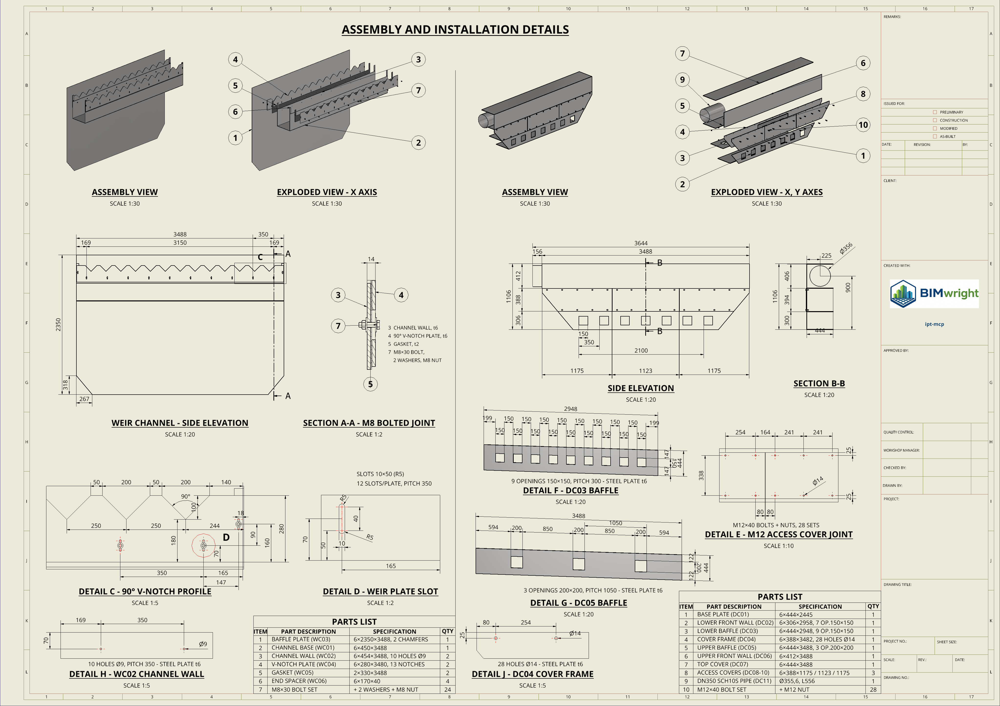

<!-- mcp-name: io.github.bimwright/ipt-mcp -->

<h1 align="center">ipt-mcp</h1>

<p align="center">
  <a href="https://github.com/bimwright/ipt-mcp/actions/workflows/build.yml"></a>
  <a href="LICENSE"></a>
  <a href="#支持的-inventor-版本"></a>
  <a href="#工具面"></a>
</p>

<p align="center">
  <a href="README.md">English</a> · <a href="README.vi.md">Tiếng Việt</a> · 简体中文 · <a href="README.ja.md">日本語</a>
</p>

---

`ipt-mcp` 是一个开源（[Apache-2.0](LICENSE)）的 [Model Context Protocol](https://modelcontextprotocol.io) gateway，让 Claude Code —— 以及任何 MCP-capable client —— 在本地驱动 **Autodesk Inventor 2022-2027**。

Agent 通过 stdio 说 MCP。Server 通过一个本地、经过认证的 transport（TCP 或 Named Pipe）向每个 Inventor 版本对应的进程内 add-in 发送 NDJSON。Add-in 把每条命令 marshals 到 Inventor 的 STA thread 上，并与 Inventor API 通信。

你的模型留在你的机器上。

---

## 实际案例：Inventor 原生工程图

这张机械装配与安装详图，通过 **Agent 经 ipt-mcp 操作 Autodesk Inventor 2027 的工作流创建并完善**，并非渲染的概念示意图。工作流使用原生工程图工具和 `inventor_send_code`，由用户指导、审核并参与编辑。

[](.github/assets/showcase/inventor-assembly-drawing.png)

*点击图片可查看完整分辨率的图纸（4096 × 2893）。*

- **15 个视图：** 装配图、爆炸图、剖视图和放大详图。
- **111 个原生尺寸和 21 个零件标注**，以及两张零件表。
- **英文注释和自定义标题栏：** 嵌入 BIMwright 标志，项目信息栏保持空白。
- **通过 MCP 完善图纸：** 统一尺寸样式、对齐注释，并将完成的图纸导出为 PNG。

这是经用户审核的展示案例，**不是正式发布的制造图纸，也不是仅凭一条提示词自动生成的结果**。仓库仅包含展示图片，不分发项目模型。

---

## ipt-mcp 是什么

两个进程，一条本地管道：

- **`Bimwright.Ipt.Server.exe`** —— 一个 .NET 10 MCP stdio server，由 Claude Code、Cursor、Cline、Codex 或其他 stdio MCP client 启动。它**没有 Inventor 引用**，可以在未安装 Inventor 的 Windows 上 build 和测试。Gateway 运行时需要 Windows，用于用户身份和安装生命周期；“仅 server” 指的是不依赖 Inventor SDK，而不是支持跨平台运行。
- **`Bimwright.Ipt.Plugin.InvNN.dll`** —— 一个 `ApplicationAddInServer` add-in，加载在 `Inventor.exe` 内部，运行一个 TCP 或 Named-Pipe listener，并在 Inventor 主 UI（STA）thread 上执行命令。每个 Inventor 年份一个薄 shell，全部从同一份 `src/shared/**` source glob compile。

与 Revit 不同，Inventor **没有 `ExternalEvent`** 等价物。Add-in 通过一个隐藏的、仅消息的 WinForms control（`InventorStaDispatcher`）把工作 marshals 到 STA thread 上。完整设计见 [ARCHITECTURE.md](ARCHITECTURE.md)。

---

## 支持的 Inventor 版本

| Inventor | Target Framework | Transport | 备注 |
|----------|------------------|-----------|------|
| 2022 | `net48` (.NET Framework 4.8) | TCP | 直接引用 `System.Windows.Forms` |
| 2023 | `net48` (.NET Framework 4.8) | TCP | |
| 2024 | `net48` (.NET Framework 4.8) | TCP | |
| 2025 | `net8.0-windows7.0` | Named Pipe | `UseWindowsForms`、`EnableDynamicLoading` |
| 2026 | `net8.0-windows7.0` | Named Pipe | |
| 2027 | `net10.0-windows7.0` | Named Pipe | 需要 .NET 10 SDK；支持 `UseInventorAssemblyContext` |

- MCP server 是一个独立进程，**不受 Inventor 版本影响** —— 它只转发 JSON envelope。
- 2022-2024 用 TCP（net48 add-in）；2025-2027 用 Named Pipe —— Named Pipe 避免了现代 Windows 上的 loopback-firewall 弹窗。
- Inventor 从 2025 起把桌面 add-in 开发从 .NET Framework 上移开：**2025/2026 用 .NET 8，2027 用 .NET 10**。（.NET 8 add-in 在 2027 上仍二进制兼容，但 net10 是原生目标。）
- 全程使用**4-digit calendar years**（2022..2027）—— 永远不要使用 legacy 版本号。

> **状态：Phase 1 和 Phase 2 的支持范围已验收。** Phase 3 新增 4 个 tools，已通过 build、自动化测试和 Inventor 2027 原生一次性 fixture 验证；已安装 client 的验收与 release 验收另行进行。参见 [Phase 3 行为](docs/testing/drawing-phase3.md)。

最终 MCP 结果的输出保护在 64/256 KiB 时警告，并使用 1 MiB 的 UTF-8 预算。过大的读取要求缩小范围；已完成的写入保留精简的效果摘要，不得重放。`--disable-output-guard` 仍保留 transport 上限。CLI/JSON/环境变量阈值及可配置的 36 小时 spill 策略见 [drawing 测试文档](docs/testing/drawing-phase1.md)。

---

## 安装 / 接入 MCP Client

从 [GitHub Releases](https://github.com/bimwright/ipt-mcp/releases/latest) 下载 client setup ZIP。其中包含一个 self-contained 的 MCP server，以及针对**真实** interop compile 的 Inventor add-in 年份（见 `manifest.json`）。v0.1.0 ZIP 含 **2025** 和 **2027**。其他年份请在本地 build —— 不要发布用 `SkipInventorReferenceCheck` 生成的仅形状（shape-only）DLL。

```powershell
$tag = (Invoke-RestMethod https://api.github.com/repos/bimwright/ipt-mcp/releases/latest).tag_name
$zip = "$env:TEMP\IptMcp.Setup-$tag-win-x64.zip"
$dir = "$env:TEMP\IptMcp.Setup-$tag-win-x64"
Invoke-WebRequest "https://github.com/bimwright/ipt-mcp/releases/download/$tag/IptMcp.Setup-$tag-win-x64.zip" -OutFile $zip
Expand-Archive $zip -DestinationPath $dir -Force

powershell -ExecutionPolicy Bypass -File "$dir\install.ps1" -WhatIf
powershell -ExecutionPolicy Bypass -File "$dir\install.ps1"
```

安装会部署 `%APPDATA%\Autodesk\ApplicationPlugins\Bimwright.Ipt.bundle\`，并把 `ipt-mcp.exe` 放到固定路径 `%LOCALAPPDATA%\Bimwright\ipt-mcp\server\current\ipt-mcp.exe`。Installer 失败时回滚，按 package 校验已安装的 bundle，用 `--help` 对 server 做 smoke 检查，并且从不修改 MCP client 配置 —— 请自行把 client 指向这个固定的 `ipt-mcp.exe` 路径（由 agent 接入时见 ZIP 中的 `AGENTS.md`）。更新保持该路径不变，因此 client 只需重启；client 重新指向后，`-PruneOldServers` 会清理旧的 `server\<version>\` 副本。`uninstall.ps1` 执行完整清理（除非 `-Purge`，否则保留个人数据；`install.ps1 -Uninstall` 只移除 bundle）。用 `--target 2025` 或 `BIMWRIGHT_INVENTOR_TARGET=2025` 固定年份。

**不要** `dotnet tool install -g Bimwright.Ipt.Server` —— 这不是受支持的 client 安装方式。

**开发者：** 在装有 Inventor interop 的机器上运行 `pwsh scripts/package-bundle.ps1`（跳过没有 SDK 的年份）。重新 build 前请关闭 Inventor。

Add-in 发现是自动的：每个运行中的 add-in 写入 `%LOCALAPPDATA%\Bimwright\ipt-mcp\inventor-<year>-<pid>.json`。只有恰好一个 Inventor 在运行时，gateway 才会自动绑定。打开多个时，调用返回 `AMBIGUOUS_TARGET`，直到你选定一个：先调用 `inventor_list_available_targets`，再用 `pid:<n>` 或 `id:<target_id>` 调用 `inventor_switch_target`。已选中的 session 永远不会被换成另一个：如果它退出，调用返回 `TARGET_LOST`，直到你用 `pid:<n>` 或 `id:<target_id>` 显式切换。离开本 gateway 选中的、仍在运行的 session 需要 `rebind=true`（否则返回 `TARGET_REBIND_REQUIRED`），`auto` 或年份永远不会移动已有的选择。格式错误的 selector 返回 `INVALID_TARGET_SELECTOR`。`inventor_get_current_target` 和 `inventor_list_available_targets` 永远不会选择 session。在 `--read-only` 下没有 `inventor_switch_target`：启动时传入 `--target pid:<n>`，或只打开一个 Inventor。每张 toast 卡片的标题以其 Inventor 的 `PID: <n>` 结尾，便于与 agent 选中的 session 对应。

写入只在已确认的 document 上执行。先与用户核对 active document，然后每个 session 用 `pid:<n>` 和 `verify=true` 调用一次 `inventor_switch_target`；在此之前写入返回 `TARGET_UNCONFIRMED`，且不会被发送。如果另一个 document 变为 active，写入会由 add-in 返回 `DOCUMENT_CHANGED`（或 `DOCUMENT_UNCONFIRMED`），且不会开始；请重新确认，或传入 `document`（完整路径或名称）指定目标 document，此时不与 active document 绑定。已确认的 document 关闭后，打开或新建另一个 document 会把确认转移到它上面。用 `inventor_open_document(s)`、`inventor_new_part`、`inventor_new_assembly`、`inventor_new_drawing`、`inventor_new_sheet_fabrication_part` 或 `inventor_create_part` 打开或新建 document 时，确认会转移到它所激活的 document。Server 和 add-in 都必须支持 `document_target_v1`：如果 add-in 或 server 较旧，写入返回 `PAIRING_REQUIRED`，读取仍然可用，因此请从同一个 release 同时更新两者。

`inventor_send_code` 默认启用。`--disable-send-code` 隐藏 code 工具；`BIMWRIGHT_INVENTOR_PLUGIN_DISABLE_SEND_CODE=1` 在宿主中禁止执行。read-only 模式排除它。真实项目工作传 `usage_context="project"`，测试 ipt-mcp 本身时传 `"test"`（默认 `"unknown"`）；该值记录在 call journal 中，不改变脚本的运行方式。

---

## 构建与开发

Autodesk Inventor 二进制文件和 Inventor SDK 在本仓库中**不重新分发**（见 [不重新分发](#不重新分发)）。Build 和运行 **server 与 tests** 需要 Windows 和 .NET 10 SDK，不需要安装 Inventor；build 一个**按版本的 add-in** 需要匹配的 SDK 加上 Inventor interop reference assembly。

```powershell
# Server + tests on Windows (server-only; .NET 10 SDK, no Inventor installation required):
dotnet build src/server -c Debug
dotnet test  tests/Bimwright.Ipt.Tests -c Debug

# Legacy TFM compatibility check using the installed 2027 interop reference:
dotnet build src/plugin-inv24 -c Debug /p:InventorInteropDir="C:\Program Files\Common Files\Autodesk Shared\Extensions 2027\Framework\Interop"
dotnet build src/plugin-inv27 -c Debug   # real 2027 interop compile; needs the .NET 10 SDK

# A per-version add-in always needs an Inventor interop reference. For a legacy TFM compatibility
# check, point InventorInteropDir at an installed compatible interop; real release builds use the
# matching year's default path.
```

- **Server** 只显式 include `shared/Contracts/*` + `shared/Security/*`（+ ToolBaker），因此在没有 Inventor SDK 时也能 compile。
- 每个 **add-in** 使用 `<Compile Include="..\shared\**\*.cs" />` 拉入所有内容，包括触碰 API 的 `Infrastructure`/`Plugin`/`Handlers`。
- 默认 interop hint 路径是 `C:\Program Files\Common Files\Autodesk Shared\Extensions <year>\Framework\Interop\Autodesk.Inventor.Interop.dll`。
- Build add-in 2027 需要安装 **.NET 10 SDK**。
- **部署 add-in DLL 前请关闭 Inventor**，否则它会被锁住。

---

## 工具面

开发 checkout 默认暴露 **150 个工具**（`--toolsets all`）；`--disable-send-code` 后为 **144 个工具**，`--read-only` 下为 **39 个工具**。所有 MCP 名称以 `inventor_` 开头。Toolset 过滤器可以缩小这个范围。下文已发布的 v0.2.1 benchmark 记录保留其原来的 111 个工具范围。

默认启用包括 `code` 在内的全部 19 个 toolset。用 `--toolsets <csv>` 缩小范围。

所有长度输入单位为 **mm**，角度单位为 **degrees**；add-in 会转换成 Inventor 内部的 centimetres/radians。

**指定目标 document。** Document 级 tools（`get_document_info`、`list_bodies`、`list_features`、iProperty、parameter、material 和 mass tools、`save_document`、`close_document` 以及 assembly tools）接受可选的 `document`：Inventor 已在内存中的某个 document 的完整路径或名称 —— 一个打开的窗口，*或*作为 assembly 引用加载的 part。依次按路径、显示名称、文件名、唯一子串匹配；它永远不会被自动打开或激活，名称有歧义或未知时返回候选列表。省略时作用于 active document。

**Occurrence selector。** 批量 assembly tools 用同一个共享 selector 选取 occurrence：`{names?: [glob], regex?, file?: glob, path_contains?, leaf?: false, max_depth?, include_suppressed?: false, limit?}`（或只给一个名称 / 名称数组）。Glob 使用 `*`/`?`；包含 `/` 的名称 glob 匹配 occurrence 路径（`SUB:1/PART:2`）。零个匹配或超过 `limit` 都是错误，并列出最接近的名称 —— 结果永远不会被静默截断。

**对话框。** 保存、打开、关闭、导出、批量 document tools，以及放置标题栏的 drawing tools（`new_drawing`、`add_sheet`、`set_title_block`）默认在 `Application.SilentOperation` 下运行（`silent=true`），因此 Inventor 会用默认值自行回答提示，而不是打开一个隐藏的模态对话框阻塞调用。标题栏带提示条目的 template 不再让 `new_drawing` 停在 "Prompted Texts" 对话框上；用 `inventor_set_title_block` 填写这些条目。Inventor 没有用指定按钮回答某个特定对话框的事件（Revit 的 `DialogBoxShowing`），因此没有逐对话框的回答规则。

**宿主繁忙。** Inventor 中打开模态对话框时，除 health 外的每条命令都会立即返回 `HOST_BUSY`，而不是排在对话框后面等待。命令队列已满，或之前的工作让 Inventor 一直忙到截止时间时，也返回 `HOST_BUSY`。这些情况下命令都没有开始，之后也不会运行，因此 Inventor 空闲后可以安全地重新发送。`TIMEOUT` 现在表示命令已开始但未按时完成：其结果未知，重试写入前请先检查 document。`inventor_health` 报告 `host_busy`、`busy_reason`（`modal_dialog` 或 `sta_busy`）和 `modal_dialog {open, title}`，探测时不触碰 Inventor 主线程。Add-in 同时最多服务四个连接，因此长调用运行时 health 和下一个调用仍能连接。如果 add-in 未及时接受连接（例如每次只服务一个调用的旧 add-in），调用返回 `TARGET_BUSY`；如果其 pipe 不存在，返回 `TARGET_UNAVAILABLE`。两者都表示没有发送任何内容，因此命令没有运行。


### drawing_query (2) / drawing (20) —— Inventor 2027

更早的 Inventor 2027 fixture 结果：[Phase 3 tool 行为](docs/testing/drawing-phase3.md)。这些记录早于 v0.2.1 的运行时改动；需要重新进行 live 验收。

`inventor_get_drawing_info` 和 `inventor_find_view_geometry` 是只读的。Drawing 写入 tools：
`inventor_new_drawing`、`inventor_add_sheet`、`inventor_set_title_block`、
`inventor_add_drawing_view`、`inventor_add_section_view`、`inventor_edit_drawing_view`、
`inventor_add_drawing_dimension`、`inventor_add_balloon`、`inventor_export_drawing`、
`inventor_capture_sheet`、`inventor_add_drawing_note`、`inventor_add_drawing_table`、
`inventor_add_drawing_symbol`、`inventor_edit_drawing_annotation`、`inventor_delete_drawing_items`、
`inventor_edit_drawing_table`、`inventor_set_drawing_styles`、`inventor_edit_sheet`、`inventor_sketch_on_view`、`inventor_hide_view_edges`。Capture 会写入 PNG 文件，因此不在 read-only 中。

[Drawing 检查与当前限制](docs/testing/drawing-phase1.md) ·
[Drawing 注释、表格与图纸](docs/testing/drawing-phase2.md) ·
[通用 live smoke 记录](docs/benchmarks/drawing-phase1-smoke.json) ·
[声明的只读清单](docs/testing/readonly-tools.json)。

### 开发 checkout 中的 Sheet Fabrication

选择 `sheet_fabrication` 用于创作，`sheet_fabrication_query` 用于只读检查：

```bash
bimwright-ipt --toolsets sheet_fabrication,sheet_fabrication_query
```

| Tool | 用途 |
|---|---|
| `inventor_new_sheet_fabrication_part` | 从 Inventor sheet template 创建 part。 |
| `inventor_sheet_fabrication_info` | 检查厚度、样式和 flat pattern 状态。 |
| `inventor_set_sheet_fabrication_thickness` | 用数值或 parameter 表达式覆盖 part 厚度。 |
| `inventor_sheet_fabrication_face` | 由闭合草图轮廓创建基础板。 |
| `inventor_sheet_fabrication_flange` | 在选定的边界边上添加 flange。 |
| `inventor_sheet_fabrication_cut` | 用草图轮廓切穿板材。 |
| `inventor_flat_pattern` | 创建或检查 flat pattern。 |
| `inventor_unwrap_try` | 尝试展开选定的面；也适用于普通 part。 |

`--read-only` 保留检查 tool，移除创作 tools。响应字段为 `is_sheet_fabrication` 和 `use_sheet_fabrication_style_thickness`。使用早期开发名称的 workflow 必须更新其 tool 和 toolset 引用。请使用从同一 revision build 的 server 和 add-in。Autodesk 的 `SheetMetal*` API 标识符和 template 文件名保持不变。

### iLogic rules 与源代码执行

`ilogic` toolset 运行已有的内部/外部 rule，列出或读取 rule，读取诊断信息，并提供命令/撤销 tools。其中四个查询 tools 在 `--read-only` 下仍可用。

通过 `inventor_ilogic_upsert_rule` 创建或修改 VB 源代码，以及执行 `inventor_ilogic_run_snippet`，需要 `code` toolset 和 send-code 权限。`--disable-send-code` 会隐藏这两者；add-in kill switch 会独立拒绝它们。Rule 执行、源代码创作、UI 命令和撤销在 `batch_execute` 中被阻止，因为它们的效果可能超出其 document 事务。

`upsert_rule` 通过 Autodesk 的 AddRule 运行一次新创建的 rule。对于已有 rule，`run=true` 会在替换文本后执行一次。原生失败状态、rule 异常和未完成的清理返回 `ok:false`，诊断信息在 `data` 中；rule 的任意副作用不会回滚。

Snippet 通过 `iProperties.Value("Custom", "MCP_RESULT")` 返回字符串。已有的字符串属性会被恢复，本次调用创建的通道会被删除。非字符串的冲突在执行前被拒绝。名称带有临时 rule 前缀的已有 rule 会被保留。超过 65,536 个字符的结果直接失败，而不是返回截断的 JSON。历史上的 `MCP_RESULT_BEGIN/END` 日志标记不再被视为 snippet 结果。

`ilogic_read_log` 在 `max_chars` 为正数时限制读取量（默认 65,536，最大 1,048,576）。`max_chars=0` 显式请求整个文件。响应报告 `bytes_read` 和 `truncated`。Rule 参数是扁平的 JSON 对象，值为字符串、数字、布尔值或 null。

Sheet Fabrication 创建需要 sheet fabrication template，且不能在 batch 中运行。厚度修改失败时恢复之前的厚度/样式状态；跨折弯（across-bends）切除的深度随板材变化跟随原生 Thickness parameter。Flange 半径覆盖值必须是有限且大于零的数。

### meta (3) —— server-side 的 target tools，不 round-trip 到 add-in；在 `--read-only` 下仍然暴露

| Tool | 描述 |
|---|---|
| `inventor_list_available_targets` | 列出检测到的 live Inventor add-in targets（year、pid、transport、active document）；`selected` 标记 gateway 的 target。 |
| `inventor_get_current_target` | 报告已选中的 target；永远不会选择 target（尚未选择时返回 `bound=false` 及 live 候选）。 |
| `inventor_switch_target` | 按 `pid:<n>`、`id:<target_id>`、`auto` 或 Inventor year 选择 target；匹配多个 session 的 selector 会被拒绝。离开本 gateway 选中的、仍在运行的 session 需要 `rebind=true`。`verify=true` 为写入确认 active document。在 `--read-only` 下不注册。 |

### query (12) —— 只读的 document/health/model 探测及 agent 结果报告

每个 Inventor session 开始时，必要时先选择目标 target，然后调用一次 `inventor_health(check_updates=true)`，让 agent 发现更新的稳定 release。网络不可用或不允许访问时，使用默认离线调用，并把更新检查保留为 not checked/unknown。后续常规探测保持离线。原有的 host 字段和 `setup_gateway`/`setup_plugin` 身份保持不变；精简的 `mcp` 块新增 `server_version`、`server_informational_version`、`plugin_version`、`server_build_id`、`plugin_build_id`、`version_alignment` 和 `revision_alignment`。Alignment 为 `match`、`mismatch` 或 `unknown`；version 或 revision 一致不能证明二进制兼容或 publisher 可信。Build id 使用已加载 assembly 的 informational-version 元数据，缺失时退回到组件的 module id。运行时身份在 server 启动或 add-in 激活时捕获。`artifact_sha256` 是捕获时对磁盘的观察（`artifact_hash_basis=on_disk_at_identity_capture`），不是已加载内存的摘要，也不能证明之后的文件替换已经生效。

默认调用是本地的，可离线工作。如果 host 不存在或无法连接，仍会返回 server 身份，同时带 `ok:false`、`host_connected:false` 和原始错误；这不是一次成功的 host 探测。`check_updates=true` 获取一个[官方稳定 release](https://docs.github.com/en/rest/releases/releases#get-the-latest-release)，并把其 tag 解析为源代码 commit。所有请求共享五秒预算；每个元数据响应限制为 256 KiB。`update.components.server` 和 `.plugin` 各自报告 `current_version`、`current_build_id`、`version_status`、`build_status` 和 `status`。Component status 为 `update_available`、`release_match`、`release_mismatch`、`ahead_of_release`、`unknown` 或 `not_checked`。Revision 比较使用已加载 assembly 元数据中的完整 Git hash；其他 build id 保持 unknown。即使 server 与 release 一致，较旧的已加载 plugin 仍会显示出来。Tag 解析失败时保留 version 比较结果，但 build status 为 unknown。

`update.status=checked` 表示 release 查询成功，而不是两个 component 都是最新的。逐 component 的 `update_available` 只比较 semantic version。Component version 与 release 相同时，`release_mismatch` 要求两侧都有完整 Git SHA 且 SHA 不同。`+development`、`+build` 之类的 revision 元数据或没有 revision 时，该 component 状态为 `unknown`。对于处于 release version、且没有已确认 revision 不一致的组合，缺少 revision 证据会报告为 `RELEASE_IDENTITY_UNVERIFIED`。这两种结果都不建议自动降级。总体标志在任一 component 有更新的稳定版本时为 true，只有两个 component 的 version/revision 都与 release 一致时为 false，其余情况为 null。源代码 revision 一致不能验证 release artifact 字节（`artifact_verification=not_performed`）。响应从不下载或安装 package。预览、授权、回滚和重启验证请遵循[安装指南](AGENTS.md)。

检查 `update.components` 和 `update.notification` 两者，然后遵循其 `agent_action`。Code 区分 `NEW_RELEASE_AVAILABLE`、`RELEASE_REVIEW_REQUIRED`、`RELEASE_IDENTITY_UNVERIFIED`、`UPDATE_CHECK_UNAVAILABLE` 和信息性的 `LOCAL_VERSION_AHEAD`。查询失败时报告 `lookup_reason`（例如 `http_403`、`timeout` 或 `network_unavailable`），已报告的运行时身份保持不变，不声称本地故障，也不请求安装授权。即使没有较旧的 peer，本地版本高于 release 也会被报告。逐 component 的 `update_available=false` 只表示未确认存在更高的 semantic version，不表示 release 身份一致。仅凭 notification 为 null 永远不能证明已是最新。

Notification 用 `protected_components` 和 `protected_component_reasons` 列出受保护组件；已知领先或未解析的已观察 build 会被保留。身份尚未观察到的 plugin 单独列在 `unobserved_components` 中，并带 `identity_observed=false`：应检查目标 Inventor 连接并获取元数据，不要假设 host 已关闭或已安装的 plugin 已损坏。`comparison_reason` 区分缺少运行时证据与 release 查询/revision 证据不可用。缺少 artifact hash 本身不决定是否保护；release artifact 字节验证另行进行。

总结前，读取两个 component 的比较结果、保护/未观察字段和完整的 notification message；notification 的 `components` 列出主要受影响的集合，而不是全部运行时事实。Server 领先且 plugin 未观察时，对 plugin 返回 `RELEASE_IDENTITY_UNVERIFIED`，同时单独保护 server。两个 component version 都与 release 一致但 tag 解析失败时，同一 code 与 `comparison_reason=release_revision_unavailable` 及外部 `lookup_reason` 一起出现。仅此不会把 component 标记为受保护或有故障；为 false 的 proposal 标志仍会阻止安装。应停止 update 流程并获取缺失的 release 证据；否则正常的 Inventor 工作可以继续。

`update_guidance.mode` 为 `check_only`、`retry_check`、`review`、`none` 或 `prepare_update`。只有 `prepare_update` 且 `bundle_update_proposal_allowed=true` 时才返回安装流程和 `requires_user_authorization=true`；适用时复用已有授权。其他模式只包含检查/报告/审查步骤，没有 install.ps1 或 installer 命令，也不请求安装授权。较新的本地 server 加旧 plugin 会阻止完整 ZIP 的建议；tag 解析失败或 peer 未观察也会阻止它，同时保留已知的新版本事实。Health 从不安装任何内容。四项 annotations 保持 read-only true、destructive false、idempotent true、open-world true。

对于允许的 update，保留 health proposal 中的确切 release tag。解压前用配套的 `.zip.sha256` asset 验证官方 ZIP，要求存在 `manifest.json`，并在替换前预览 installer 以验证解压后文件的 checksum。Health 不返回预期的 ZIP digest，也不做 package 验证。Manifest 检查各个 payload 文件；它不能替代整个 ZIP 的 checksum，也不能建立独立的 publisher 认证。

重新连接/重启后，**client** 必须记录新的 `initialize` 和新的 `tools/list`，然后在同一 connection 上调用 health。`serverInfo.version` 包含完整的 informational version。把 `serverInfo.name/version` 与 `client_verification.expected_server_info` 对照，把 health tool 的 `_meta["bimwright/ipt-mcp/runtime"]` 与 `client_verification.expected_runtime`（version、module id、PID 和进程启动时间）对照。还要验证其当前 schema 和 annotations，包括可选的布尔参数 `check_updates` 以及 read-only/open-world 提示。仅看 tool 数量是不够的。`client_verification.status=not_observable_by_server` 明确了这一边界；client 隐藏握手/目录证据时，其刷新仍未验证。直接对 server 做的 smoke 测试能验证候选协议，但不能证明另一个 client 的 cache。

| Tool | 描述 |
|---|---|
| `inventor_health` | session 开始时用 `check_updates=true` 调用一次以发现 release，`update.notification` 存在时通知用户。常规探测默认保持离线。报告 host 状态以及已加载的 server/plugin 身份。 |
| `inventor_report_task_result` | agent 显式报告任务结果：`task_id`、`outcome`（`completed`/`failed`/`cancelled`）、单行 `summary`、可选 Markdown `body`（最大 32 KiB）。显示总结卡片，并把报告连同自上次报告以来运行的 write tools 保存到 `%LOCALAPPDATA%\Bimwright\ipt-mcp\reports\`，Inventor 无法连接时也会保存。不修改模型。 |
| `inventor_get_report_history` | 已保存的 agent 报告，最新的在前：一页摘要（`offset`、`limit` 1–50），或按 `report_id` 返回一份完整报告。本地数据；无需 Inventor。 |
| `inventor_list_open_documents` | 列出内存中的 documents：title、path、type、is_active、dirty、visible；可选 `filter` / `dirty_only`。 |
| `inventor_get_document_state` | 保存或结束工作前检查：`mode`（`local_file`、`unsaved`、`template`、`read_only`）、`is_modified`、`dirty_references`、`modifiable`、`is_read_only`、`exists_on_disk`、`saved_in_version`、`needs_migrating`、`file_save_counter`、`document_id`，以及保存 `policy {mode, rules, allowed}` 和项目的 `old_versions_to_keep`。可作用于 active document、`document` 或 `scope=all`；没有打开 document 时也可用。 |
| `inventor_get_document_info` | active 或指定 document 的标题、完整路径、类型和 dirty 标志；`references=true` 会加上其文件引用（带 missing 标志）。 |
| `inventor_list_bodies` | 列出 part 的 solid bodies：id（`body:N`）、name、volume_mm3、bbox_mm、face_count、生成 feature（created_by）、visible。 |
| `inventor_list_features` | 按 tree 顺序列出 part 的 features：name、type、health、suppressed、body_names。 |
| `inventor_probe_brep` | 调查 part 的 B-rep 端口：带 inner-loop 圆形边的平面 — normal（已按 IsParamReversed 校正）、center_mm、port_diameter_mm、面上所有圆。 |
| `inventor_list_sketch_points` | 检查一个命名草图：点引用、以 mm 表示的位置、圆/圆弧中心和线段端点，以及 `origin_ref`。可选 `document` 选择一个打开的 part；`max_items` 默认 200（1–1000）。不投影几何，也不修改 document。 |

### document (12) —— document 生命周期（write）

| Tool | 描述 |
|---|---|
| `inventor_new_part` | 新建一个 part document（.ipt）；可选 template 路径。 |
| `inventor_new_assembly` | 新建一个 assembly document（.iam）；可选 template 路径。 |
| `inventor_open_document` | 从完整路径打开已有 document 并设为 active。 |
| `inventor_save_document` | 按 `inventor_get_document_state` 的 policy 保存 active document（或 `document`），并强制执行该 policy。原位保存：从未保存的 document、template、只读文件或磁盘上不存在的文件会被拒绝（`data.reason`）；没有改动时返回 `saved=false`、`reason=no_changes`；旧格式文件需要在用户批准后传 `allow_format_upgrade=true`。带 `path` 时：Save-As 到已存在文件夹中、与 document 类型相同的新本地文件；永远不会覆盖已有文件。 |
| `inventor_close_document` | 关闭 active document（或 `document`）；`save=true` 会先按 `inventor_save_document` 的 policy 保存，保存被拒绝时 document 保持打开（`data.reason`）。 |
| `inventor_set_units` | 设置 active document 的长度单位（mm、cm、m、in、ft）。 |
| `inventor_set_material` | 按名称给 active part 分配一个 material。 |
| `inventor_save_all` | 更新根文档并静默保存它及所有有改动的被引用文档；逐文件报告 saved / read_only / error；支持 `dry_run`。遵循 `inventor_save_document` 的 policy（`dry_run` 时也是）：根文档从未保存、是 template、只读或不存在，或它将保存的某个文档是 template 或未带 `allow_format_upgrade=true` 的旧格式文件时，拒绝并返回 `data.reason`。 |
| `inventor_open_documents` | 一次打开多个文档（默认不开窗口，用于以 `document` 为目标的编辑）。 |
| `inventor_close_documents` | 按路径/名称关闭文档，或关闭所有可见文档（`keep_active`）。`save=true` 对每个文件遵循 `inventor_save_document` 的 policy：被拒绝的文件保持打开并保留改动（`status=refused`、`reason`）。 |
| `inventor_save_checkpoint` | 经用户批准后，把已确认的 active 本地文件复制到其旁边的 `<name>.checkpoints\`（有未保存改动时先保存），用大小和 SHA-256 验证并建立索引。Assembly 和 drawing 的 checkpoint 只包含该文件本身（`REFERENCES_NOT_CAPTURED`）。只有在用户批准转换旧格式文件后才使用 `allow_format_upgrade=true`。 |
| `inventor_manage_checkpoints` | `action=list`；`prune`（用 `dry_run=true` 预览，批准后用预览得到的 `plan_hash` 执行；milestone 会保留）；`restore` 把 checkpoint 复制为 `<name>-restored-<id>.<ext>`，永远不覆盖工作文件。 |

### ipart (8) —— Standard iPart family 与 Excel 目录

| Tool | 用途 |
|---|---|
| `inventor_get_ipart_info` | 检查打开的普通 part、factory 或 member，以及表格行、Excel 绑定和生成状态。只读。 |
| `inventor_create_ipart_factory` | 把一个干净、已保存的普通 part 复制到新的 factory 路径，并配置 parameter、material、description 和 feature 抑制列。 |
| `inventor_update_ipart_table` | 在 Excel 目录接管表格之前，预览/应用完整行的 upsert。 |
| `inventor_set_ipart_row` | 选择并验证一个 factory 行，不改变 assembly occurrence。 |
| `inventor_generate_ipart_members` | 预览/生成选定的行，验证其实体和属性，并复用已验证且未改变的 member。 |
| `inventor_sync_ipart_excel` | 把一个已保存的 `.xlsx` 目录单向预览/应用到 factory。 |
| `inventor_place_ipart_member` | 把之前生成的 member 放入打开的 assembly。 |
| `inventor_change_ipart_member` | 把一个确切的顶层 occurrence 切换到同一 factory 的另一个已验证行。 |

从参数化建模的 part 开始。配置列，例如 `{name:"Length",kind:"parameter",target:"Length"}` 和 `{name:"Hole",kind:"suppression",target:"MountHole"}`。Factory 会自动包含 Member 和 Part Number。行输入为 `{member:"BUSH-020",part_number:"BUSH-020",values:{Length:40,Hole:false}}`，每个已配置的列都必须出现。数值 parameter 使用原 parameter 的单位；字符串接受 Inventor 表达式。布尔抑制表示 `true = suppress`、`false = compute`。Material 必须已在 factory document 中可用。

Excel 使用一行表头，包含 `member`、`part_number` 和已配置的列名，后面是完整、连续的行。已配置的单元格不能为空，如果配置了可选的 Description 列也一样；不支持清空原生属性单元格。首次同步时提供 `path`、`sheet` 和 `header_cell`；可选的 `mapping` 把这些名称映射到其他 Excel 表头。之后的调用可以复用该绑定。表格更新、Excel 同步和生成默认 `dry_run=true`；应用需要 `dry_run=false`。同步前请保存/重新计算工作簿：这些 tools 读取已保存的值，包括缓存的公式结果，永远不写回 Excel。绑定后，请在 Excel 中编辑行并同步，而不是通过 JSON 写表格。重新排列 Excel 行会保留 member 身份；省略已有 member 会被拒绝，而不是删除。

工作流程是 **编辑 Excel → 同步表格 → 生成选定的 member → 放置或切换 occurrence**。同步会重建并验证改动过的 factory 行；它不会自动生成文件或刷新 assembly。Assembly 引用仍需要原生 member `.ipt` 文件。请把 factory、其旁边的 `.ipart-mcp.json` checkpoint 文件、工作簿和生成的 member 文件夹一起管理。

Write tools 目前支持由 `inventor_create_ipart_factory` 创建的受管 Standard iPart factory。源文件必须是干净、已保存、带独立 parameter 的普通实体 part；custom iPart、sheet metal、原生 Excel parameter 链接、接管已有 factory 和 iAssembly 不在此范围内。输出路径必须是本地驱动器上新的 `.ipt` 路径；共享/代理缓存会被拒绝。目录限制为 16 MiB、1,000 行和 48 个已配置列；每次调用生成 1–50 个指定名称的 member。不接受宏或外部工作簿链接。

Factory 操作会显式保存其受管副本和 checkpoint。Assembly 操作把保存留给用户。所有写入都拒绝 `batch_execute`、嵌套事务、有未保存改动的 factory 和冲突的操作。失败的多文件操作可能在磁盘上留下文件：检查 `file_effects` 和待完成的操作，必要时恢复干净的 factory，然后继续同一个操作。事务中止不代表文件回滚。Member 生成会比较原生实体并回读属性，然后才把文件标记为当前版本。

### parameters (7) —— model、user 与 Excel parameters

| Tool | 描述 |
|---|---|
| `inventor_list_parameters` | 列出 parameters（model + user）：名称、表达式、值、单位、种类。 |
| `inventor_get_parameter` | 按名称获取一个 parameter：表达式、值、单位。 |
| `inventor_set_parameter` | 设置一个已有 parameter 的表达式/值，然后更新 document。 |
| `inventor_create_parameter` | 新建一个 user parameter（名称、表达式、单位）。 |
| `inventor_list_excel_tables` | 列出原生电子表格表、稳定的链接表 ID、parameter 值和健康状态。 |
| `inventor_link_excel_table` | 链接一个本地 `.xlsx` parameter 块，并在重新计算后验证原生回读。 |
| `inventor_reload_excel_table` | 按 ID 重新加载链接表，验证已保存的值和几何健康状态，并报告自上次已验证的链接/重新加载以来的改动。 |

Excel 块使用**第一个工作表**，纵向列为 `name`、`value`、`units` 和可选的 `comment`。`start_cell` 指向第一个 parameter 行，而不是其表头。名称必须是唯一的 ASCII 标识符；值必须是有限的已保存数字或公式结果；单位指定为 `mm`、`deg`、`ul`（无单位）或其他 Inventor 单位。链接/重新加载前请重新计算并保存工作簿。这些 tools 不计算 Excel 公式、不编辑工作簿，也不保存 part。限制：本地驱动器 `.xlsx`、16 MiB、1,000 个连续行；不支持宏、外部工作簿链接、UNC 路径，重新加载时也不能改变 parameter 成员。

例如，用 `inventor_link_excel_table(path="C:/parts/flange.xlsx", start_cell="A6", document="flange.ipt")` 链接，然后在 `inventor_reload_excel_table` 中复用其 `table_id`。草图尺寸、厚度和阵列数量必须引用链接的 parameter 名称，几何才会改变。Part 中已有的原生链接在第一次成功重新加载时建立其变更基线；该调用报告 `changed_parameters=null`，而不是编造之前的值。

Excel 写入在 `batch_execute` 之外运行，并拥有自己的 document 事务。几何更新失败并中止后，Inventor 可能保留已刷新的电子表格 parameter。因此重新加载会把失败后的状态与持久化的已验证 checkpoint 比较，在无法验证恢复时报告 `rollback_failed` / `recovery_required`。此时请恢复最后一次已验证的 Excel 值，成功重新加载，并在保存前检查 part。仅凭 `transaction_aborted` 不能证明链接值已恢复。

### properties (4) —— iProperties 与 mass properties（write）

| Tool | 描述 |
|---|---|
| `inventor_get_iproperty` | 按 property-set 和 property 名称获取一个 iProperty 值。 |
| `inventor_set_iproperty` | 设置一个 iProperty 值。 |
| `inventor_get_mass_properties` | 质量（g）、体积（mm³）、表面积（mm²）、质心、包围盒。 |
| `inventor_list_iproperty_sets` | 列出 iProperty 集合（name、internal_name、属性名；可选值）—— get/set_iproperty 的 discovery。 |

### sketch (11) —— 2D 草图几何与约束（write）

| Tool | 描述 |
|---|---|
| `inventor_create_sketch` | 在一个平面上创建 2D 草图（XY/XZ/YZ 或一个 face/work-plane 引用）。 |
| `inventor_project_geometry` | 把 model edges/vertices（按 edge ids）投影进 active 草图。 |
| `inventor_draw_line` | 画一条草图线段，从 (x1,y1) 到 (x2,y2)。 |
| `inventor_draw_circle` | 画一个草图圆，由圆心 + 半径确定。 |
| `inventor_draw_rectangle` | 画一个两点草图矩形。 |
| `inventor_draw_arc` | 画一个草图圆弧（圆心、半径、起始/结束角度）。 |
| `inventor_add_sketch_dimension` | 给草图图元添加一个驱动尺寸约束。 |
| `inventor_add_sketch_point_dimension` | 用以 mm 表示的正数或 parameter 表达式，驱动两个点引用之间的水平、垂直或对齐距离。可选 `document` 指定一个打开的 part。 |
| `inventor_add_sketch_constraint` | 添加一个几何约束（coincident、parallel、tangent 等）。 |
| `inventor_draw_text` | 添加一个 fitted 文本框（position mm，可选 font_size_mm；rotation_deg 仅支持 90 的倍数）。 |
| `inventor_close_sketch` | 结束草图编辑（退出 sketch edit 模式）。 |

要定位孔，用草图名称调用 `inventor_list_sketch_points`，选择 role 为 `circle_center` 的点，然后从 `origin_ref` 到该 `point_ref` 添加两个点尺寸：`orientation="horizontal", value="HoleX"` 和 `orientation="vertical", value="HoleY"`。修改这些已有 parameter 会移动孔中心。表达式可以引用已有的链接 Excel parameter。可选的 `text_position=[x,y]` 控制注释在草图中的位置（mm）。两个点必须属于同一个草图。引用使用原生对象 key，拒绝已删除的对象或其他文件中的对象；Save As 后请重新查询。距离必须为正；零偏移需要几何约束。尺寸创建会验证重新计算结果和实际点距离，失败时回滚，保存留给调用方。必要时，原点尺寸会投影草图原点或创建一个固定的局部原点；如果操作回滚，这个辅助点也会被移除。在 batch 或其他打开的事务中，尺寸必须以该事务的 document 为目标。

### feature (17) —— 实体与工作特征（write）

| Tool | 描述 |
|---|---|
| `inventor_create_part` | 用 JSON recipe 一次调用建完整零件：草图（矩形 / 圆 / 带 bulge 圆弧的多段线、内部孔洞，位于原点平面或固定平面上）→ 拉伸 / 孔 / 圆角 / 倒角 → 材料 + iProperties → 静默 Save-As。错误会指出 recipe 路径（`features[2].extrude.distance`）；构建失败时零件不保存直接关闭；`dry_run` 只做校验。 |
| `inventor_build_solids` | 在已有零件中用数据一次调用建多个实体：item `{name, op: new/join/cut, target?}` 加一个形状（join/cut 可省略 `name`；`defaults` 填充重复的形状值）—— `box`（min/max）、`tube`（a, b, od, wall?）、`prism`（axis, from, to, profile）或 `extrude`（平面位姿, depth, profile）。所有 item 先校验，所有问题一次返回；每个 item 建完后检查（特征健康、恰好一个新实体、切除须减少且合并须增加体积）。失败的 item 被移除，已建的保留，`next_index` 指出从哪里继续。`dry_run` 对照零件校验。一次撤销。 |
| `inventor_extrude` | 拉伸一个命名草图（距离、join/cut/intersect、方向）。 |
| `inventor_revolve` | 把一个命名草图绕一个轴旋转（角度、operation）。 |
| `inventor_combine` | 对实体做布尔运算（base + tool bodies，join/cut/intersect，keep_tool_bodies）。 |
| `inventor_batch_execute` | 在一个事务中运行最多 20 条 wire commands（单次 undo，出错回滚）。 |
| `inventor_fillet` | 添加等半径边倒圆 — `edgeIds` 或 `edges` 选择器 `{kind:circular, radius_mm?, center_mm?, on_body?, adjacent_surface_types?}`；返回 `matched_edges`。 |
| `inventor_chamfer` | 给 model edges 添加等距倒角。 |
| `inventor_create_work_plane` | 创建一个工作平面（offset、three_points、tangent 或 fixed 原点+轴）。 |
| `inventor_create_work_axis` | 创建一个工作轴（two_points、edge、plane_intersection、normal_to_face_through_point）。 |
| `inventor_create_work_point` | 在 {x,y,z}/[x,y,z] mm 处创建固定工作点；construction point 无法命名（name_applied 会报告）。 |
| `inventor_hole` | 在确定性选择的平面面上钻通孔/沉孔/埋头孔；可选 tapped-thread 元数据。 |
| `inventor_circular_pattern` | 绕一个命名轴圆形阵列 part features（在某一角度上 count）。 |
| `inventor_rectangular_pattern` | 沿一个或两个命名轴矩形阵列 part features。 |
| `inventor_loft` | 按有序 sketch profiles（'SketchName' 或 'SketchName:N'）做 loft；可选 centerline sketch、closed/merge-tangent-faces。 |
| `inventor_sweep` | 把 sketch profile 沿 sketch path 扫掠（相连段自动串链）；orientation normal_to_path\|parallel。 |
| `inventor_create_bim_connector` | 在圆形 port edge 上创建 BIM pipe connector（ref 来自 inventor_probe_brep 的 `circles[].edge`）；kind=pipe，可选 system/flow/connection 元数据。 |

### export (11) —— 视图捕获与几何导出（write）

> `output_path` 必须位于允许的根目录下：user profile、`%TEMP%`，或自行添加的根目录 —— 例如在运行 Inventor 的机器上设置 `BIMWRIGHT_INVENTOR_EXPORT_ROOT=D:\Inventor-Exports`（设置后需重启 Inventor 和 MCP 客户端/服务器会话）。

| Tool | 描述 |
|---|---|
| `inventor_capture_view` | 把 active view 捕获为 PNG 文件（写入 `<export-root>\captures\` 或 `output_path`）；`inline=true` 改为返回受限的 base64 PNG。可在同一调用中设置视图（设计视图、对象/occurrence 可见性、方向或相机、fit），并一次拍摄多个 `shots`。 |
| `inventor_set_view_state` | 激活或创建设计视图，切换对象可见性（工作特征、草图等），并按 selector 显示/隐藏 occurrence。 |
| `inventor_export_step` | 把 active part/assembly 导出为 STEP（.stp/.step）。 |
| `inventor_export_stl` | 把 active part/assembly 导出为 STL（.stl）。 |
| `inventor_export_sat` | 把 active part/assembly 导出为 ACIS SAT（.sat）—— 用于 Revit interop 的格式；acis_version 默认 7（唯一支持的值）。 |
| `inventor_export_bodies_sat` | 一次调用把多个已打开零件的实体逐个导出为独立 SAT 文件（`items=[{document, bodies?, key?}]`、`out_dir`）；预先检查路径与已存在文件，`verify=true` 回读每个文件（体积/bbox/面数），按实体报告错误。 |
| `inventor_export_dxf` | 导出 2D DXF；必须声明 source（`sketch` 或 `flat_pattern`）。 |
| `inventor_derive_envelope` | 从源 part/assembly 创建 derived part —— envelope/interop 路径：`derive_style`、`include_bodies` 选择 solid、轻量 `bounding_box` 模式；.ipt 保存到允许的 root 下。 |
| `inventor_view_fit` | 把 active view 缩放适配到 model extents（捕获前运行）。 |
| `inventor_set_view_orientation` | 设置一个标准相机方向（iso/front/top 等），用于多角度捕获。 |
| `inventor_set_camera` | 显式设置相机（eye/target mm、up、perspective、extents_mm、fit）—— 标准方向不合适时在 capture_view 前使用。 |

> 导出路径必须是绝对路径，且位于允许的 output root 之下（用户 profile 或 temp）。

### assembly (9, write) —— 组合与编辑装配体

| Tool | 描述 |
|---|---|
| `inventor_create_design_view` | 复制一个 assembly 设计视图；精确的 occurrence 可见性/外观设置，可选激活。已在 Inventor 2027 一次性 fixture 上验证。 |
| `inventor_place_occurrence` | 把一个 component（.ipt/.iam）放入 active assembly；可选初始 pose + grounded。 |
| `inventor_add_constraint` | 约束两个命名引用（mate/flush/insert/angle）；response 携带 `health` —— 务必检查它。 |
| `inventor_create_imate` | 使用确定性面选择器在 active part 上编写一个命名 iMate。 |
| `inventor_place_occurrences` | 在一个撤销步骤中放置多个组件；姿态为原点+旋转、坐标轴或 4×4 矩阵；`lock` = none / grounded / workplanes（三个隐藏的固定工作平面，与零件的原点平面 flush 约束）。 |
| `inventor_delete_occurrences` | 删除 selector 匹配的顶层 occurrence（连同其锁定平面）；`dry_run`。 |
| `inventor_set_occurrence_state` | 在一个撤销步骤中，对每个 selector 匹配项设置 visible / suppressed / grounded / pose / lock；`dry_run`。 |
| `inventor_set_appearance` | 按 RGB 为 occurrence（selector）或零件实体着色，或按名称应用库外观。 |
| `inventor_reset_appearance` | 移除 occurrence 或零件实体上的外观覆盖。 |

### assembly_query (6, read-only) —— 数值自检一组；在 `--read-only` 下存活

| Tool | 描述 |
|---|---|
| `inventor_list_interfaces` | 列出 doc 或一个 occurrence 的命名接口（iMates、工作特征、origin 几何）。 |
| `inventor_list_occurrences` | 按 selector 过滤的 occurrence 报告，包含所选字段（path、file、bbox_mm、transform、visibility、grounded、material、appearance、mass、volume）；内联返回或写入文件。 |
| `inventor_check_interference` | 运行干涉分析 —— 旧式 occurrence 名称，或带包围盒预筛选的 `set_a` × `set_b` selector；pair 按体积排序，数量上限为 `max_pairs`。 |
| `inventor_measure_min_distance` | 两个 occurrences 或命名引用之间的最小 3D 距离（mm）—— 或批量：`pairs[]` 或 `set_a` × `set_b` 加 `threshold_mm`（间隙检查）。 |
| `inventor_get_assembly_bom` | BOM + occurrence 树，带 grounded 标志以及 translation/rotation 自由度。 |
| `inventor_list_constraints` | 读回每个约束的 type、`health`、suppressed 标志以及两个 occurrence 名称。 |

### code (4) —— C# 脚本与 code modules

| Tool | 描述 |
|---|---|
| `inventor_send_code` | `inventor_send_code` 默认启用。`--disable-send-code` 隐藏 code 工具；`BIMWRIGHT_INVENTOR_PLUGIN_DISABLE_SEND_CODE=1` 在宿主中禁止执行。read-only 模式排除它。 |
| `inventor_save_code_module` | 保存可复用的 C# helper module（仅声明）；保存前在 add-in 中做策略检查和 dry-compile；可用 `requires` 依赖其他 module。 |
| `inventor_list_code_modules` | 列出已保存的 module 及其 hash、描述和声明的签名。 |
| `inventor_delete_code_module` | 删除已保存的 module（被其他 module requires 时拒绝）。 |

### toolbaker (3, read-only) —— 纯粹操作 server-side 的 bake 数据库

| Tool | 描述 |
|---|---|
| `inventor_list_baked_tools` | 列出所有已验证、已编译、已注册的 baked tools。 |
| `inventor_list_bake_suggestions` | 列出来自重复 workflow 的 active ToolBaker 建议。 |
| `inventor_create_bake_issue_draft` | 为一个建议创建 GitHub issue 草稿（不提交）。 |

### toolbaker_write (3, write) —— 运行 baked tools 并管理建议生命周期

| Tool | 描述 |
|---|---|
| `inventor_run_baked_tool` | 按名称携带 JSON 参数执行一个已注册的 baked tool。 |
| `inventor_accept_bake_suggestion` | 接受一个建议：validate + compile + apply + persist 为一个 baked tool。 |
| `inventor_dismiss_bake_suggestion` | 驳回或暂缓一个 active 建议。 |

---

## Toast 通知

当 Inventor 可见时，命令结果更新到 **一张紧凑的活动卡片**，显示最新 tool 和带数字滚动效果的 **Success / Failed / Capture** 计数器。Capture 是 Success 的子集，包含 `inventor_capture_view` 的 `inline=true` 调用，不应再加到操作总数中。Failed 包含脚本软失败和 batch rollback。读写操作都使用蓝色强调色；记录过失败的卡片保持红色强调色。该卡片与 rvt-mcp、dwg-mcp 的卡片相同，数值变化时布局保持稳定，没有优先级堆叠或逐 tool 的 toast 队列。成功且保存了图像的 capture 还会显示该图像的**缩略图**，居中放在固定大小的框内；点击缩略图会打开文件。计数仅覆盖当前 Inventor target 上该卡片的生命周期，不代表推断出的整个任务或特定 MCP client。`inventor_health` 不产生 toast。**Agent connected** 只是状态通知，不增加计数，也不替换保留中的活动卡片或任务报告。

活动卡片默认在 **最后一个结果之后 20 秒**消失。可在 **Status → Toast duration → Apply** 中选择 10、20、30 或 60 秒，选择保存为 `toastIdleSeconds`。保存失败时会显示错误，并继续使用原来的时长。由指针移动确认的真实悬停暂停计时，离开后重新开始完整的所选时长。新时长从下一个结果或指针离开时开始生效。卡片出现在静止光标下不算悬停。点击卡片打开 **History** 并关闭卡片；**×** 只关闭卡片。卡片标题始终显示网关名称和 **Inventor 年份**（`ipt-mcp 2027`），不受 branding 开关影响。

agent 必须显式调用 `inventor_report_task_result` 报告整个工作的结果：每项 agent/job 使用唯一 `task_id`（1–80 字符），`outcome` 为 `completed`、`failed`、`cancelled`，`summary` 为真实的单行总结（1–120 字符）。报告 **替换同一个共享卡位**，标注 **Agent reported**，显示时限为 **8 秒**；真实悬停暂停，离开后重新计时。报告不增加活动计数，下一个 tool 结果开始新的活动卡片。不会从空闲时间或成功的 tool 调用推断任务完成。报告绕过 Inventor 命令队列（不调用 Inventor API），因此长时间 `send_code` 占用主线程时仍可送达。响应中的 `toast_shown` 表示是否已保留卡片供显示；Inventor 最小化或被对话框遮挡时保留的卡片也算在内，并在窗口可用后显示。报告遵守 Toasts 开关，需同时更新 server **和** add-in。

**已保存的报告。** Server 还会把每份报告保存为 `%LOCALAPPDATA%\Bimwright\ipt-mcp\reports\` 中的一个 JSON 文件（保留最新的 500 份），包含可选的 Markdown `body` 以及该 session 自上一份报告以来运行的 write tools；同一 session 重新发送某个 `task_id` 会替换该报告。报告由 agent 自报，未经验证。`inventor_get_report_history` 可读回它们。在 agent 报告之前，修改模型的 tools 的结果会带有 `_report` 提醒（第一次完整，之后简短；对 `send_code` 只有一条条件性提醒，因为 server 无法判断脚本是否修改了模型）。读取、打开/关闭/保存、checkpoint 和导出不带提醒。

Toast 使用 **专用 STA UI 线程上的纯代码 WPF**，窗口 **无 owner 且不激活（unowned / no-activate）**，独立于 Inventor 主 STA，toast 线程不调用 Inventor COM。命令结果通知在响应返回后投递。Toast 不抢焦点，Inventor 最小化或打开模态对话框时隐藏，**即使其他应用位于前台也保持置顶**。卡片使用与 rvt-mcp、dwg-mcp 相同的固定浅色样式；没有主题设置，也不会读取卡片后面的屏幕内容。

通过功能区开关 toast：**Bimwright ▸ MCP → Toasts**（Status 打开诊断对话框）。该选择持久化到 `%LOCALAPPDATA%\Bimwright\ipt-mcp\iptmcp.config.json` 的 `enableToast`。环境变量 `BIMWRIGHT_INVENTOR_ENABLE_TOAST` 会覆盖 JSON 值。已移除的 `toastTheme` 键和 `BIMWRIGHT_INVENTOR_TOAST_THEME` 会被忽略。格式错误的配置文件不会被改动——开关拒绝覆盖它。

同一功能区的 **Toast Brand** **默认关闭**；选择保存在同一文件的 `showBranding` 键中，并在下次启动 Inventor 时恢复。启用后卡片底部预留一行字标，并在真实悬停时以擦拭动画在该行显示 BIMwright 字标，离开时淡出。**卡片出现时不会自动播放字标擦拭动画**。动效遵守 Windows 动画设置。Toast UI 标签仍为英文；README 翻译不代表已实现 UI 本地化。

## MCP 命令历史

Call-log 文件默认禁用。用 `--enable-call-log` 启用；plug-in 会把已脱敏的调用记录到 `%LOCALAPPDATA%\Bimwright\ipt-mcp\mcp-calls.jsonl`。关闭文件日志时，内存中的 History 仍然可用。

新的 plugin、gateway 和 send-code journal 分段会在下一条 UTF-8 记录超过 5 MiB 之前轮转。每个生成的组最多保留 100 MiB、30 天，归档文件名唯一，位于当前文件旁边；近期超大的旧分段在组预算内保留。即使 call logging 关闭，启动维护也会运行，但不会启用 call logging。追加、轮转和保留共用一个跨进程锁；日志失败不会绕过该锁，也不会改变 CAD 结果。维护只处理匹配的生成日志组，保留配置、恢复状态、模型文件和用户导出。

Transport 启动时先预留 endpoint，再宣告就绪。停止时关闭实际连接，并取消尚未开始的工作；准入机制会保留已取消的 STA 投递，直到其回调排空，已投递或执行中的项目最多 64 个。已在 Inventor STA 线程上运行的工作允许完成。超时或连接丢失可能使结果未知：重试前请使用 health 并检查 document 状态，不要自动重新发送同一脚本。

`send_code`、`ilogic_run_snippet` 和 `ilogic_upsert_rule` 的源代码默认脱敏为 `{code_hash, code_length}`。`BIMWRIGHT_CACHE_SEND_CODE_BODIES=1` 在内存中保留源代码，用于显示和重新运行。`BIMWRIGHT_PERSIST_SEND_CODE_BODIES=1`（+ 可选 `BIMWRIGHT_PERSIST_SEND_CODE_BODIES_TTL`，例如 `4h`/`2d`，默认 4 h）把经 bake 脱敏的 `send_code` 源代码写入 `send-code-journal.jsonl`，以便重新运行时恢复 —— 窗口会提示恢复的源代码已脱敏，行为可能与原始代码不同。iLogic 源代码没有恢复 journal；其脱敏的 History 条目无法重新运行。

---

## 安全

简短版：你的模型留在你的机器上，write/dangerous tools 都被 gate 住。

- **只读模式。** `--read-only` 仅保留 annotation 为 `ReadOnly = true` 的工具，不写入文档或文件。仍保留 parameter/property 查询、view fit 和 code module 列表。add-in 同时遵守 `BIMWRIGHT_INVENTOR_PLUGIN_READ_ONLY=1` / `BIMWRIGHT_INVENTOR_READ_ONLY=1`。
- **send_code.** `inventor_send_code` 默认启用。`--disable-send-code` 隐藏 code 工具；`BIMWRIGHT_INVENTOR_PLUGIN_DISABLE_SEND_CODE=1` 在宿主中禁止执行。read-only 模式排除它。
- **本地、经过认证的 transport。** TCP 绑定 loopback；Named Pipe 的作用域是 local-machine。每个 per-session descriptor 都带一个随机 auth token，但 MCP meta tools 永远不会返回它。
- **Sanitized errors。** 返回给 model 的错误信息会被 sanitize，避免泄露绝对路径/密钥。
- **ToolBaker 控制。** 默认启用 ToolBaker。你可以通过传入 --disable-toolbaker 命令行标志，或者设置 BIMWRIGHT_INVENTOR_ENABLE_TOOLBAKER=0 来完全禁用它。
- **允许的导出路径。** 文件导出工具会验证 output_path 是否指向安全文件夹（位于 User Profile 或 Temp 目录下）。你可以通过设置环境变量 BIMWRIGHT_INVENTOR_EXPORT_ROOT 来定义额外允许的根文件夹。
- **错误与日志中的机密遮蔽。** 带引号的键值凭据和 `Bearer` 令牌始终会被遮蔽。另有一个启发式规则会把任何 24 个字符以上的字母数字串视为可能的机密并遮蔽，**默认开启**。在需要看清长标识符（COM 类型名、零件名）的可信机器上，可在用户环境变量中设置 `BIMWRIGHT_INVENTOR_MASK_LONG_TOKENS=0`（服务器和插件都会读取；需重启 Inventor 和 MCP 客户端）。

**ToolBaker** 把重复的本地 workflow 变成个人、已验证的工具：建议通过 `inventor_list_bake_suggestions` 浮现，你用 `inventor_accept_bake_suggestion` 显式接受一个（validate → compile → apply → persist），accept 后的工具就可以通过 `inventor_list_baked_tools` / `inventor_run_baked_tool` 调用。启用 adaptive bake 后（`--enable-adaptive-bake`，默认关闭），用 3 个不同 `data` 输入都成功的 `send_code` 脚本会被建议为一个 script tool；在你用相同代码接受之前只记录 hash，接受后该 tool 只需传入 data 即可运行，并受与 `send_code` 相同的 gate 约束。Bake 数据库和 audit log 都位于本地 `%LOCALAPPDATA%\Bimwright\ipt-mcp\baked\`。见 [docs/toolbaker.md](docs/toolbaker.md) 和 [SECURITY.md](SECURITY.md)。

---

## 不重新分发

本项目**不**重新分发 Autodesk Inventor 二进制文件或 Inventor SDK / interop DLLs。发布的 server 和单元测试在没有 Inventor 时也能 build 并运行。Build 按版本的 add-ins 需要一个**本地 Inventor 安装**或匹配的 **interop reference assemblies**（`Autodesk.Inventor.Interop.dll`），通过默认的 Autodesk shared-extensions 路径或显式的 `/p:InventorInteropDir=...` MSBuild 属性提供。在 Inventor 上运行 gateway 需要一个已授权的 Inventor 安装。

---

## bimwright 家族

连接 AI 助手与 BIM、CAD 应用的开源工具。

**bimwright** 这个名字由 **BIM** 和 **wright** 组成。wright 是英语中表示制作者或建造者的旧词，如 *shipwright*（造船工）。

参见 [gateway 名称是如何选定的](https://github.com/bimwright/.github/blob/master/profile/README.md#naming)。

- [**rvt-mcp**](https://github.com/bimwright/rvt-mcp) —— Autodesk® Revit®
- [**dwg-mcp**](https://github.com/bimwright/dwg-mcp) —— Autodesk® AutoCAD®
- [**nwd-mcp**](https://github.com/bimwright/nwd-mcp) —— Autodesk® Navisworks®
- [**ipt-mcp**](https://github.com/bimwright/ipt-mcp) —— Autodesk® Inventor®
- [**bim-wiki**](https://github.com/bimwright/bim-wiki) —— 越南语优先的 BIM 知识库

---

## 许可证

[Apache-2.0](LICENSE)。见 [LICENSE](LICENSE)。

Inventor 和 Autodesk 是 Autodesk, Inc. 的注册商标。bimwright 是一个独立的 open-source 项目，与 Autodesk, Inc. 无关联、无赞助、无背书。

## 权限与 auto mode (Permissions & auto mode)

以下 allow list 从 39 个 read-only annotation 生成，并对照运行中的服务器检查。请把 `ipt-mcp` 替换成客户端中准确的 server ID。不要使用 `mcp__ipt-mcp__*` 或其他整个服务器范围的通配符。`inventor_send_code` 不带 annotation，也没有强制每次确认的 metadata；是否为它单独添加精确的 allow 规则由用户自行选择。权限在实际客户端中是否持久保存，需在该客户端中测试。

<!-- BEGIN GENERATED READONLY -->
```json
{
  "permissions": {
    "allow": [
      "mcp__ipt-mcp__inventor_check_interference",
      "mcp__ipt-mcp__inventor_create_bake_issue_draft",
      "mcp__ipt-mcp__inventor_find_view_geometry",
      "mcp__ipt-mcp__inventor_get_assembly_bom",
      "mcp__ipt-mcp__inventor_get_current_target",
      "mcp__ipt-mcp__inventor_get_document_info",
      "mcp__ipt-mcp__inventor_get_document_state",
      "mcp__ipt-mcp__inventor_get_drawing_info",
      "mcp__ipt-mcp__inventor_get_ipart_info",
      "mcp__ipt-mcp__inventor_get_iproperty",
      "mcp__ipt-mcp__inventor_get_mass_properties",
      "mcp__ipt-mcp__inventor_get_parameter",
      "mcp__ipt-mcp__inventor_get_report_history",
      "mcp__ipt-mcp__inventor_health",
      "mcp__ipt-mcp__inventor_ilogic_get_rule",
      "mcp__ipt-mcp__inventor_ilogic_list_rules",
      "mcp__ipt-mcp__inventor_ilogic_read_log",
      "mcp__ipt-mcp__inventor_list_available_targets",
      "mcp__ipt-mcp__inventor_list_bake_suggestions",
      "mcp__ipt-mcp__inventor_list_baked_tools",
      "mcp__ipt-mcp__inventor_list_bodies",
      "mcp__ipt-mcp__inventor_list_code_modules",
      "mcp__ipt-mcp__inventor_list_commands",
      "mcp__ipt-mcp__inventor_list_constraints",
      "mcp__ipt-mcp__inventor_list_edges",
      "mcp__ipt-mcp__inventor_list_excel_tables",
      "mcp__ipt-mcp__inventor_list_faces",
      "mcp__ipt-mcp__inventor_list_features",
      "mcp__ipt-mcp__inventor_list_interfaces",
      "mcp__ipt-mcp__inventor_list_iproperty_sets",
      "mcp__ipt-mcp__inventor_list_occurrences",
      "mcp__ipt-mcp__inventor_list_open_documents",
      "mcp__ipt-mcp__inventor_list_parameters",
      "mcp__ipt-mcp__inventor_list_sketch_points",
      "mcp__ipt-mcp__inventor_measure_min_distance",
      "mcp__ipt-mcp__inventor_probe_brep",
      "mcp__ipt-mcp__inventor_report_task_result",
      "mcp__ipt-mcp__inventor_sheet_fabrication_info",
      "mcp__ipt-mcp__inventor_view_fit"
    ]
  }
}
```
<!-- END GENERATED READONLY -->

### 运行时设置 (v0.2.1)

| 设置 | 默认值 | CLI / JSON |
|---|---|---|
| send_code | 开启 | `--enable-send-code` / `--disable-send-code`; `enableSendCode` |
| Call-log 文件 | 关闭 | `--enable-call-log` / `--disable-call-log`; `enableCallLog` |
| Toolsets | all | `--toolsets all`; `toolsets` |
| Read-only | 关闭 | `--read-only`; `readOnly` |
| 响应保护 | 开启 | `--enable-output-guard` / `--disable-output-guard`; `enableOutputGuard` |
| 警告 / 强警告 / 预算 | 65536 / 262144 / 1048576 字节 | `--output-warning-bytes`, `--output-strong-warning-bytes`, `--output-budget-bytes`; `outputWarningBytes`, `outputStrongWarningBytes`, `outputBudgetBytes` |
| Transport 上限 | 5000000 字节 | `--max-response-bytes`; `maxResponseBytes` |
| Spill 保留时间 | 36 小时 | `--spill-retention-hours`; `spillRetentionHours`（无效值按 36 处理） |

CLI 覆盖环境变量，环境变量覆盖 `--config` JSON。Server 的日志开关会传递到 plug-in；`BIMWRIGHT_INVENTOR_PLUGIN_DISABLE_CALL_LOG=1` 可以否决它。History 重新运行不会持久化 call log。内存中的 History 与此独立。源代码缓存（`BIMWRIGHT_CACHE_SEND_CODE_BODIES=1`）和源代码 journal（`BIMWRIGHT_PERSIST_SEND_CODE_BODIES=1`，TTL 默认 4 小时）是分别的可选项；journal 还需要启用 call logging。启用的 call log 只保留源代码长度/hash，从不保留源代码本身。已保存的 code module 是用户明确要求的存储；类似凭据的源代码值会在编译/存储前被拒绝，代码不会被改写。

`send_code` 提供 `app` 和可为 null 的 `doc`，接受带 `return` 的脚本主体及可选的 helper 声明，并导入 `System`、`System.Collections.Generic`、`System.Linq`、`Inventor`。对 active document 的写入共用一个撤销事务；出错时中止该事务，警告会被返回。新建/已关闭的 document、其他 document 和外部文件不在该回滚范围内。超大的脚本输出包含一个文件、预览、schema 和 `mutation_applied: null`；请读取该文件，不要重新运行脚本。Spill 文件位于 `%LOCALAPPDATA%\Bimwright\ipt-mcp\spill`，新文件永远不会因数量上限被清除。

[Benchmark 记录与验证范围](docs/benchmarks/README.md)。

[v0.2.1 实机基准：Inventor 2027，111 个工具](docs/benchmarks/v0.2.1-inventor-2027.md)。
